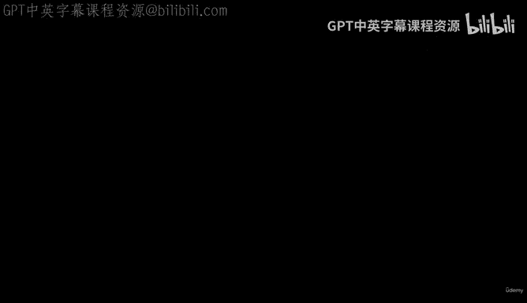
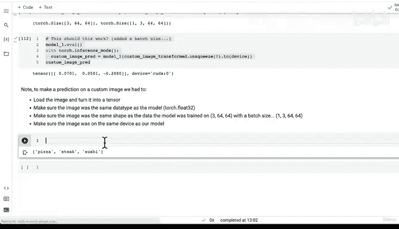

# Daniel Bourke《PyTorch 深度学习｜PyTorch 101 Crash Course For Beginners in 2025》中英字幕 - P164：164_06_034 自定义数据预测（第三部分）：图像格式标准化.zh_en - GPT中英字幕课程资源 - BV1kTSKB1E9m

In the last video we loaded in our own custom image and got two big thumbs up from my dad and we turned it into a tensor so we've got a custom image tensor here。

 it's quite big though， and we looked at a few things of what we have to do before we pass it through model so we need to make sure it's in the data type torch float 32 shape 64643 and on the right device So let's make another section here we'll go 11。

2 and we'll call it making a prediction on a custom image with a Pi torch。😊。

Model or with a trained pytorch model。 and albeit our models aren't quite the level we would like them at yet。

 I think it's important just to see what it's like to make a prediction end to end on some custom data because that's the fun part。

 right。So try to make。A prediction on an image。Now I want to just highlight something about the importance of different data types and shapes and whatnot。

 and devices， three of the biggest errors in deep learning in let's see what happens if we try to predict on U and8。

Format。So we'll go model 1。 aval and with torch。 inference mode， let's make a prediction。

 We'll pass it through our model 1。 We could use Model 0 if we wanted to here。

 they're both put forming pretty poorly anyway。Let's send it to the device and see what happens。

Oh no， what did we get wrong here， Runtime error input type so we've got U into 8。

So this is one of our first errors that we talked about。

 We need to make sure that our custom data is of the same data type that our model was originally trained on。

 So we've got torch couda float tensor。So we've got an issue here。 We've got a U into8。

Image data or image tensor trying to be predicted on by a model with its data type of torch coter float tensor。

 So let's try fix this by load in the custom image and convert to torch dot float 32。

So one of the ways we can do this is we'll just recreate the custom image tensor。

 and I'm going to use torchvision。o。read image。We don't have to fully reload our image。

 but I'm going to do it anyway for completeness and a little bit of practice。

And then I'm going to set the type here with the type method to torch float 32。And then。

Let's just see what happens。We'll go custom image， let's see what this looks like。

I wonder if our model will work on this。Let's just try again， we'll bring this up。

Copy this down to make a prediction and custom image dot2 device。 Our image is in Torch floatloat 32。

 Now。 Let's see what happens。Oh， we get an issue。 Oh， my goodness。 That's a big matrix。 Now。

 I have a feeling that that might be because our image。

 our custom image is of a shape that's far too large。 Custom image， not shape。What do we get。

 Oh my gosh，403024。 And do you notice as well that our values here aren't between 0 and 1。

 whereas our previous images， do we have an image。There we go that our model was trained on were between 0 and 1。

 So how could we get these values to be between 0 and1。Well。

 one of the ways to do so is by dividing by 2，5，5。Now， why would we divide by 255？Well。

 because that's a standard image format is to store the image tensor values in values from 0 to 255 for red。

 green and blue color channels。So if we want to scale them， so this is what I meant by 0 to 255。

 if we wanted to scale these values to be between0 and1， we can divide them by 255。

Because that is the maximum value that there can be。 So let's see what happens if we do that。Okay。

 we get out image values between zero and one Can we plot this image so PLt。

m show let's plot our custom image， we've got to commmute it so it works nicely with Matpl Lib。

What do we get here？Beautiful， we get the same image， right， but it's still quite big。 Look at that。

 We've got a pixel height of or image height of almost 4000 pixels and a width of over 3000 pixels。

 So we need to do some adjustments further on。 So let's keep going。 We've got custom image to device。

 We've got an error here。 So this is a shape error。😊。

So what can we do to transform our image shape and you might have already tried this？Well。

 let's create a transform pipeline to transform L image shape， so create transform pipeline。

Or composition to resize the image， because remember what are we trying to do。

 we're trying to get our model to predict on the same type of data it was trained on。😡。

So let's go custom image transform。Is transformforms dotcompose。And we're just going to。

 since our image is already of a tensor， let's do transformforms。

 re's size and we'll set the size to the same shape that our model was trained on。

Or the same size that is。So let's go from Torch vision， We don't have to rewrite this。

 it's already imported， but I just want to highlight that we're using the transformforms package。

We'll run that。There we go。 We've got a transform pipeline。 Now。

 let's see what happens when we transform our target image。 Trans target image。 What happens。

Custom image transformed。 I love printing the inputs and outputs of our different pipelines here。

 So let's pass our。😊，Custom image that we've just imported。 So custom image transform。

 our custom image is recall。Ob shape。Quite large。We're going to pass it through our transformation pipeline and let's print out the shapes。

Let's go original shape。And then we'll go custom image dot shape。And then we'll go print。

Transformed shape。Is going to be custom image underscore transformed。Dot shape。我' see。

The transformation。Oh， would you look at that， how good we've gone from quite a large image to a transformed image here。

😊，So it's going to be squished and squashed a little， so let's what happens。

 let's see what happens when we plot our。😊，Transformed image。

 we've gone from 4000 pixels on the height to 64， and we've gone from 3000 pixels on the height to 64。

 So this is what our model is going to see。Let's go custom image transformed and we're going to permute it to be  one。

2，0。Okay， so quite pixelated。 Do you see how this might affect the accuracy of our model。

 Because we've gone from custom image， Is this going to， Oh yeah， we need to plot do M show。

 We've gone from this high definition image。2。An image that's of far lower quality here。

 And I can kind of see myself that this is still a pizza， but I know that it's a pizza。

 So just keep this in mind going forward is that another way that we could potentially improve our model's performance if we increased the size of the training image data。

 So instead of 64，64， we might want to upgrade our models' capability to deal with images that are of 2。

2，4，2，24。😊，So if we have a look at what this looks like， 224，224。Wow。

 that looks a lot better than 6464。 so that's something that you might want to try out later on。

 but we're going to stick in line with the CNN explainer model。

How about we try to make another prediction So since we've transformed our。

Image to be the same size as the data our model was trained on。 So with torch inference mode。

 let's go custom image pre equals Model one on custom image underscore transformed。Does it work now？

Oh my goodness， still not working。 Exp all tenses on the same device。 Of course。

 that's what we forgot here。Let's go to device or actually let's leave that error there and we'll just copy this code down here and let's put this custom image transform back on the right device and see if we finally get a prediction to happen with our model。

😊，Oh， we still get an error。 Oh， my goodness。 What's going on here。 Oh。

 we need to add a batch size to it。 So I'm just gonna write up here。 This will error。No batchsh size。

h。And。This will error。Image not on right device。And then let's try again。😊。

We need to add a batch size to our image。 So if we look at custom image transformed。Dot shape。

Recall that our images that pass through our model had a batch dimension。

 So this is another place where we get shape mismatch issues is if our model。

 because what's going on in neural network is a lot of tenor manipulation。

 If the dimensions don't line up， we want to perform matrix multiplication and the rules。

If we don't play to the rules， the matrix multiplication will fail。

 So let's fix this by adding a batch dimension so we can do this by going a custom image transformed。

 Let's unsqueeze it on the first dimension and then check the shape。There we go。

 We add a single batch。 So that's what we want to do when we make a prediction on a single custom image。

 We want to pass it to our model as an image or a batch of one sample。

So let's finally see if this will work。Let's just not comment what we will do this。

 or maybe we'll try anyway， this should work。Added a batch size。

So do you see the steps we've been through so far and we're going to unsqueeze this？

UnSqueeze on the zeroth dimension to add a batch size。Oh， it didn't error。 Oh my goodness。

 It didn't error。 Have a look at that。Yes， that's what we want。

 We get a prediction Loit because the raw outputs of our model。

 we get a logit value for each of our custom classes。 So this could be pizza。 This could be steak。

 and this could be sushi， depending on the order of our classes。 Let's just have a look。😊。

Class to IDX。Did we not get that？Class names。Beautiful， so pizza steak， sushi。

 we've still got a ways to go to convert this into that。

 but I just want to highlight what we've done so note。😊，To make a prediction on a custom image。

We had to。This is something you'll have to keep in mind for almost all of your custom data。

 it needs to be formatted in the same way that your model was trained on。

 so we had to load the image。😡，And turn it into a tensor。We had to make sure the image was the same。

Data type。As the model， so that was torch Fat 32。And then we had to make sure the image was the same shape as the data the model was trained on。

Which was 64，64，3。With a batch size。 So that was 1，3，64。64， and excuse me。

 this should actually be the other way around。 This should be colour channels first because we're dealing with pie torch here。

64。 and then finally， we had to make sure the image was on the same device as our model。So。

They are three of the big ones that we've talked about so much。

 same data type or data type mismatch will result in a bunch of issues。

Shape mismat will result in a bunch of issues， and device M match will also result in a bunch of issues。

 If you want these to be highlighted， they are in。The Learn Pytoch。 Ao resource we have。

Putting things together。Where do we have it。 Oh yeah， No， it's in the main takeaway section。 Sorry。

 predicticing on your own custom data with a train model is possible as long as you format the data into a similar format to what the model was trained on。

 So make sure you take care of the three big pieytorch and deep learning errors。 wrong data types。

 wrong data shapes and wrong devices。 regardless of whether that's images or audio or text。

 these three will follow you around。 So just keep them in mind。

 But now we've got some code to predict on custom images。 But it's kind of all over the place。

 Like we've got about 10 coding cells here just to make a prediction on a custom image。

 How about we functionize this and see if it works on our pizza dad image。

I'll see you in the next video。