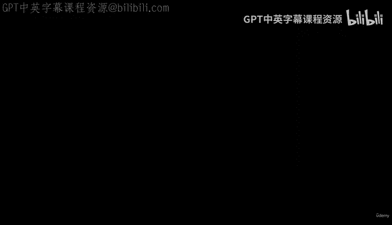
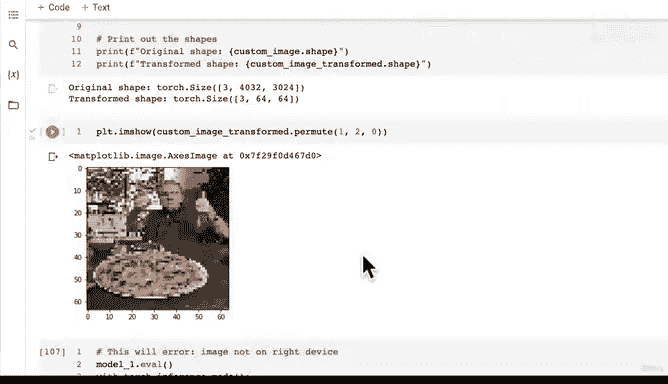

# Daniel Bourke《PyTorch 深度学习｜PyTorch 101 Crash Course For Beginners in 2025》中英字幕 - P165：165_06_035 自定义数据预测（第四部分）：模型原始输出转预测结果.zh_en - GPT中英字幕课程资源 - BV1kTSKB1E9m

Welcome back。 We're now well on our way to making custom predictions on our own custom image data。

 Let's keep pushing forward。 In the last video， we finished off getting some raw model logits。

 So the raw outputs from our model。 Now， let's see how we can convert these logits into prediction labels。

 Let's write some code。 So convert logits to prediction labels。 or let's go convert logits。

 Let's first convert them to prediction probabilities。😊，Probabilities。So how do we do that。

 let's go custom image pre probs equals torch。oftmax。

To convert our custom image pre across the first dimension。

So the first dimension of this tensor will be the inner brackets， of course。😊。

So just this little section here， let's see what these look like。

 this will be prediction probabilities。Wonderful， so you'll notice that these are quite spread out。😊。

Now this is not ideal， ideally we'd like our model to assign a fairly large prediction probability to the target class。

 the right target class that is， however， since our model when we trained it isn't actually performing that all that well。

 the prediction probabilities are quite spread out across all of the classes。But nonetheless。

 we're just highlighting what it's like to predict on custom data。

 So now let's convert the prediction probabilities。Two prediction labels。

Now you'll notice that we used Softmax because why we are working with multiclass classification data。

 and so we can get the custom image pre labels。The integers by taking the arg max of the prediction probabilities。

Custom image pre pros across the first dimension as well。So let's go custom image。Pread labels。

 let's see what they look like。0， so the index here with the highest value is index number 0。

 And you'll notice that it's still on the coer device。

 So what would happen if we tried to index on our class names。With the custom image pre labels。

Or maybe that doesn't need to be a plural。Oh， there we go。 We get pizza。

 but you might also have to change this to the CPU later on。

 Otherwise you might run into some errors。 So just be aware of that。

 So you notice how we just put it to the CPU。 So we get pizza。 Weve got a correct prediction。

 But this is as good as guessing， in my opinion because these are kind of spread out。 Ily。

 this value would be higher， maybe something like 0。8 or above for our pizza dad image。

 But nonetheless， our model is getting two thumbs up， even on this。64 by 64 image。

 But that's a lot of code that we've written。 Let's functionise it So we can just pass in a file path and get a custom prediction from it。

So putting custom image prediction together。Let's go building a function。

So we want the ideal outcome is。Let's plot our image as well。Ideal outcome。Is。A function。

Where we plot or where we pass an image path。two。And have our model predict on that image and plot the image plus the prediction。

So this is our ideal outcome， and I think I'm going to issue this as a challenge。 So give that a go。

 put all of our code above together and you'll just have to import the image。

 you'll have to process it and whatnot。 I know I said we were going to build a function in this video。

 but we're going to save that to the next video。 I'd like you to give that a go。

 So start from way back up here。😊，Import the image。Via Torch Vi IO Read image。

 format it using what we've done， change the data type， change the shape。

Change the device and then plot the image with its prediction as the title。

So give that a go and we'll do it together in the next video。😊。

