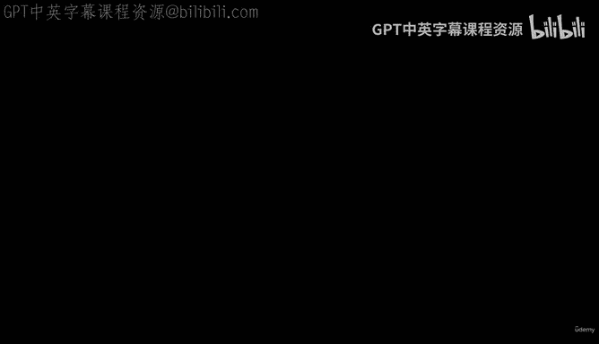
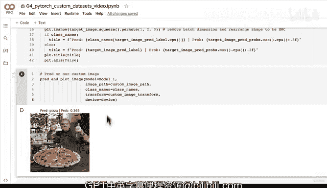

# Daniel Bourke《PyTorch 深度学习｜PyTorch 101 Crash Course For Beginners in 2025》中英字幕 - P166：166_06_036 自定义数据预测（第五部分）：全流程整合.zh_en - GPT中英字幕课程资源 - BV1kTSKB1E9m

How'd you go。I just realized I had a typo in in the previous cell。 But that's all right。

 Did you give it a shot。 Did you put together the custom image prediction in a function format。

 I'd love it if you did， but if not， that's okay， let's keep going。

 Let's see what that might look like。 And there are many different ways that you could do this。

 But here's one of the ways that I've thought of。 So we want a function that's going to pre and plot a target image。

 We wanted to take in a torch model。😊，And so that's going to be ideally a trained model。

🎼We want it to also take in an image path which will be of a string。

 it can take in a class names list so that we can index it and get the prediction label in string format。

So let's put this as a list of strings and by default。

 this can equal none just in case we just wanted the prediction。

It wants to take in a transform so that we can pass it in some form of transform to transform the image and then it's going to take in a device which will be by default the target device so let's write a little do string here makes a prediction on a target image。

With a。Trained model and plots the image and prediction。Beautiful。Now， what do we have to do first？

Let's our load in the image。Load in the image just like we did before with torch vision。

 so target image equals torchvision。o。read image。And we'll go string on the image path。

 which will be the image path here， and we convert it to a string just in case it doesn't get passed in as a string。

And then let's change it into type。Torch float 32， because we want to make sure that our。

Custom image or our custom data is in the same type as what we trained our model on。

 So now let's divide。The image pixel values。By 255。

To get them between0 or to get them between 01 as a range so we can just do this by target image equals target image dividedr by 255 and we could also just do this in one step up here。

 255 but I've just put it out there just to let you know that hey。

 read image imports image data as between0 and 255 so our model prefers numbers between 0 on1 so let's just scale it there。

Now we want to transform our data if necessary， in our case it is， but it won't always be。

 so we want this function to be pretty generic pre and plot image。So if the transform exists， let's。

Set the target image to the transform or we'll pass it through the transform that is。Wonderful。

 and the transform we're going to get from here。Now what's left to do？Well。

 let's make sure the model。Is on the target device。It might be by default。

 but if we're passing in a device parameter， we may as well make sure the model is there too。

 and now we can make a prediction。So let's turn on a val slash inference mode and make a prediction with our model。

 So model we call a vow mode and then with torch dot inference mode。

 because we're making a prediction we want to turn our model into inference mode or put it in inference mode context。

Let's add an extra dimension。😊，To the image。Let's go target image。

 We could do this step above actually， but we're just going to do it here。

 Im kind of remembering things on the fly here of what we need to do。 We're adding a。This is。

 let's write this down。 This is the batch dimension。EG， our model will predict on batches of。

One x image。So we're just unsqueezing it to add an extra dimension at the zeroth dimension space。

 just like we did in a previous video。😊，Now let's make a prediction。

On the image with an extra dimension， otherwise if we don't have that extra dimension。

 we saw that we get a shape issue。So right down here。

 target image pre and remember this is going to be the raw model outputs， raw Loit outputs。

We'll go target image pre， and。Yeah， I believe that's all we need。For the prediction， oh wait。

 there was one more thing， two device me to also make sure the target image is on the right device。😊。

Beautiful， so a fair few steps here， but nothing we can't handle。

 all we're really doing is replicating what we've done for matches of images。

 but we want to make sure that if someone passed any image to our pre and plot image function that we've got functionality in here to handle that image。

😊，And do we get this， Oh， we want just target image to device。 Did you catch that error？

So let's keep going now let's convert the logits。Our models raw logits。

 let's convert those to predictionbabilities。This is so exciting we're getting so close to making a function to predict on custom data。

 so we'll set this to target image pre probs， which is going to be torch。 softmax。😊。

And we will pass in the target image pre here， and we want to get the softm of the first dimension。

Now let's convert our prediction probabilities， which is what we get in the line above。

We want to convert those to prediction。Libels。So let's get the target image pre labels。Equs torch。

 argm， we want to get the arg max of or in other words， the index。

 which is the maximum value from the pre pros of the first dimension as well。 Now。

 what should we return here？Well we don't really need to return anything。 We want to create a plot。

 so let's plot the image。Alongside the prediction。And prediction probability。Beautiful， so plot。

imhow。What are we going to pass in here， We're going to pass in here。 our target image。 Now。

 we have to squeeze this， I believe， because we've added an extra dimension up here。

 So we'll squeeze it to remove that batch size。 and then we still have to permute it because mappl Lib likes。

Images in the format color channels last 1，2，0。 So remove batch dimension。

And rearrange shape to B HC HWC， that is color channels last。 Now。

 if the class names parameter exists so we've passed in a list of class names。

 this function is really just replicating everything we've done in the past 10 cells， by the way。

 So right back up here we're replicating all of this stuff in one function。 So pretty large function。

 but once we've written it， we can pass in our images as much as we like。 So。If class names exist。

 let's set the title to showcase that class name so the pre is going to be a class names。

 let's index on that pre image or target image pre label。

 and this is where we'll have to put it to the CPU because if we're using a title with Maplotlib。

 Mapllootlibb can handle things that are on the GPU， this is why we have to put it to the CPU。

And then I believe that should be enough for that。 Let's add a little line in here so that we can have it。

 Oh， I've missed something。An outside bracket there。Wonderful。

 let's add the prediction probability because that's always fun to see。

So we want target image pre pros and we want to get the maximum pre probe from that and we'll also put that on the CPU。

And I think we might get this three decimal places。Now， this is saying。All preed libels。

 We don't need that。 We need just non plural。Beautiful， now， if the class names doesn't exist。

 let's just set the title equal to。F F string well go pre。Target image pre label。

Is Google Co Lab still telling me this is wrong？Target image pre label。 on no。

 we've still got the same thing。 It just hasn't caught up with me。 yet I'm coding a bit fast here。

 and then we'll pass in the prob。Which will be just the same as above， I could even copy this in。

Beautiful。And let's now。Set the title to the title。

And we will turn the axes off PLT axes false Fair bit code there。

 but this is going to be a super exciting moment。 Let's see what this looks like When we pass it in a target image and a target model。

 some class names and a transform。 Are you ready。😊，We've got our transform ready， by the way。

 it's back up here。Custom image transform is just going to resize our image。So let's see， oh。

 this file was updated remotely on another tab。Sometimes this happens and usually Google Collabs sorts itself out but that's all right。

 doesn't affect our code for now。Preed on our custom image， are you ready？Save failed。

 Would you like to override， Yes， I would。So you might see that in Google Coab。

Usually it fixes itself there we go save successfully， pre and plot image。

I was going to say Google Co Lab， don't fail me now， we're about to predict on our own custom data。😊。

Using a model trained on our own custom data。Image Part， let's pass in custom image path。

 which is going to be the path to our pizza dad image。Let's go class names， equals class names。

 which is pizzaizz steakak and sushi， we'll pass in our transform to convert our image to the right shape and size。

 custom image。😊，Transform， and then finally， the target device is going to be device。 Are you ready。

 Let's make a prediction on custom data。 One of my favorite things。

 One of the most fun things to do when building deep learning models，3，2，1。😊，How did it go， Oh no。

 What did we get wrong， CPU。Okay， such a so close， but yet so far has no attribute CPU。Oh。

 maybe we need to put this to CPU。 That's where I got the square bracket wrong。

So that's what we needed to change。 We needed to， because this is going to be potentially on the GPU Ta image pre label。

 We need to put it on the CPU。 We need to do that Y。

 because this is going to be the title of our mappl Lib plot and mappllib doesn't interface too well with data on a GPU。

 Let's try it again，3，2，1， running。look at that prediction on a custom image and it gets it right。

 Two thumbs up。 I didn't plan this。 Our model is performing actually quite poorly。

 So this is as good as a guess to me。 You might want to try this on your own image。 And in fact。

 if you do， please share it with me。 I would love to see it。😊。

But you could potentially try this with another model， see what happens。Stake， okay， there we go。

 So even though Model 1 performs worse， quantitatively， it performs better， qualitatively。

 So that's the power of visualize， visualize， visualize。

 And if we use model 0 also which isn't performing too well。

 It gets it wrong with a prediction probability of 0。368， which isn't too high either。

 So we've talked about a couple of different ways to improve our models。

 Now we've even got a way to make predictions on our own custom images。 So give that a shot。

 I'd love to see your custom predictions， upload an image here if you want or download it into Google coab using code that we've used before。

 but。😊，We've come a fairly long way。I feel like we've covered enough for custom data sets。

 Let's sum what we've covered in the next video and I've got a bunch of exercises and extra curriculum for you。

 So this is exciting stuff。 I'll see you in the next video。😊。

