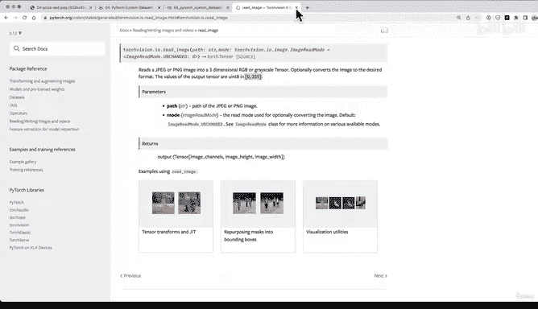
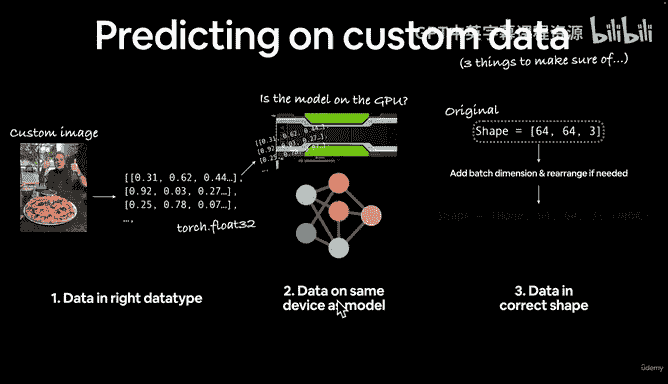
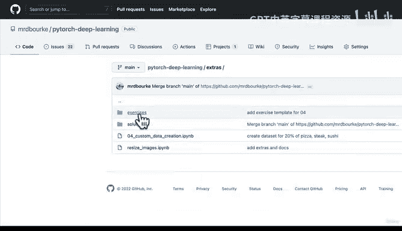

# Daniel Bourke《PyTorch 深度学习｜PyTorch 101 Crash Course For Beginners in 2025》中英字幕 - P167：167_06_037 内容总结与练习拓展.zh_en - GPT中英字幕课程资源 - BV1kTSKB1E9m

In the last video， we did the very exciting thing of making a prediction on our own custom image。

 although it's quite pixelated。 and although our model's performance quantitatively didn't turn out to be too good qualitatively。

 it happened to work out。 But， of course， there are a fair few ways that we could improve our model's performance。

 But the main takeaway here is that we had to do a bunch of preprocessing to make sure our custom image was in the same format as what our model expected。

 And this is quite a lot of what I do behind the scenes for nurify， if you upload an image here。

 it gets preprocessed in a similar way to go through a image classification model to output a label like this。

 So let's get out of this。😊。

To summarize， I've got a colorful slide here， but we've already covered this。

 predicting on custom data。 These are three things to make sure of。

 regardless of whether you're using images， text or audio。

 make sure your data is in the right data type。 In our case， it was torch floatloat 32。

Make sure your data is on the same device as the model。 So we had to put our custom image to the GPU。

 which was where our model also lived。 and then we had to make sure our data was in the correct shape。

 So the original shape was 64，643。 actually this should be reversed because it was color channels first。

 but the same principle remains here。 we had to add a batch dimension and rearrange if we needed。

 So in our case， we used images of this shape。

Btches first， color channels first， height width。But depending on your problem will depend on your shape。

 depending on the device you're using will depend on where your data and your model lives。

 and depending on the data type you're using will depend on what you're using for Torch Float 32 or something else。

So let's summarize。😊，If we go here。Maine takeaways。You can read through these。

 but some of the big ones are Pytorch has many built in functions to deal with all kinds of data。

 from vision to text to audio to recommendation systems， so if we look at the Pytorch docs。

You're going to become very familiar with these over time。 We've got torch audio data， Torch text。

 Torch vision is what we practiced with， and we've got a whole bunch of things here for transforming and augmenting images。

 data sets， utilities operators and torch data is currently in beta。

 but this is just something to be aware of later on so it's a prototype library right now but by the time you watch this it might be available but it's another way of loading data。

 so just be aware of this for later on。And if we come back。To up here。

If Pytorch built in data loading functions， don't suit your requirements。

 you can write your own custom data set classes by subclassing torch。uts。da。 data set。

 and we saw that way back up here in option number2。Option 2， here we go。

 loading image data with a custom data set wrote plenty of code to do that。

And then a lot of machine learning is dealing with the balance between overfitting and underfitting。

 We've got a whole section in the book here to check out what an ideal loss curve should look like and how to deal with overfitting。

 how to deal with underfitting。 Its， it is a fine line。

 So much of the research and machine learning is actually dedicated towards this balance。

 And then three big things for。Been aware of when you're predicting on your own custom data。

 wrong data types， wrong data shapes and wrong devices。 And will follow you around， as I said。

 And we saw that in practice， to get our own custom image ready for a trained model。Now。

 we have some exercises here。 If you'd like the link to it， you can go to Lne Pytorch。

 dot I O Section number 4， exercises and， of course， extra curriculum。

 A lot of the things I've mentioned throughout the course。

 that would be a good resource to check out。 containedtain in here。 But the exercises。 This is。

 This is your time to shine。 your time to practice。 Let's go back to this notebook。

 Sc right down to the bottom。 Look how much code we've written。😊，Goodness， me exercises。

For all exercises and extra curriculum。s here。Turn that into markdown。 Wo。 And so if we go in here。

 you've got a couple of resources。 There's an exercise template notebook for number four and example solutions for notebook number four。

 which is what we're working on now。 So of course I'd encourage you to go through the pytorch custom datasets。

 exercises template first， try to fill out all of the code here on your own。

 So we've got some questions here， we've got some dummy code， we've got some comments。

 So give that a go， go through this， use this book resource to reference。

 use all the code we've written， use the documentation， whatever you want。

 but try to go through this on your own。 And then if you get stuck somewhere。

 you can look at an example solution that I created， which is here。

 Pytorch custom datas exercise solutions。 and just be aware that this is just one way of doing things。

 It's not necessarily the best。 It's just a way to reference what you're writing to what I would do。

 And there's actually now live walkthroughs of the solutions， errors and all on YouTube。😊。

So if you go to this video， you's going to mute。😊，So this is me live streaming the whole thing。

Writing a bunch of pytorrch code。 If you just keep going through all of that。

 you'll see me writing all of the solutions， running into errors， trying different things， et cetera。

 et cetera。 But that's on YouTube。 You can check that out on your own time。

But I feel like we've covered enough。Exercises， oh， by the way。

 this is in the extras Excis tab of the Pytorch deep learninging repo。

 So extras exercises and solutions are contained in there。

Far out。We've covered a lot。 Look at all that。So that has been Pytdge custom data sets。

 I will see you in the next section。😊。