# Daniel Bourke《PyTorch 深度学习｜PyTorch 101 Crash Course For Beginners in 2025》中英字幕 - P168：168_07_001 模块化编程概念与内容规划.zh_en - GPT中英字幕课程资源 - BV1kTSKB1E9m

Ho。 welcomelcome to the next section。😊，Going modular with。Hi torch。 Now。

 this is a very exciting section。 But before we get started， let's start how we always start。

 Where can you get help， Number one rule， Fo along with the code， if and doubt， run the code。

 All of the code resources you need will be on the Github。 So if you get stuck。

 you can reference them。 then， of course， try it for yourself。 write the code， try it out。

 see what comes out。😊。

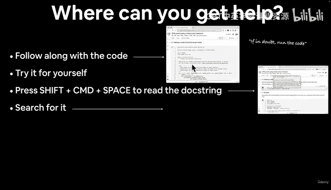

Press shift command in space。 if you'd like to read the dock string。 If you're still stuck。

 I'd recommend searching for it。 You'll come across resources such as stack overflow or the very helpful Pytorch documentation。

 which we've had plenty of practice with so far。 Then， of course， try again。

 refer back to the model motto， if in doubt， run the code。 Finally， if you're still stuck。

 you can always ask a question on the Pytorch deep learning Disc page。

 So the discussions page for this course。😊。

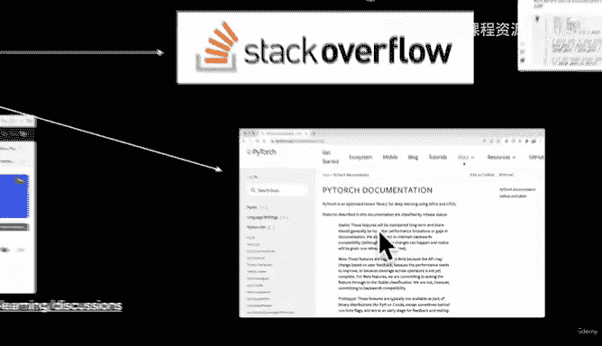

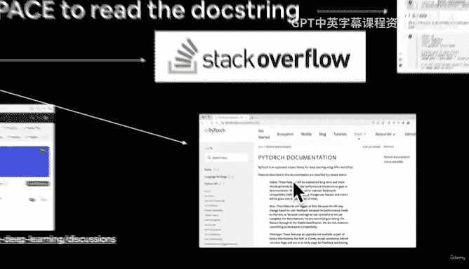

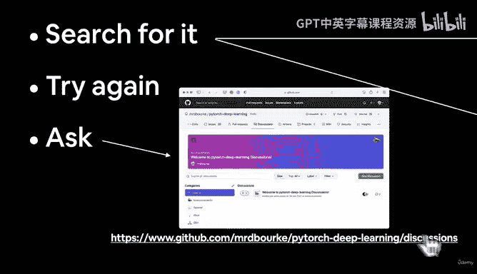

You can go new discussion。 You can select a category Q& A or anything else here that you like。

 such as maybe Section 05。And then what is going？Moular。And then if we come down in here。

 then video number， doing this will really help us out。 help you。

 So video number might be 171 or something like that。 I'm not sure exactly what video number this is。

 This is just an example。 And I'm not sure what going。Modular is。

And then you could click start discussion and then someone will help you out answering that question。

😊。

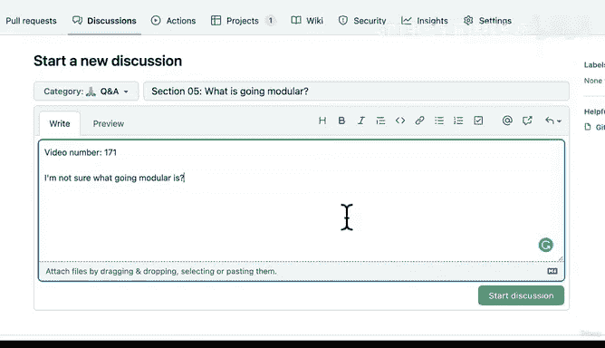

But speaking of what is going modular。How about we answer that question。

 So this is the whole goal of this entire section is to go modular。 And what do I mean by that。 Well。

 you might have written some nice code in a notebook。 You might be wondering。

 can I reuse it elsewhere。 And in fact， we have。 We have written lots of nice code in plenty of notebooks so far。

 And a lot of that code， we've had a bit of practice now writing it a few times。

 And I've done that on purpose。 because one of the best ways to practice code is to write more code。

 But now that we've had some practice writing， training los and data loading and whatnot。

 we might want to reuse it So the whole premise of going modular， I that， yes。

 you can reuse your helpful code， And that's what we want to cover in this section。

 reuse the most useful code from our previous notebook in Python scripts。

 Let's get a little bit more specific here。😊，Food vision Min is what we built in the last section。

We loaded in some data， we wrote some high touch code to load in some data of steak。

 sushi and pizza images。

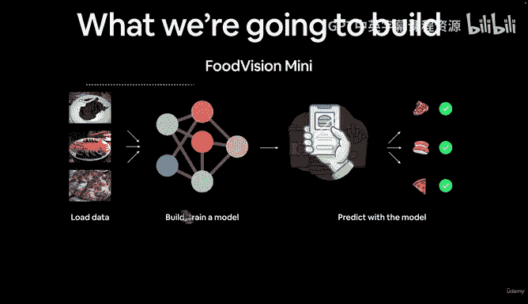

We built and trained a model to identify different foods。

Then we made some predictions with the model albeit。

 they weren't as good as what this graphic is showing。 It did get a fair few wrong， but that's okay。

 What we want to focus on in this section is turning all of the code here that we use to load our data to build a model。

 to train a model into a series of Python scripts。😊。

We're going to finish up with a directory structure like this。

 So we'll have a top level directory called going modular after this section。

 Then we'll have a subdirecty also called going modular。

 and then within that going modular subdirecty。 We'll have a series of Python scripts。

 So one to prepare the data， One to train and test the model in the engine dot pi。

 One to build our Pytorch model， we've built a Pytorch model a fair few times now。

 So rather than rewrite the code every time we can put that into a Python script。

 and we'll have train dot pi。 and then we'll have Utils dot pi。 and finally。

 we'll also end up with a model directory that's going to contain our different trained pytoch models。

😊。

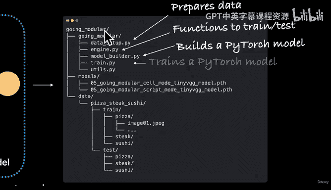

And our data is going to be in the same format that we've used over the past couple of sections。

 And that is standard image classification format， Our images of pizza， steak and sushi。

 But this is another thing to note。 You could customise this in almost any way shape or form you like。

And the same with your data， it really depends on the problem you're working on。

But this kind of structure here is often how you'll find Pyto code in the wild。

But we'll get to that in a second。Here's what we really want to do。

 We want to be able to train a Pyto model with a single line of code。

And with that single line of code， it would be great if we could pass in different hyper parametersa。

 such as which model to train。😊，How big should our batch size be。What learning rate should we use。

 How long should we train for？ Now， this is a command on the command line。

 We could run Python train dot pi。 That's our target script。 We want to train some model。

 We want to use a batch size， a batch size。 We want to use a learning rate of learning rate。

 We want to train for nu epochs。Now these flags here。Are called argument flags。

We'll have a look at that， later on。But。Here's an example。

 If we wanted to train our tiny VGG model from the last section， we could write Python train dot pi。

 model tiny VGG batch size 32 learning rate 0。001 number of epochs 10。 And of course。

 you might be guessing， could we add more hyperparameters here。

 such as number of hitting units or a number of layers or something like that。 And the answer is yes。

 This could really extend out to 20 different pipeparameter to 30 to 10。

 doesn't really matter it's infinitely customizable。😊。

And so what this line is essentially saying is train the tiny VGG model with a batch size of 32 and a learning rate of 0。

01 for 10 epochs。Now， as I mentioned before， this is often how you'll find Pytorch code in the wild。

 Yes， of course， you'll find them in different notebooks。

 but this is the detection on 2 documentation。 Now。

 De on 2 is a computer vision library from metata or Facebook that uses Pytorch。

And so if we see here， we've got TraNe。 Pi that's going to train your neural network on eight GPUs it looks like with a certain configuration file。

Then if you wanted to train with one GPU， you notice how there's another argument flag here。

 you just change that to one GPU。And you can change a few hyperparameters here。

But that's train net dot pi。 That's a Python script。The same thing goes for this torch vision。

 So we've been using torch vision， and that's from the actual Pi torch library that itself。

This is how they do object detection。 So if you go to Pytorrch slash vision slash references slash detection object detection。

 you'll see there's a bunch of Python scripts here。 there's train dot pi。Uils dot pi， engine dot pi。

The same thing here on the Pych blog post where they train state of the art computer vision models with Tor vision。

They use Torch Run， which is a way of running your Pytorrch scripts or your Python scripts。

I'll leave that as extra curriculum if you want to look into it， but here's train dot pi。

 There's the model They're using Resnet 50 with a batch size of 128， a learning rate of 0。5。

 a learning rate scheduler of cosine a kneeing Al， a learning rate warm up epochs of 5 learning rate warm up method linear。

 There's a lot of different hyperpara here。 A fair few。

 a bit more there outside the scope of this course。

 but we're going the principles we're going to cover are much the same。

 We want to write a train dot pi script by the end of this section that's able to train our model。😊。

And then same thing here with this is a brand new paper at the time of recording called Com M AE paper on Github。

Now they run Python， submit it， finet dot Pi， a Python script。

So I just want to share with you my workflow。 It's not necessarily the the be all and end all of workflows。

 it is just one example， So this is one of many options to turn your useful notebook code into Python scripts。

So I start with Jupiter slash Google Coabab notebooks because they are great at experimenting and visualizing different things。

😊。

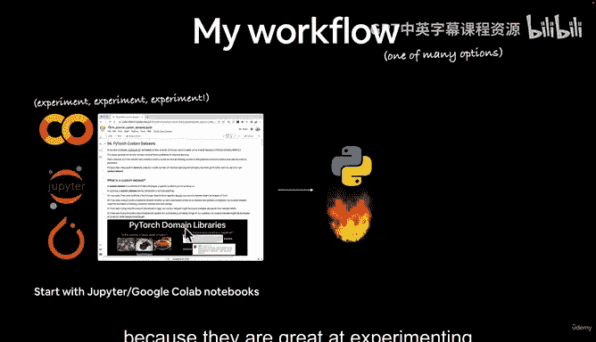

And then if I've written some useful notebook code in some code cells。

 I move the most useful code to Python scripts。😊，So it's still P Torch code here。

 import OS from Torch Viion import data sets transforms from Torchutils。 data import data loader。

 and this might be called data setup。 Pi， and this is what's going to set up my data。

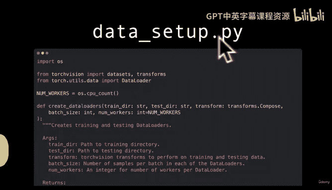

In here， we return a train data loader， a test data loader and class names。

 We're going to have a look at how to create one of these files or many of these files actually。

 in the upcoming coding sections。😊，Now， there's two parts of this section or two notebooks of this section that you need to be aware of。

 One is cell mode and one is script mode。 What we're going to be doing is we're going to start with a cell mode notebook。

 So this is notebook 05 part1 cell mode。 This is nothing different from a normal Jupyter notebook and normal Google coab notebook。

 We're going to run it from top to bottom。 It just executes Python code in cells just as we've been doing throughout the rest of the course。

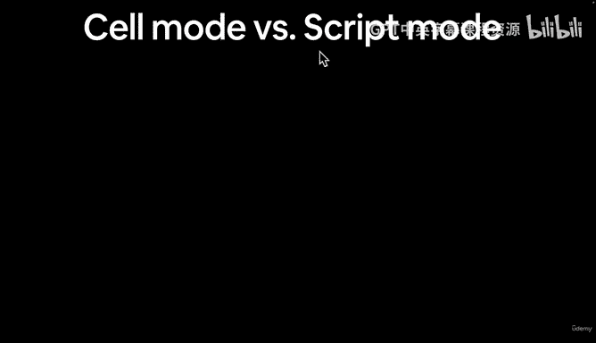

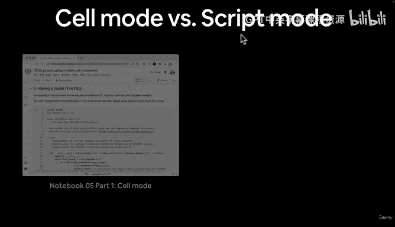

Now， this is part 1。 We're going to use that as the basis to move to part 2。 Now。

 the script mode notebook is going to turn our useful code into Python scripts using a Jupiter magic command。

😊，Now this is something to be aware of or something you can look up as well。

 A magic command is something that starts with double percentage sign。

 Now there's other magics that start with a single percentage sign。

 but our specifically starts with a double percentage sign。 Then we're going to write file。

 That's the command。 and then going modular slash model builder dot pi。

 we'll write whatever is in this code cell。😊，To a script of the name Model builder dot pi in the going modular directory。

 Now we're going to see this in action later on， but this is just something to be aware of。

 This section comes in two parts。 Part 1 is a notebook that is cell mode。 Part 2 is script mode。

 which is going to turn the code from cell mode into Python scripts。

We're going to adhere to our workflow of course。😡，We've seen this a few times now。

 so we can jump through it a bit。 But what I want you to be aware of is that each of these little sections here。

 because they。Kind of function within themselves。 They do interact with each other。

 but they can all be individualized into different Python scripts。

 And that's what we're going to see throughout this section。

So each of these could be turned into a Python script。 So one to get your data ready。

 one to build a model， one to train the model， one to， well。Fitting is part of training the model。

 one to evaluate， one to save， etc， etc。😊，AndFinally， what we've going to cover broadly。

 while we've already gone through a fair bit of this。

 but we'll see how we can transform data for use of the model。 we've already done a bit of that。

 loading custom data with prebuilt functions。 We're going to build field vision Min to classify pizza steak and sushi images。

 this is the main one we're focused on。 turning useful notebook code。

 all of the above into Python scripts。 And finally。

 we're going to see how we can train a Pytoch model from the command line。

 And how while this is a machine learning cooking show。 So we're going to be cooking up lots of code。

 Well that being said，😊，Let's code。 I'll see you in Google Co Lab。

