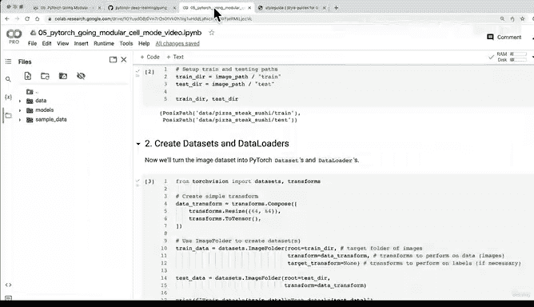

# Daniel Bourke《PyTorch 深度学习｜PyTorch 101 Crash Course For Beginners in 2025》中英字幕 - P169：169_07_002 模块化笔记本（第一部分）：端到端运行.zh_en - GPT中英字幕课程资源 - BV1kTSKB1E9m

Ohrighty。 Let's write some code。 This is one of my favourite sections of the whole course。 Now。

 I just want to get you familiar with some resources that we're going to be using。

 So the first one is going modular。 So section 5。😊。

A whole textbased version of this section is contained in this section。 Now， of course。

 that is part of the book version of the course。 So05 Pytoch going modular。

 everything you need for the upcoming videos will be in here。 such as what is going modular。

 Why would you want to go modular。 a few things that we've covered pros and cons of notebooks versus Python scripts。

 Now， this is really exciting for me， because if you， if you like me。

 I learn to code Python in a Jupyter notebook。 whereas a lot of code you'll find in the wild is not in a Jupyter notebook。

 but in Python scripts。 So that's what we're focused on doing in this section is going from notebook to Python scripts。

 There's my workflow that I talked about how you'll find Pytoch code in the wild， and a lot more。

 But here's what we're going to cover。 and there's a time there。 I better fix that。

 But the main concept of this section is to turn useful notebook code cells into reusable Python files。

 So specifically， there are two notebooks for this section。 Part1 is in cell mode。

 So this is just run as。😊，Normal notebook， top to bottom。

 and it's a condensed version of notebook 04。 So what we did in the last section。

 Py torch custom data sets， we wrote a lot of code， right， Look， look how much there is。

 So all I've done for part one of section 05。 Oh， excuse me。😊，What we're going to cover， where。

Is for cell mode， I've condensed all of the code from Notebook 04 and then script mode builds upon cell mode。

 So the reason we're doing two parts is so that you can see the changes I've made in part2 compared to part1。

 So if you'd like to reference what we're working towards part 2 is what we're working towards。😊。

So there's the notebook book there。But we're going to start with part one。

 so let's open that part one， and if you'd like to find this as well。

 another section that you should be aware of， So this is back on the Py Toch deep Learning homepage going modular in here is another explainer of what we're going to do。

So there's part one， cell mode， we're working from part one towards part2。

So I could open it up from here。This is again。Pie towards deep learning。

Within the going modular section， or from 0。5。So going modular。

 I just opened up the cell mode part  one。 and now to make a copy of this。

 I'm going to click this button here， open in coab。 So let's see what happens when we do this。

 I'm just going to x out of all these extra tabs。😊，So just to remind you。

 I went from the homepage going modular and then opened up part number one。And then。

While that's loading up here， I clicked Open in coabab。

So that's what's going to give us this part one， cell mode。 Now to make a copy of this。

 I can click copy to drive。So this is going to create a copy in my own Google Drive because you'll notice the difference here。

 This is running from Github。 Now， this is running from Google Drive。

 So I'd recommend you do that if you'd like a copy of this notebook in your own Google Drive。

So because this is a video notebook for me， I'm going to just append the video tag here。That way。

 you know that I've run this notebook in the videos。

And it will end up in Pinto deep learning in the videoide notebookbooks folder at the end of this section。

So let's close the GiHub version of this one， so notice the Gitthub symbol。

I'm running the one with the Google Drive symbol because I just copied that to my Google Drive。

I'm going to make sure that I have a GPU。😡，GPU save。

 and then we'll connect will'll start our runtime。Connecting。Beautiful。

 so you'll notice that there's some information。 This is part one of two。

 There's some links to the notebooks we've talked about。 What is cell mode。

 So cell mode is we're just going to run this notebook exactly how it is。 No changes。😊。

And what's the difference between part one and part two， well you can read on that there。

 but I prefer to show you， where can you get help？So this is a little bit different to how we've started notebooks before。

 This one we're starting with some code。 Now the reason we're starting with some code is because we've written all of the code in the previous section in notebook04。

 So let's just see what happens if we run all of these cells。

 So section 1 is going to get the data that's going to download。😊。

The pizzaa Stak Sushi Zip file from Gitthub， it's going to set up a training and test directory。

It's going to create some data sets and data loaders。

 more specifically a trained data loader and a test data loader。😊。

It's going to make a model tiny VGG。 We've seen all of this code in the previous sections。

 It's going to set up device agnostic code here and create an instance of tiny VGG。

Then we've got a dummy Ford pass。We create a train and test step functions and train to combine them。

 So you'll see train step here。 You'll notice I've also added doc strings to these functions that we've written in the previous notebook。

 And that's in the format of Google's Python functions and methods style guide。

 So this is just a way to style your Python code。 And if you're going to be writing code that you're going to reuse and share。

 Oftentimes you'll want to have a dock string here that explains what's going on。

 not only for other people that read it， but for your future self， if you were to reread your code。

 what's going on。 And so to make a doc string in a style that's well respected and used quite widely。

 I used Googles style guide for Python。😊，Then if we keep going， we have a test step function。

 we have a dock string as well。We have a train function。

 which is going to leverage test step and train step and train our model。

We have a function called saveve model， which is going to save a model to file。

Then we have a series of code steps here that's going to train， evaluate and save the model。

So there we go train model 0， and we get some epochs here。 We get some training。 And finally。

 it finishes with saving the model 2。The modelss directory。So we come over here。

Data directory that's created when we run the first cell， get data。

Sample data this comes with Google Collab so don't worry about this one and models。

 there is our saved model。So what we want to do， this notebook runs end to end。By using code cells。

 So in cell mode， what we want to do is turn all of our useful code cells into Python scripts。

Now that's where part2 notebook comes in。 So that's what we're working towards。

 So if you want to have a look at what we're working towards you can leverage or you can go and look at part2。

 But in the next video now that we've started off with cell mode。

 we're going to start writing some code to turn the most useful notebook cells here into Python scripts namely what do we want to end up with we want to end up with a file called going modular that has data setup dotpi engine dot Pi Model builded dotpi Tra dot pi and Uts do pi。

So that's what we're working towards。

I'll see you in the next video。