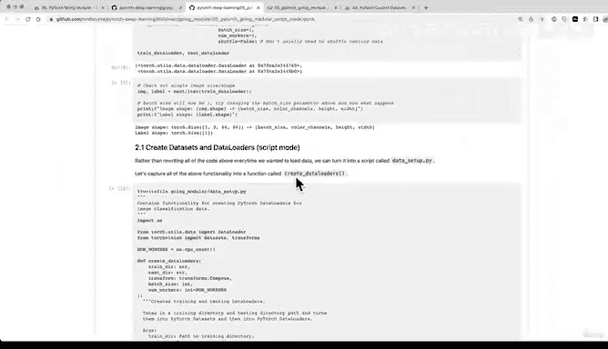

# Daniel Bourke《PyTorch 深度学习｜PyTorch 101 Crash Course For Beginners in 2025》中英字幕 - P170：170_07_003 下载数据集.zh_en - GPT中英字幕课程资源 - BV1kTSKB1E9m

Welcome back In the last video， we checked out the layer of the land for ourgoing modular section and the two best places to find information about the going modular section are 05 Pyto going modular and the going modular directory。

 So we started off by going to notebook part1， which is cell mode。😊，We opened that in Google CoLab。

Using this button here。I then made a copy of that in my Google drive。

 and then I ran all of the cells in this notebook here。 So if we go down， have a look。

 this is all of the code that we wrote for notebook 04 Section 04 custom data sets。

 It's just been condensed into a few useful code cells。

 because that's the name of the game right for the going modular section。

 We want to turn useful notebook code cells into reusable Python script。 In other words， dot P files。

 specifically the files that are in here。😊，So let's just have a look。

 what if we were to restart this runtime， I just want to emphasize what we're doing with these cells in here。

Let's go up to section number one， and that's get data。 So I've just restarted the run on。

 I'll restarted again just to make sure restarting。And do we have any files over here， We still do。

 So I might remove these files over here， just so。RMRF， the bang， by the way。

 this exclamation point in a code cell remains that I want to run this line on the command line。

 I'm going to remove the data folder。Just to emphasize the fact that this was generated by the notebook。

So that's gone。 And I'm also going to remove models。Wonderful。So if we refresh that。

 we've got a new notebook and the sample data this comes with Google Coab。

 so don't worry too much about that。So the get data code cell is the same one that we used in notebook 04。

So section 1， get data。 If you'd like to read up on。How we got it。 you can read this section here。

 So we're not going to spend too much time on how this works。

 because we've already written this code， but let's just see what happens when we run it。

 So we import O zip file。 We set up a path to a data folder。 If the image folder doesn't exist。

 we download and prepare it。 We download some pizza steak and sushi data。

 sushi images that is pizza steak and sushi images。We unzip it。

 and then we remove the zip file because we don't need that anymore。

 Let's see what happens if we run this cell。Didn't find。 So we download， and we unzip。

 we have a look over here now。 We've got data。 Now。

 this is going to download some images in standard image classification format。

 So if we have a look in here， we've got test directory。

 we've got the training directory and within each within each of those。

 we have training images for the pizza class。😊，Then if we close that for the steak for sushi and the label for each of those images is the directory name。

 so the pizza images are in here， same for the testing folder。

Now we've covered that in a previous module， but that's just all this cell is doing is getting the data。

And in fact， you might want to， with what you're about to learn in this section。

 turn this into a script of itself。 In fact， that's your first exercise for this section。

But now what do we do next where we set up the training and testing paths。

So let's create a path here for the training data and the testing data。 Again。

 we've already written code to do this。 The whole premise of this section is to reuse useful code。

 So we're going to leave that how it is。All that this seller is doing is replicating the same code we used in Note O4 to download the pizzaizza Steak and sushi dataset set。

Now from here on out， we want to turn all of these subsections into Python scripts。

That's exactly what the script mode notebook contains。 So if we have a look。

 let's get it a little preview of what's going on。If you run these two side by side。

Part 1 and part 2， you'll see the differentiation。So we've got to get data exact same code in this notebook。

Then we've got Section 2， the difference in part2 script mode notebook is that we have sections that are 2。

1 create data sets and data loaders in script mode。

 So if you want to jump ahead and have a look at that。

 you can otherwise let's create a script to create data loaders in the next video。

I'll see you there。