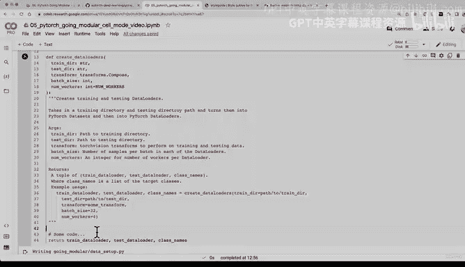

# Daniel Bourke《PyTorch 深度学习｜PyTorch 101 Crash Course For Beginners in 2025》中英字幕 - P171：171_07_004 编写首个数据配置Python脚本大纲.zh_en - GPT中英字幕课程资源 - BV1kTSKB1E9m

Welcome back。 In the last video， we ran a code cell to get some data。 Now， if you'd like。

 you can try to turn this into a Python script using what we're about to learn， but。😊。

We also discussed that this is what we're working towards。

 We're working towards creating Python scripts。 So the script mode notebook。

So this section comes with two parts。 We start with part  one。 We're trying to move towards part 2。

 So let's keep pushing forward with that。We're up to part2 of the cell mode notebook create data sets and data loaders。

 So we've got a data set over here， which is in standard image classification format and in the previous section Section 04。

 we learned how we can use Torch vision data sets and transforms to load in our data in its current form and turn it into data sets。

 we also learned that we can turn our data sets into data loaders。😊，However。

 we've written code like this before， so wouldn't it be good if we could functionise this or turn it into a Python script that we could reuse？

😡，So let's just run this and see what happens， shift and enter， shift and enter。

 we can get the class names， we can get a class dictionary if we want。

 we can check the length and we can turn train and test data sets into data loaders wonderful and then we can check out a single image size and shape。

😊，So let's have a look at how we could go modular with this particular section。😊。

Let's create section 2。1 and this is going to be。A script for creating。

Create data sets and data loaders。Scrip mode Now I want to emphasize that this is only one way of creating a script like we're doing here。

So we could just copy this into a Python Ad P file。

 but there's a Jupyter magic command called right file that we're going to use。

 So I'll just write this down。So。Let's use the Jupiter。Magic function。To create。Ay。

Dop high file for creating。Data loaders。So let's look this up， Jupiter。Jupiter sell magic。

 And if you're wondering why am I using Jupiter， not Google Coab。

 while Google Coab runs a version of Jupiter under the hood。 So Jupiter notebooks are a very。

Popular way to run different data science code and Google Coab builds on top of Jupiter。

 which is why if you save your notebook， it saves it as an i Py N B Jupiter before it was called Jupiter was called I Python。

But it's now a Jupiter notebook， coab notebook， same thing， just running in different areas。

 So built in magic commands。 notice that there are magics here with a single percentage sign。

 that's a line magic。 And then I believe if we look up the double percentage sign。

 what do we have here。Were we going to get， yeah， cell magics。

 So a cell magic runs in the whole cell。 So if we look up percentage percentage right file。😊。

Here we go。 Write the contents of the cell to a file。 That's exactly what we want。

 So what are we trying to do。We're trying to save our most useful code cells to reusable Python scripts so we can save a code cells content to our file using the Jupyter magic Now let's write in right file。

😊，And then it's going to be file name after that。Beautiful， so let's see this in practice。

 We want to。 How about we create a file， We write a file called we're going to save it to a going modular directory。

 and we're going to go data set up。😊，Dot high。Now， I just want to re highlightigh the fact that we're turning this code here。

Into a Python script， and if you're wondering where this code came from。

 create data sets and data loaders if we go back to notebook04。

We loaded in image data using image folder and then we created the data sets there。

 and then we turn in the data loaders there， so that's where this code came from。

We're just going to get out of that。 So we have less tabs open。Let's see what we can do here， hey。

How about at the top of the file， we write in a dock string？Which explains what the file will do。

Functionality for creating。High torch。Data loaders。And for image classification data。

So this is going to appear at the top of our dot high file。And it tells anyone who uses it that， hey。

 this is what this file does。 So let's start off。 We need to import the same things that we have here。

So we need to copy this。From Torch Viion datas， import datas and transforms。Wonderful。

 and we need to also import data loader。Because this is going into a Python script。

 so our Python script needs all of the modules that our scripts have access to。😊。

And there's one more thing that we're going to use。Which is import O S。

 We'll see where that comes into play in a second。 Well actually how about we just do it right now。

 N workersers equals O S dot CPU count。Beautiful。So let's keep pushing forward。

 We're going to go def create data loaders。 Now， this is going to be a function that we can use to create our data loaders。

 So let's put some inputs to this function。We wanted to look up a training directory。

This can be a string。We wanted to also look up a testing directory path， this can also be a string。

And then we'll pass in a transform to transform our data in some way， shape or form。

 and we want to let it know that it's a composition of transforms from。The Transforms library。

What else would do we need， Maybe a batch size， This can be an integer。And then finally。

 let's set numb workers。For the data loaders to be an int and we' set it to nu workers。

So none workers is just going to be。However many CPUs we have access to， so if we were to run this。

Get rid of this line， otherwise it's going to save it to file N workers is two in the case of Google coab。

 it might be more if you're using nuworkers/os。cpu count on your local machine。

So let's just get rid of this and see what happens if we just run this。Oh。

 no such file or directory going modular。 Well， what we're going to have to do is。Create。

Diy for going modular。Scrips。So we could of course， come over here and add a file， but。

Let's just create one。Using code， we'm going to go OS。Make those。Going modular。

 we're going to store all of our scripts here。So if we have a look。Going modla。

 that's all we created。 This is going to be empty now。 And that's why we got that error。

Because going modular didn't exist。So let's run this and see what happens。Oh， look at that。

 We've written our first Python script。 albeit， it doesn't do too much。 Let's have a look。

 going modular data set dot pi。😊，Look at that。That is the power of this Jupiter magic。

 We write this line， and then we get this。 So you can imagine later on。

 if we have some useful code and we want to write it to file， we can use this line here。😊。

So let's complete this file setup ay， we'll get rid of that and we'll get rid of this。

 Let's just go back to finishing off this。I'll write a dock string here。

 I'm going to spend a bit of time on this first one writing a dock string just so you can see what it's like。

Testing data loaders， maybe O leave that as a challenge to you。

 and I'm using Google style guide for Python。 We've covered this before， briefly mentioned it。

 But if you're writing a function。Function。Oh， we're going to have a lot of。We search for Dockstr。

Yeah， comments and dock strings。 Here we go。 This is your extra curriculum。

To read up how you should structure the doc strings of your functions， this is Google style guide。

 you don't necessarily have to use this。 It's just。

 I find it fairly easy to read and you might see it in a fair few places where Python scripts are written。

 So this is what we did at the start of our module。 And if you're working with functions and methods。

You can write as， returns， raiseors， so we have one line at the top of our function describing exactly what the function does。

We can describe it a little bit longer here。 We can type in what as it takes。 So arguments here。

 table handle， explain what that is。 Then we have returns， What comes out of it。 So in this case。

 a dictionary comes out and it looks like this。 So that's what we're going to replicate for our function here。

 Let's go back。Takes in a。Training directoring。And。Testing directoring。Path and turns them into。

Pine torch。Data sets and then into Pi torch。Data Lous and that line is a bit too long for Python。

 so we're just going to enter that。Beautiful， and now what as do we take。Let's right in here。

 trainer。Which is the path to。Training directory？So all I'm doing is writing information about trainer and tester and the arguments that our function takes here。

Ter。Part two testing directory Now this is important to do not only for people that you share your code with because that's what you eventually want to do right is write code that's so good you can share it with others。

But it's also for your future self， what if you were to look up some code that you've written a few months ago and you don't know what's going on。

😊，So this is transform to perform on the training and testing data。 You can customize。

 this is important to know， you can customize these functions however which way you want What I am writing now is just one way of doing things。

So batch size is going to be number of samples per batch in each of the data loaders。

And then finally， we're going to set numb workers。Which will be an integer。

For a number of workers per data loader。And then finally， we can type out returns。

What do we get from this？A top of。We're going to get a train data loader back。

We're also going to get a test data loader。And we're also going to get class names。Beautiful。

I'll just explain what class names is， Class names is a list of the target。Classes。And。

After we write the example usage， we'll finish this video off so it doesn't get too long and then I'll set you the challenge of actually writing the entire function here。

😊，By condensing the code that we've got。The train data loaders and the data set creation and the transformation creation。

 I think you can do this。😊，Once we have the example usage down。

That'll be your challenge for this notebook， so train data loader， test data loader， class names。

Equals we want to create a function here called C data loaders like we've written above。

Trainder equals the path to the train directory。And then the tester might just tab across here。

 Tester equals path。2。Tester where the test data is， and then transform。

Equals some transform that you can。Create。Let's say the batch size is by default 32 and then the nu workers。

 let's just say that's four， but we've already hard coded numb workers so we don't necessarily have to do that。

So give that a go。😊，Down here， by the end it should return train data loader。

 test data loader and class names。So in here， it's going to be some。codeode。

So that's your challenge for this video。😊，To prevent it from getting too long。

 what we're doing is we're turning this code， data loaders and data set into a Python script called data setup dot pi。

 And what we just did was we wrote a doc string。 So if someone uses our code in the future or we do in Google style。

They know what's going on and they have an example of what happens。

 so give that a go write in the code there and we'll do it together in the next video。

