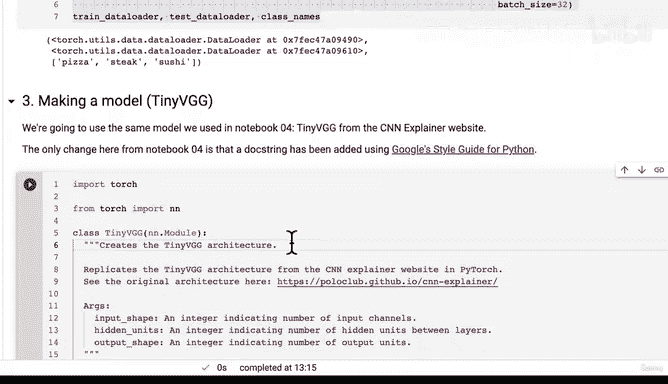

# Daniel Bourke《PyTorch 深度学习｜PyTorch 101 Crash Course For Beginners in 2025》中英字幕 - P172：172_07_005 创建PyTorch DataLoader生成脚本.zh_en - GPT中英字幕课程资源 - BV1kTSKB1E9m

Welcome back in the previous video， we wrote the outline for our first Python script。

 which is super exciting。😊，Data set dot pi， namely。

 we created a function here to create some data loaders， given a training directory。

 a testing directory， a transform， a batch size and some number of workers。

 We wrote the doc string here in Google Python style guide。

 We're going to be continuing to do that throughout the rest of this section for writing our various scripts。

 So I'm going to get out of that。 And we use the built in Jupiter magic。 I was about to say Python。

 but it's a Jupiter magic Also i Python write file to turn this cell into a script。

 So let's keep going forward。 I set you the challenge of filling in the logic for this code。

 So I hope you gave it a shot。 but let's now try it out together。

 And I think the tabing is a bit off with this。😊，I's going to shift tab there and then tab that across。

Okay， beautiful。Tab， wonderful， so let's load in our data sets。😊，I'm going to here use image folder。

To create data sets。So we can go train data。Equals。Let's do data sets dot image folder。

 And then we're going to pass in a trainer， which is our。Parameter from up here， trainer。

And then we can also pass in the transform， which equals transform。Wonderful。

 and then we can create test data equals datas。 image folder。

And we'll pass it in the tester and at the transform， in this case。

 we're using the same transform for test and train。

 which is you don't always have to do that but just for simplicity just to exemplify what we're doing。

 we're just going to keep it straightforward， same transform for training and test data and that's because we've got to transform parameter here。

😊，Now we've got data sets。 What do we have to do Well we can get the class names。

Because you see down here， our function returns a train data loader， a test data loader。

 we haven't created those yet， but it also returns class names。

 so let's set the class names equal to train data dot classes。

We've seen that before in a previous module。 Now we can turn our images。Into data。Loaders。

 so P torch data loaders。And we can do this because in our script we've imported。From torch。utils。

data import data loader。So let's create the train data loader， which is going to be equal to。

Data loader， and then we'll pass it a train data set。

 and we'll pass it in the batch size as equal to batch size。

Then we'll set shuffle equals to true for the training data。And then we'll set the number of workers。

 So nu workers， this is going to be how many calls a used to load our data equals our nu workers parameter。

Which is this one here。Now'm worker argument， and I might just tab this over as well。

And tab this over。Foraing is very important in Python， as you'd be aware of。

 and then we're going to use this other parameter called pin memory。😊。

We haven't seen this one before， I don't think， but where could we find out about pin memory well？😊。

Let's look up the documentation for data loader we could look it up here， shift command space。

 but I personally find this a little bit hard to read in Google CoLab。

 so let's go Ptorrch data loader。😊，Torchuttails。da。And let's find pin memory。 What does this do。

 You might see this somewhere。 So that's why I'm highlighting it。

It is generally not recommended to return kuder tenses in multi process。 Instead。

 we recommend using automatic memory pinning i。e。 setting pin memory equals true。

 which enables fast data transfer to couda enabled GPus。 So this is an important thing。

 as we might have discussed previously， if not， I'm going to discuss it now。

 a lot of your time will be spent transferring data from nongU。 So say a CPU to a GPU。

 And so what pin memory equals true does， is it enables pinning memory So keeping memory in place on a GPU where possible。

 So rather than spend time continually transferring data wasting compute time there。

 it tries to store as much data as it can permanently on the GPU and does computing there。

 So instead of doing lots and lots of transferring， it pins that memory。

 And if you want to look up more about this pin memory equals true。

 you've got the documentation Otherwise you can look up how to make deep learning models go。😊，B。🤢。

And I'm been serious about that。 make deep learning go B from first principles。

 B is as in your GPU is spinning really fast and going。BSo Horace dot I O Bur Intro。

 This is how to speed up your deep learning models from first principles。 High。

 highly recommend compute。Bandth， in other words， transferring information。 Yes。

 see this is what you want to do。 You want to compute as much as possible。

 reduceuce the number of memory transfers。 That's where Pm memory equals true comes into play。

And you can read more about that here， that's some extra curriculum for you there。

But let's just save that pin memory equals true。Hopefully get a little speed up。

 maybe not with our smaller data set， that's more for larger data sets。

 but I thought I'd just make you aware of it because you're probably going to come across it in your Ptorrch travels。

😊，Bge size equals batchge size and we're not going to shuffle the testing data。So， false。

Noumb workers equals。The numb workers。Not numb workers。 That's a great Lincoln Park song， actually。

 numb。😊，And then pin memory。Equals3。Wonderful now if this all goes to plan。

 we should have a trained data loader and a test data loader and some class names。

 but it's going to save it to a script。 So if we run this。😊，Overwriting， beautiful。

 let's have a look at our updated file going modular， we have our first Python script。😊，My friends。

 look at what we've done。 We've got a Python script。 Yeah， do you know what we can do with this now。

 We can import this function and create our train data loader and our test data loader and our class names。

 So let's give that a shot。 Hey， What have we done， We've replicated these couple of cells up here。

 So that's working towards our goal of saving to Python scripts。

 the most useful code cells of our notebook so that we don't have to keep rewriting them over and over again。

😊，So， let's try this out。How about， where were we。We've got data setup dot pi。 Now。

 let's go from going modular。Which is our directory that we created from going modular。

Import data setup。Run this。 What do we get？Oh beautiful。 And now， if we go data set up， do we have。😊。

Autocomple create data loaders， beautiful now do we get a dock string with this？😊。

We do creates training and testing data loaders。 This is the dock string that we wrote takes in a training directory and a testing directory path。

😊，There's the arguments。 See， this is why we write it in that specific style because I like this style of formatting returns。

Example usage， we could really format that a little bit better， maybe。

 but this is where's that coming from， that doing is coming from here。The one that we wrote。

How cool is that。So maybe we format this a little bit more so it works better。

 but that's good enough for me for now。 let's see how it works。 Hey， let's go。

 let's make our train data loader。😊，Test data loader， class names。

Trainer equals trainer because we've already got。Trainer as a path and tester， I believe。Yes， we do。

Ter equals tester。 What are the other parameters we can pass in。Transform。

Transform equals data transform。Which is the transform that we wrote above。So we can see this here。

Data transform。Compose， we do a resize and we do a two tensor。 This was just up here。

We didn't write this this section， but we wrote this previously， create a simple transform。

 And then finally， I know I'm jumping all over the place。

 but we're going to bring this back in a second。😊，Let's pass in a batch size。

 which we use our batch size， let's say 32， and then numb workers， well。

 nu workers get set by default。So let's just do that。

And then let's see what our train data loader looks like， our test data loader。And our class names。O。

Have a go at that。 Look， we're using data set。 The script that we just wrote create data loaders。

 We've created a data loader train data loader test data loader。

 And now we have the class names pizza steak sushi beautiful。

 So going forward instead of writing the code that we've got above here。

 So instead of writing all of this stuff again and again and again。

 we could just leverage our data setup dot pi。 we could save this somewhere and just import this script and create our data loaders by passing in a training and testing directory。

😊，How cool is that， So let's not stop there。 Let's keep pushing forward。

 I'd like to do the same thing for the rest of the sections。So what are we up to。

 making a model tiny VigG。 Now， we've written the tiny VGG model a few times now。

 How about we turn this into a script。You might want to give it a go before we go to the next video。

 so try that out see if you can turn this code cell into a script called model builder。 pi。😊。

And we'll do it together in the next video。I'll see you there。

