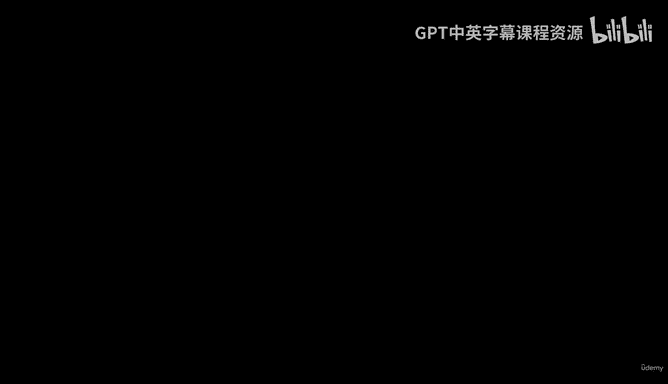
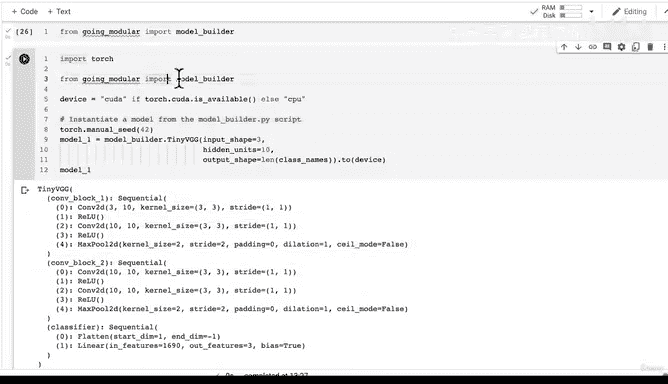

# Daniel Bourke《PyTorch 深度学习｜PyTorch 101 Crash Course For Beginners in 2025》中英字幕 - P173：173_07_006 将模型构建代码转为Python脚本.zh_en - GPT中英字幕课程资源 - BV1kTSKB1E9m

In the last video， we created our first Python script data setup。

 Pi to create our training and testing data loader。

 as well as return a list of the class names that we're working with。😊，But let's not stop there。

 Let's now see if we can turn our making a model code into a Python script。

 Now this is the same model we used in notebook 04。 We've seen this before。

 so I'm not going to spend too much time as coding the model。

 I just want to focus on how we could turn it into a Python script。

 So if you want a step through of it。 We have model 0 tiny VgG。

 This is where we created it in the previous section。😊。

But let's see what happens if we run this cell， and then if we run this one。

 creates an instance of our model， we've got a forwardd method。

 if we wanted to leverage the benefits of operator fusion。

 that'll be contained in that post that I showed before。

 how to make your deep learning models go blur， you could use that。😊，Then， we have。

Devvice agnostic code。😡，Then we do a dummy Ford pass to make sure that the model works。

And it looks like it does。 So let's see how we can turn。This modeling into a Python script。

 So we'll come down here to the end of section 3。And I'm going to create a little text cell。And。

Rather than rewrite all of our modeling codes。Let's go call this making a model。Tony VGG。

With a script and we'll call this one model builder doti。You can call it whatever you want。

 sometimes you just see it saved as model dot Pi， I'm going to call mine model builder dot Pi。

And let's turn our。Model building code。Into a Python script we can import。

 So that's what we want to do。 We want to be able to import our model from a Python script。

 So how do you think we could do that？Well， previously we wrote some code to turn our data setup using a magic function。

So you might have already given this a go yourself。

 so we're going to write file going modular and I'm going to save it as model builder dot pi。

 so that's going to turn whatever is in this cell into model builder dot pi So if we just print。

Hello。I'm about to build a model。In here。Let's see what happens。Beautiful。

Then if we have model builder dot pi。There we go。 Beaiful。 Now， what if we just ran a Python。

 This is a Python program。😊，So if we just go Python。Going modular。Model builded up high。There we go。

 It does whatever is in that script。 So ideally， we want to end up later on with train dot pi and it trains a model。

 but let's cover that later。😊，We're up to here。So I'm going to put this into a。String here。

 So this contains pieytorrch model code to instantiate a tiny。

VGG model from the CNN explainer website， just as we've seen before in previous sections。

So we're going to cheat a little bit with this one rather than rewrite all of our modeling code。

 let's just copy what's in this cell above here。I'll show you how quickly we can turn this into a Python script So we import torch from torch import N N。

 Then we just have our class tiny VGG with a dock string here。When come down。

And we're just going to copy that there。Now， do you think that's enough？Well， let's find out， hey。

So if we overwrite going modular model builder dot pi look what we have in there。

 contains pytage model code to instantiate a tiny vy model from the CNN explainer website。

 and there's all of our modeling code。 So how about we try to create a model。

 and we replicate what we've got up above here， we've got a single forward pass。

 But this time we want to leverage our model builder dot pi script。 instead of our cell up here。😊。

So we have to replicate something like this。😊，Let's see what this looks like。

We'll go import torch What we're trying to do is a dummy Ford pass with the model that we create from model builder dot high just to make sure that it works So from going modular import model builder。

So this is going to import。The model build a script that we just created。

And then we can set up device agnostic code。 We don't have to do this again。

 but I'm just going to do it anyway for completeness。If doc torch， dot couda。Is available else。CPU。

Beautiful， now let's instantiate a model from the model builder。Dot pi script， we can do this how。

Well， let's find out， hey， torch manual seed。We want to go model one equals。

 instead of just writing plain tiny VGG， we can go model builder。Dot tiny VGG。And then if we look up。

 can we look up the dock string here？Oh we haven't imported this yet。 So if we just run that。

Dot tiny VGG。There we go。 Look at that， creates the tiny VGG architecture。

 replicates the tiny VGG architecture from the CNN explainer website。 Here's our args， input shape。

 hidden units， output shape。 Where do we get this from。😊，That's the dogck string that's in here。

Class tiny VGG。That's all I've done。 I've written the doc string here。

In the style of Google Docstream， Google Python Doing。Al right， let's keep pushing forward。

 This is so exciting。 Look how quickly we can create a model。 Now， hidden units。

 let's just stick with 10 like we've been using in previous sections， then the output shape。😊。

Equs length。Of class names， and then we're going to send this to the target device and then let's have a look。

At Model one， do I have enough？Brackets there。I think I might need one more。Honno。

 that's correct number of brackets。 Let's run that。

 We get a tiny B G G model from our going modular script model builder。 How good is that Now。

 let's try a dummy Ford pass。 I'm just going to copy the code from up here just to make sure it works with the exact same code。

😊。

This is a dummy Ford pass here。We've seen what this looks like。

 All we do is we get a batch of images， and we get a single image from the batch and unsqueeze it so that the single image fits the model。

 The shape fits its model。 We want to perform a forward pass on a single image。

 But instead of model 0 that we created from within the notebook， we want to use model 1。

 which we created， we still created it from within the notebook。

 but we used the code from model builder dot pi。😊，So let's just make sure it works。And yes， it does。

 Look at us go。 We are slowly， but surely turning in。 We're not even slowly。 We're going quite fast。

 We are turning our useful notebook code into Python scripts。

 So do you remember how long it took us to first write this model。😊。

And we've written it a few times now。 But now we've got it saved in model builded do pi。

 so we could just import this script， and we have a tiny VG G model ready to go。 And， of course。

 you could use model builded dot pi for any of your Pytorage models and use similar Pytorch code that we've written here or Python code to import it and instantiate it ready to go。

😊，This is the power of going modular， but we started with a notebook and we practice writing functions like train step。

 test step and train to see if they worked and we use the notebook to experiment this is my workflow what I do day to day as a machine learning engineer is I try things out in a notebook and once they start to work I save them to Python scriptris so that I can use my useful code over and over and over again。

😊，So let's keep pushing forward。 You might want to try it yourself。 We've got train step。

 test step functions and train。 These are all from notebook4。 Nothing different here。

 All I've done is I've added a doc string to each of them。

 You might want to practice writing these using Google's Python functions and methods style guide。

 as we've discussed before。 Let's turn these three functions in the next video into a python script called engine dot pi。

 because they're gonna， that's what drives our model training， right， These three functions。

 So lets let's call the script， something relatable。 engine dot pi。😊，I'll see you in the next video。

