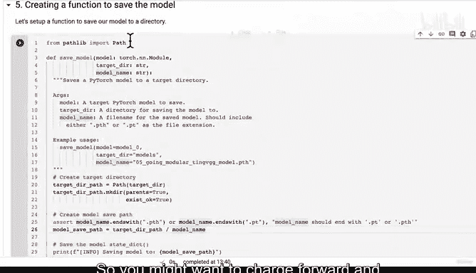

# Daniel Bourke《PyTorch 深度学习｜PyTorch 101 Crash Course For Beginners in 2025》中英字幕 - P174：174_07_007 将模型训练代码转为Python脚本.zh_en - GPT中英字幕课程资源 - BV1kTSKB1E9m

Over the last two videos， we've created data setup dot pi， model buildedt pi。

 and it's time to move on to the next step。 and that is turning our training and testing step functions and our train function into their own Python script so we don't have to rewrite all of these test loops over and over again。

 I know it is fun writing them， but we've done enough practice here I think already Okay so let's see how we can create a script called engine dot pi And if you're wondering for reference all I've done is I've taken these functions that we wrote in notebook04。

 So if we come up here， notebook 04， create train and test loop functions。 there's train step。

 all of the steps with that test step， and then there's train which combines test step and train step。

😊，And I've added a dock string to each in Google's Python functions and methods style guide。

 So let's run this code。 Oh， and by the way， if you're wondering what's going on here。

 they might be new to。 if you haven't seen this before， This is your extra curriculum。

 It's Python type annotations。 So that's just going to give people a hint。

 namely people who use your code in the future。 or yourself as to what types these arguments should be。

 And what gets returned。 Now， they're only hints。 So they aren't going to really enforce it。

 They're just hints。 So we can check out some resources for that。 But it's just telling it'， hey。

 this model is a type torch and N dot module and that this function is going to return a tuple containing two floats。

😊，So let's see it in action， Hey， run train step and then we'll get test step and then we'll combine。

😊，Test step and train step into。Train Now you'll notice。

 all I've done is I've added a dock string here。 It's quite lengthy。

 but it's going to help later on if we wanted to look up what our code actually did。And then。

 if we wanted to。Run that beautiful。 so we could write code here， train。

And then pass in some parameters， a model， a train data loader， a test data loader， an optimizer。

 a loss function， epochs and a device。 But let's just see how we can turn this into a script called engine dot pi。

 What I'm going to do is I'm going to create a subheading here。😊，This is 4。1。

Turn training functions into a script and this is going to be called engine dot pi。

 so you might have already tried this yourself。Let's see one way of doing it。

 so we're going to use the Jupiter magic。Rightite file。Going modulular。Dot engine dot pi。 Now。

 we want within our engine dot pi file to have access to the train step function to the test step function and to the train function。

 So let's see what this might do。Or writer information heading about our Python script contains functions for training and testing。

A pie torch model。Easy as you like， right， and then we can put up the top the imports。

Just a thing to note that if you don't import the things within your Engine do pi script or whatever script that you're using。

 if you don't import the necessary imports， the necessary modules，Your functions。

 your classes will error out。 So that's what we're doing here。

 These functions require a few different modules from the typing module from T Q DM for progress bars。

And yeah， typing tuple。 So let's see what this looks like in practice。From typing， import， D， list。

 and tuple。That's going to help with our type annotations。Then of course， we can import torch。

And then from tqdm。auto import tqdm for progress bars。Wonderful。😊，So what can we do now， Well。

 we could rewrite all of our functions。But we've already done that。

 so let's just leverage the fact that we've written some great code up here and I'm going to get this train step function。

 We don't need the import up the top there， So we'll scroll back down。😊。

To our script where we're creating engine dot pi and we'll give the first one， which is train step。

 Then we'll enter down to another line。 I'm going to go up and get the test step。Beautiful。

 and then we're going to。Come down here， test it， and then finally。

 instead of rewriting the train function， we've already tested this in our notebook before。

 So we're just going to copy it down below。Wonderful， so this is our longest script here。

 but there's a fair bit of functionality going on。 And so to save us rewriting all of this code over and over again。

 let's just save it to Engine dot pi。😊，And if we refresh。He， look at that。

 So now if we go from going modular， import engine， and then if we have engine dot train。

 what happens？AlltT missing seven required positional arguments， model， Tra data loader。

 test data loader， Opr， loss function epochs。😊，Well， we're going to see that in action later on。

 but now we've got access to our engine functions。So let's keep pushing forward in the next video。

 How about we create a function to save our model and。😊，We've seen how to save a model before。

 so you might want to charge forward and try to recreate this function yourself。

Or to focus on what we're covering in this section。

 try turning this save model function or this entire code cell into a script called UTs do pi。

 which is short for utilities。Give that a go， and I'll see you in the next video。

