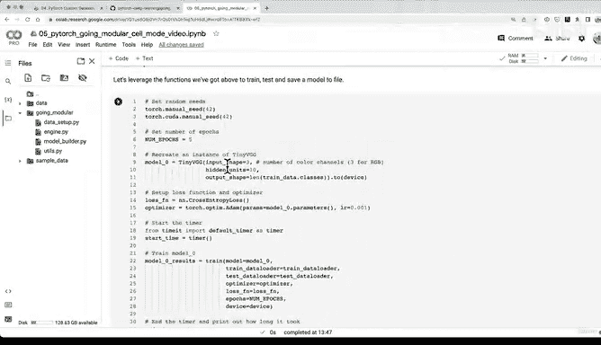

# Daniel Bourke《PyTorch 深度学习｜PyTorch 101 Crash Course For Beginners in 2025》中英字幕 - P175：175_07_008 将模型保存工具函数转为Python脚本.zh_en - GPT中英字幕课程资源 - BV1kTSKB1E9m

Welcome back。 In the last video， we created engine dot Pi， our biggest script yet。

 Have we got at this。 Remember how much time we spent writing all of our training code。😊，Now。

 look what we can do。 Now， you might be wondering， Daniel， why don't we do this from the start。

 Why don't we just save all of our training code to a file and our testing code。

 all of that sort of stuff。 Why don't we say this to a python file from the beginning。 And while。

 we definitely could have done that。 But the reason why I've spent so much time on these steps。

 is because， yes， it's one thing to just import functions from a file。

 But I thought we better practice writing the code before we just copy it and save it to a file and use it later on。

 So we've had plenty of practice writing all of this code now。

 So if we were to inspect our engine dot pi。 Well， we kind of know what's going on there。😊。

So let's get out of that how about we work on creating a utilities dot pi or UTs dot pi So if we look up Pitorrch date of the art。

 this is a recent pitorrch blog post for training state of the art computer vision models。😊。

And if we look up in here， there's a script， a training reference script。

You'll notice that this is the actual pi torch Github repo。 This is their vision。

 So torch vision references classification。 We've got detection， segmentation， classification。

 Let's focus on that because what that's what we're doing。 They've got a train dot pi file。

 That's what we're working towards this transforms dot pi， we could create that if we wanted to。

 If we had some data transforms that we wanted to save a file。 And then there's Us dot pi。

 So let's have a look at what's in here。 Okay， smooth value。😊，Is there a save method in here。

 I wonder， save on master。Okay， torch。 save， there we go。Al right。

 But the purpose of the Us dot pie file is to save any utility functions。 Yeah， there we go。

 store model weights， which could be considered save model weights。 Now。

 there's a fair few things going on here。 But do you see how this has got a do string in the similar style that we've got。

😊，Now we're practicing a simplified version of this， but the principle is still the same。

Take the useful code that you've been writing and save it to a Python file。 Now， of course。

 you could just start with Python files。 But for me。

 I find that I like starting with notebooks because they're so exploratory， you can experiment。

 experiment experiment， and you can visualize， visualize， visualize。

 But I just want to reference this that this is the style that the actual Pytorrch team are using for their modeling code。

 So just keep that in mind。 But we're going to create a u stop Pi to save our model。😊。

Get out of that。So if we run this。This gives us a function to save the model。

 so you can step through this code here if you like， but we've covered this in a previous section。

 Let's write another subheading here。Create。A file called Us dot Pi with utility。Functions。

So Us in Python is generally reserved for various utility。Functions。And right now。

Right now we only have one utility。Function。Save model。But。As our code grows。Will likely have more。

So that's just something to keep in mind， you can always update these Python scripts with whatever you like。

 you can create them using the right file magic as we've been doing or you can just go in here and edit them by hand。

😊，Print high。Then if you save that。It's going to override engine dop high。

 but we actually don't want that。 so I'll just save that fact I could comment that out。

 just something to keep in mind。And let's copy all this in here。Put it down there。

 you might have already done this before。Because I set this as a challenge。

 but let's create right file。'm going to save this is going modular and we'll keep this as UTs do pi。

 Let's put a little heading here and this is a。File containing。Various utility。

Functions for high torch model training。And now again， we've only got one utility function。

 but as your code grows， you'll likely have a fair few other utility functions that you could put in here。

 So let's see what happens。😊，If we run this。Oh going modular Us。5， I love creating Python scripts。

 look at that。😊，Oh my goodness。 Now， instead of， oh， you know what' missing。

We have an imported torch。 That's a good catch。 Thank you， Google Coabab。 So as we've said before。

 you have to make sure that your scripts。Import the modules that are required for your various code and functions that are within that script。

 So let's rerun that again over riding， and then we get a new U stop Pi， open it up。

And now that it imports torch， we don't get that red squiggly line。 beautiful。

 So let's keep pushing forward。We've now got to train， evaluate and save the model。 Oh my goodness。

 We are almost at the train dot pi script。 So， in fact。

 that can be your challenge for the next video。 Try to turn this train evaluation and saving model code into a script that is train dot pi。

 just as we've created here， But with all of this functionality built in。 so that ideally。

 we can finish off by running Python going modular。😊，Train do high。

And it's going to train a model that is going to result in something like this。

So give that a shot and I'll see you in the next video we create a train dot pi script。

