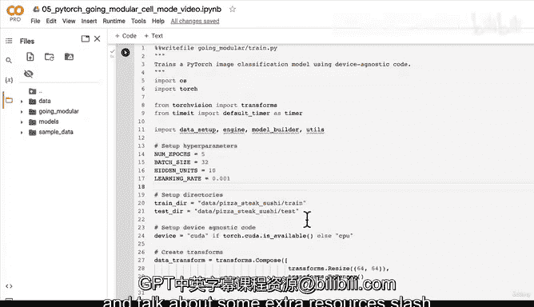

# Daniel Bourke《PyTorch 深度学习｜PyTorch 101 Crash Course For Beginners in 2025》中英字幕 - P176：176_07_009 创建单行代码训练脚本.zh_en - GPT中英字幕课程资源 - BV1kTSKB1E9m

We've created four Python scripts so far， data setup dotpi， engine dotpi。

 model builder dopi and Uts dopi。 Now it's time to leverage all the code that we've written before and create train dot pi but let's see what happens in here you might have already tried to replicate this into a train dotpy script and if you have Well kudos to you Otherwise that's what we're going to do now So we set some random seeds for reproducibility。

 We don't necessarily need to do that we set the number of epochs to five nice and simple keep our training time short just to make sure our code works。

😊，We create an instance of tiny VGG， note that this is not using the tiny VGG from Model builder dot pi。

 it's using it from the code cell above。We set up a loss function and an optimizer as we've seen before。

We start the timer to time our model training code and we train Model0 using our train function。

 which does a train step and a test step， then we have an end timer and finally we save the model using our save model code。

Now， how would we replicate this using all of the functionality that we've saved to our Python scripts？

Well， let's see， this is what we want to end up with， something like this， Python going modular。

 Tra dot pi and Tra dot Pi leverages all of these other Python files to replicate the code in this cell。

So I'm going to create another section here。😊，Which is 6。1。

I'm going to call this train evaluate and save the model。And this is going to be script mode。

And we want to call it。Trained up high。So let's create。

A file called train up high to leverage all of our other code scripts to train a。Pytorch model。

Essentially。We want to replicate the functionality of notebook 04 because remember all of the code in this notebook is a conduced or a summarized version ones of the code in notebook  O4。

 all of the functionality of notebook 04 in one line。So let's see。We're going to create。

Using right file。Going modular。Trained do pie。And。What should we say that this does？

This trains a Pytorch image classification model。Using device， agnostic code。

 I think that's pretty good。Again， you can put whatever you want here。

 whatever is descriptive of whatever problem you're working on。So we're going to need a few things。

 we need OS。And we need torch。Remember， whatever modules we need to run this code here。

 we're going to need in our。Trained up Pfi。And so we're going to import torch vision。

Because we need to create a transform， import transforms， and I'm also going to import data setup。

Now I don't have to put going modular here because train dot pi is going to be within going modular。

 So that's something to keep in mind for file parts。

 So because train dot pi will be inside going modular。

 I can just import data setup instead of writing。Like we have before。

 instead of writing from going modular。Import data setup。I can just write， import data setup。

 and that will get that module。 The same thing with engine。

 the same thing with model builder and the same thing with Us。Dot Pi。

 that is because train dot pi will be inside this going modular file。So let's get rid of that。

 let's just run that。Beautiful， and let's set up some hyperparameter。And I'll just show you。

 we refresh。So Tra dot Pi is inside going modular， so that's why we can just straight away input data setup。

 engine model builder and U。So we set up the hyperpar， nu epoch equals five。

And then we go batch size equals 32。And then we go hidden units。Equs 10。

 and then we'll set the learning rate equals to 0，01。We can keep going on。

We'll set up the directories。So trainer。Equals。Go data。Dot pizza。Stteak sushi。

Slash train and then we'll set up the test directory equals data， pizza， steak， sushi slash test。

Beautiful， now let's set up device agnostic code。😊。

Now the wonderful thing is is that because all of our other code leverages device agnostic code。

 we set it up once here and then all of our other code falls into place。

 That's what we've been working towards this whole time。😊，Else， the CPU。

And then we're going to create transforms。 Now， we don't necessarily have to create the transforms in train dot pi。

 You could create a transforms dot pi and import it。 But for simplicity， we're just going to。

Create one here because our transform is actually quite straightforward。

 it's a resize and then a two tensor。😊，But if you wanted to create multiple transforms。

 you could do that within a transforms dot pi file if you wanted to。What do we get wrong here。

 oh transforms？Excellent， now we can create our data loaders。

 So create data loaders and get class names。 How can we do this。

 while we created a function in data setup to do just that。 So train data loader。😊。

And test data loader and class names equals。We're going to。Use data setup。

Recall within data setup we have。Create data loaders。 beautiful。

 So we're going to go data setup dot create data loaders。We're going to pass in the trainer。

Which is equal to。Trainer， which is what we've said above。Trained over here。And then we can go。

Tester， which is equal to。Tester。We've set that above as well。Then we can keep pushing forward。

 We have transform。Which is equal to data transform， which is what we just created above too。

Data transform Now we have batch size。Which is equal to the batch size parameter that we've set up of。

 hyperparameter that is。And then none workers， we don't have to set number of workers because it automatically gets set within data setup do high。

What's next？ Well， we can create the model。 So let's create the model。

 All we're doing is we're replicating what happens here。 So in this code。

 the data is already created。😊，But in our script， it's not yet created， so now we're up to here。

 we recreate an instance of tiny VGG， so let's do that。😊，Create model。

 We can just call it model equals model builder。 Now， this is beautiful。

 We can just leverage our tiny VGG class from within our model builder script。

 I'll set the input shape to3，4 color channels in our images。

 I'll set the hidden units to hidden units。😊，And then we'll get the output shape here。

Now the output shape is going to be the length of the class names because we've got that above。

Which will be three because we have three target classes。Pizza sta or sushi。

 and I'm going to send this to the target device。With the device agnostic code。And now what do we do？

 Well， as we have done plenty of times before now， set up loss and optimize it so we can use this in our training loop。

And our testing loop， of course， so the loss function。

 because we're working with multiclass classification， will be cross entropy loss。

And our optimizer will be。 Well， we could use a few different options here。

 but I'm going to stick with Adam and we want to optimize our models parameters and our Lr learning rate is going to be。

Learning rate。The hyperparameter that we set above here。Now， of course。😊。

You might have guessed that these could all be argument flags。 Now， if you didn't guess that。

 that's completely fine。 but that will be one of your。

Extracurricum exercises is see how you can use Python's Arg pass to turn these into argument flags。

But more on that light up。Let's keep pushing forward， set up loss and Opr。 Now let's start training。

With help from Engine dot Pi。So engine dot train， let's pass in the model， model equals model。

Now where does dot train come from， it comes from engine。If we go down here。

 this is our train function。We have to pass in a few things here。 We've written all this code before。

 so we're leveraging it in train dot pi。We're linking together all of the pieces of the puzzle。

Train data loader equals Tra data loader。Which will be。This one up here。

And then the next parameter is the test data loader equals test data loader。Wonderful。

 and then we pass in our loss function。😊，And then the optimizer。And then what else？

But we have epochs。Num epoch， this is another hyperparameter that we set above nu epochs。

And we can keep pushing forward。 What's our final thing。Device。

So we can leverage device agnostic code and then one more step， what do we do as the last thing here？

😊，Save the model。 Oh we haven't got timing， do we， Well， let's just copy in some timing down here。

And we'll go here。Timer。And。End the timer。After the model training。

And then we need to make sure that we're importing timer。Oh we do it there。

I might just put this at the top。And we can go this here。Beautiful， okay， one last thing。

Save the model to file。And what can we do here， we can go Us。

 saveve model because we've imported us up here and within Us。 pi， we have save model。Excellent。

 so u don't find save model， and then we pass in the model we'd like to save。

 and then we pass in the target directory we'd like to save it to。 Let's。

 let's save it to the models directory。 and then we will set up a model name and we'll call this one05 going modular。

😊，Scrrit mode。Tiny VGG。Model dot PTh Now you could also do dot PT or PTH， which stands for Pitorrch。

Oh my goodness， look at this trained up high script。😊，Are you ready？Let's save it， see what happens。

Overriding going modular train dot high。One of our biggest scripts yet trains a pi torch image classification using device agnostic code。

We've got our imports。 We've got our hyperparameter。 We've got our directories。Dive agnostic code。

 our transform， our data loaders， our model， our loss and optr。 We start the timer。

 We train the model using our engine script。 We end the timer， and then we save the model to file。

 Oh my goodness。 Let's see。 Can we do what we set out to do at the very start of this section。

 Can we train our model with one line of code。😊，Mind you， this is going to be one line of code。

 but it's going to leverage all of the other code that we've written here over the past。

 however many sections we've been through， what are we up to， Section 5， we started at0。

 So five sections prior to this one。 We've written a lot of ptorch code。

 and now we're going to condense it into a single line。 Are you ready。😊，Let's go modular in three。

 two， one， no errors。Oh my goodness， we're training。Here we go。Oh， look at that。 Look at it go。

 There we go。 Epoch number one， Epoch number 2， epoch number 3， epoch number 4。 Oh， look at that。

 We'll get it print。 And finally， we get to save our model to models05 going modular script mode tiny videoii。

 And if we look， we refresh this， we now have a models directory。😊，Beautiful。Well done。

 So that whole time， we are working towards。Training our model with a single line of code a train do pi script。

And we did it。Now， let's have a look at our final。Direectctory structure， we have our data。

 which is our standard image classification data。 We have our Python scripts。

 which is all of our Pyto code and Python code that we've written across various different sections。

 but now condensed into five scripts that we could just import。 Look。

 look what we did to import those scripts within the trained up Pi。

 We just imported them with one line。😊，And all of that training loop code happened with engine dot train。

 How good is that， And now we have a directory to save our models。

And so I want to emphasize the fact that the data folder here。

 that can be whatever data you're working with。 And these going modular scripts。

 the data set up to pi， that can be whatever code you need to set up your data。 The engine。

 you might have a quite a similar engine to what we have for training and testing loops because their steps are quite similar。

 The model builder。 You could customize this to be almost any pi toch model that works with the data that you're using。

 utilities。 Hey， the sky's the limit there。 We only have one utility， but there could be many more。

 And then finally， models here。 We have our saved models。😊，So give yourself a pat on the back。

 We have written a lot of code here。 and this is a very important step in becoming。

World renowned machine learning engineer is being able to go from notebooks to Python scripts。

 So let's in the next video do a quick summary and talk about some extra resources slash exercises to practice what you've learned。

😊。

