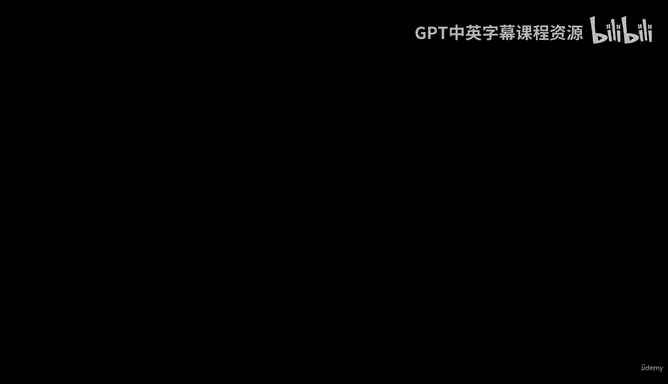
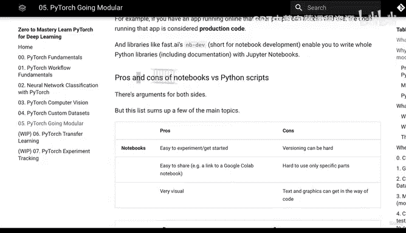
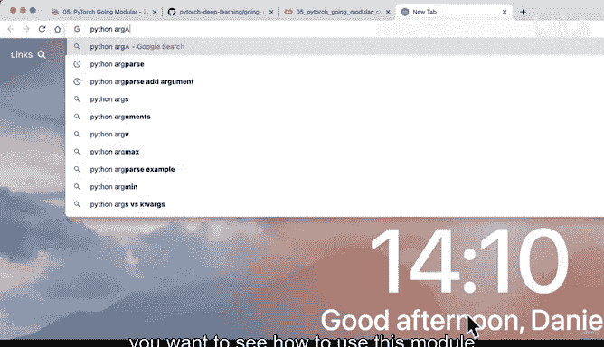
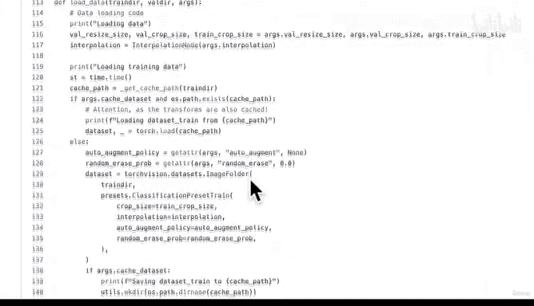

# Daniel Bourke《PyTorch 深度学习｜PyTorch 101 Crash Course For Beginners in 2025》中英字幕 - P177：177_07_010 模块化总结与练习拓展.zh_en - GPT中英字幕课程资源 - BV1kTSKB1E9m

Welcome back In the last video， we created train dot Pi。

 a script that leverages all the other scripts and all these scripts leverage all the code we've written throughout all of the other sections so far to train our P toch model in a single line of code。

 How cool is that。 And so what we've done is we've gone modular。

 We've gone from working notebook code to working Python script code。 And if you want to compare。

 see what we've done we took part one of going modular。

 So the notebook in cell mode and we turned it into script mode。

 But I'm not going to spend too much time talking about the comparisons between these two。

 I'd rather you investigate that yourself。😊，But just know what we've done is we've taken part one and we've essentially turned it into part two。

But if you'd like to learn more。😊，What I'd recommend as extra curriculum is to go back through section 5 Pytoch going modular。

 have a read through this。 This is everything that we've done so far。

 it explains why you'd like to go modular the pros and cons of notebooks versus Python scriptris。😊。

An example of what I do， my workflow。 So we've just gone through my exact workflow。

 I use Google co La to explore different options。 See if some code works。 And if it does。

 I turn it into a Python script， just as we've done。

And you'll often find pipeytorrch code in the wild in the form of scripts。

 So that's why it's good to be familiar with。Scrrit mode， P torch code。

And there are some things that we didn't quite cover just yet。

 so that's argument flags like this for training with different hyperpara。

 so that's actually the first exercise So if we come down to exercises or sorry one of the exercises。

 the second exercise。😊，So the first one is to turn the code from get data section1。

 so maybe you could turn this into a script， we didn't do this。Get data。

You might be able to turn this into a script， I'll leave that as a challenge for you。😊。

Give you a hint， you can use very similar code to what we've used to create these scripts。

And then exercise number two is use Python's A pass module to be able to send Tra。

 pi custom hyperparameter values for training procedures。So this is a little bit of a tricky one。

 but I think that you can figure it out。 So if you look up Python arg pass。

You want to see how to use this module from Python to create arguments that you can pass to your Python programs。

 so I would recommend the documentation for that， I'd also recommend real Python Ag pass。God。

How to build command line interfaces with Py in Python with AGPas。

 so that's another resource that you can check out。So let's go back here and then finally。

 create a script to predict such as predict dot pi on a target image giving a file path with a saved model。

 So in the last section of section 04。We predicted on a custom image。

 So the final exercise is to take the code that we used in this section and turn it into a script called predict dot pi so that you can predict on your own custom image。

 So I feel like these are some good challenges。 Now， of course。

 if you want an exercise template notebook。 There is one in the Pytorch deep learning repo under extra slash exercises slash 05 Pytorch going modular exercise template。

😊，There is also an example solutions notebook with some solutions to the exercises under extra slash solutions。

 and then of course now I've started to have live walkthroughs of each of the exercises in recent sections of me going through and solving them live so if you want to check out that how I would solve the exercises you can check out the full video on YouTube there。

And then finally， to finish off， if you want some more information about things that we've covered in this section Pytorch going modular。

 I'd highly recommend going through the extra curriculum。

 particularly if you want to learn more about structuring a Python project， like for example。😊。

How should you structure the files within。Going modular。

 So why did I put going modular going modular and then have Python scripts in here。

How should you structure these？This article is going to help you out。

 If you want to look out more style information about styling your Pytorch code。

 I'd highly recommend checking out this Pytoch style guide by Igor Samiage。

 I'm pronouncing that name wrong， but it's what I've used to inspire the styling of the Pytorch code in this notebook as well as various other resources。

😊，And then finally， we've seen this one， but for an example。

 Tra dot Pi script to train state of the art image classification models。

 check out the Pytorrch repo。😊，Now there's a fair few things that we haven't covered in this trained op high。

 but there is a lot of things that we have， so I'd encourage you to read through this。

 even if you don't understand some things， it's going to give you an idea of what you could work towards to start training state of the art models。

😊。

So our model is quite small at the moment， but。This model。

 or this training code here is what trains pi torch image models to state of the art results。

So with that being said， find everything you need and learn Pytoch。

0 section 05 or the Github repo here。But this has been going modular。

 I will see you in the next section。 ho It's going to be an exciting one。

 If you thought training a highydge model with one line of code was exciting。 Well。

 our model is not performing very well。 How can we step that up a notch。😊，I'll give you a hint。

It's in the next section。I'll see you there。