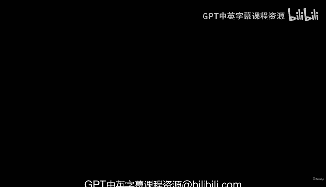
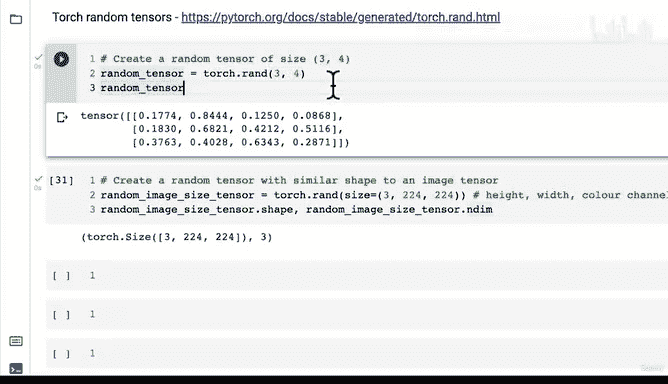

# Daniel Bourke《PyTorch 深度学习｜PyTorch 101 Crash Course For Beginners in 2025》中英字幕 - P18：018_02_014 创建随机张量.zh_en - GPT中英字幕课程资源 - BV1kTSKB1E9m

Welcome back。 In the last video， we covered the basic building blocks of data representation in deep learning。

 which is the tensor， or in pytorch specifically torch dot tensor。 But within that。

 we had to look at what a scalar is。 We had a look at what a vector is。 We had a look at a matrix。

 We had a look at what a tensor is。 And I issued you the challenge to get as creative as you like with creating your own tensor。

 So I hope you gave that a shot， because， as you'll see throughout the course and your deep learning journey。

 a tensor can represent or can be of almost any shape and size and have almost any combination of numbers within it。

😊，And so this is very important to be able to interact with different tensess。

 to be able to understand what the different names of things are。 So when you hear a matrix， you go。

 oh， maybe that's a。2 dimensional tensor。 When you hear a vector。

 maybe that's a one dimensional tensor。 When you hear a tensor。

 that could be any amount of dimensions。 And just for reference for that。

 if you come back to the course reference， we've got a scalar。 What is it， a single number。

 number of dimensions，0， We've got a vector， a number with direction， number of dimensions，1。

 a matrix。A tensor。 And now here's another little tidbit of the nomenclature of things。

 the naming of things。Typically， you'll see a variable name for a scalar or a vector as a lower case。

 So a vector， you might have a lowercase Y storing that data。 But for a matrix or a tensor。

 you'll often see an upper case letter or variable in Python in our case because we're writing code。

 And so I am not exactly sure why this is。 but this is just what you're going to see in machine learning in deep learning code and research papers across the board。

 This is a typical nominature Scalrs and vectors lowercase matrix in tenss uppercase。

 That's where that naming comes from。 And that's why I've given them a tensor uppercase here。Now。

 with that being said， let's jump in to another very important concept with tensesors。

 and that is random tensesors。Why random tenses， I'm just writing this in a code cell now。

 I could go here。 This is a comment。In Python， random tensors。But we'll get rid of that。

We could just start another text cell here， and then。3 houseushs is going to give us a heading。

 random tensors there， or I could turn this again into a markdown cell。

With Command M when I'm using Google Co Laab。So random tensesors。 Let's write down here。

 Why random tensesors。 So we've done the tedious thing of creating our own tensesors with some numbers that we've defined whatever these are。

 Again， you could define these as almost anything， but random tensesors is a big part in pie torch。

 because。Let's write this down。 Rand tensesors are important。Because the way。

Many neural networks learn is that they start with tensors full of random numbers。

And then adjust those random numbers。To better represent the data。 So seriously。

 this is one of the big concepts of neural networks。 We， I'm going to write in code here。

 which is this is what the tick is for。Start with random numbers。Look at data。Update。Random numbers。

Look at data。Update random numbers。然。Is the crux of neural networks。

 So let's create a random tensor with pie torch。 Remember how I said that pie torch is going to create。

Tensenseors for you behind the scenes。 Well， this is one of the ways that it does so。

 So we create a random tensor。And we'll give it a size of random tensor of size or shape。

 Pytor use these independently。 So size， shape。They mean they're different versions of the same thing。

So random tensor。Equals torch。😡，Dot R。 And we're going to type in here，3，4。

 And the beautiful thing about Google Coab as well， is that if we wait long enough。

 it's going to pop up with the dock string of what's going on。

 I personally find this a little hard to read in Google Coab Who you see you can keep going down there。

 You might be able to read that。 But what can we do while we can go to torch dot R。😊。

Then we go to the documentation。Beautiful， now there's a whole bunch of stuff here that you're more than welcome to read。

 We're not going to go through all that。 We're just going to see what happens hands on。

 So can copy that in here。😊，And write this in notes， torch random tenses。Done。

 I'm just gonna make some code cells down here so I've got some space。 I can get this a bit up here。

 Let's see what our random tensor looks like。There we go， beautiful of size 3，4。

 So we've got three or four elements here。😊，And then we've got three deep here。 So again。

 there's the two pairs。 So what do you think the number of dimensions will be for random tensor。

And him。2 beautiful。 And so we have some random numbers here。 Now。

 the beautiful thing about Ptorch again is that it's going to do a lot of this behind the scene。

 So if we wanted to create a size of 10，10， in some cases， we won't mo one dimension here。

 and then it's going to go 10，10。 And then if we check the number of dimensions。

 how many do you think it will be now，3， why is that， Because we've got 1，10，10。

 And then if we wanted to create 10，1010。😊，What's the number of dimensions going to be。

 It's not going to change。 Why is that。We haven't run that cell yet。

 but we've got a lot of numbers here。Yeah。We can find out what 10 times 10 times 10 is。

 And I know we can do that in our heads。 But the beauty of coab is。

 we've got a calculator right here，10 times 10 times 10。 We've got1000 elements in there。

 but sometimes tenses can be。Hundreds of thousands of elements or millions of elements。

 But Pitor is going to take care of a lot of this behind the scenes。

 So let's clean up a bit of space here。This is a random tensor。Random numbers。

 beautiful of now it's got two dimensions because we've got three by four。

 And if we put another one in the front there。We're going to have how many dimensions。

Three dimensions there， but again， this number of dimensions could be any number and what's inside here could be any number。

Let's get rid of that， and。Let's get a bit specificcause right now。

 this is just a random tensor of whatever dimension。 How about we create a random。Tensa with。

Similar shape to an image tensor。So a lot of the time， when we turn images， image size tensor。

 when we turn images into tensesors， they're going to have。

 let me just write it in code for you first， size equals。A height。

A width and a number of colour channels。 And so in this case， it's going to be hyp。

With color channels。And the colour channels are red， green， blue。 And so let's create。

Random image tensil， let's view the size of it or the shape。And then random image size， tensor。

We'll view the end dim。Beautiful， okay， so we've got torch size。The same size 2，2，4，2，2，4，3。Height。

 width colour channels。 And we've got three dimensions，1，4 height， width colour channels。

 And let's go and see an example of this。 This is the Pyto fundamentals notebook。If we go。Up to here。

So say we wanted to encode this image of my dad eating pizza with thumbs up of a square image of 224 by 224。

 this is then input。 And if we wanted to encode this into tensor format。 Well。

 one of the ways of representing an image tensor very common ways is to split it into color channels because with red green and blue you can create almost any color you want and then we have a tensor representation So sometimes you're going to see color channels come first we can switch this around in our code quite easily by going color channels here。

But you'll also see color channels come at the end I know I'm saying a lot that we kind of haven't covered yet。

 the main takeaway from here is that almost any data can be represented as a tensor and one of the common ways to represent images is in the format color channels's height width and how these values are will depend on what's in the image but we've done this in a random way。

So the takeaway from this video is that pitorrch enables you to create tensesors quite easily with the random method。

 however， it is going to do a lot of this creating tensesors for you behind the scenes and why are random tensesors so valuable because neural networks start with random numbers。

 look at data such as image tensesors and then adjust those random numbers to better represent that data and they repeat those steps onwards and onwards and onwards。

Let's finish this video here。My challenge for you is to create your own random tensor of whatever size and shape you want。

 so you could have 5，10，10 here and see what that looks like。

 and then we'll keep coding in the next video。