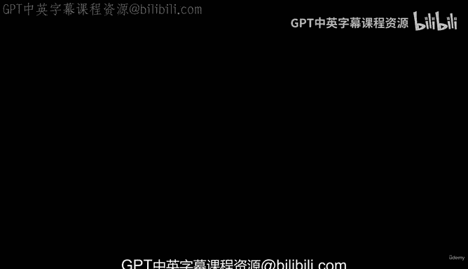
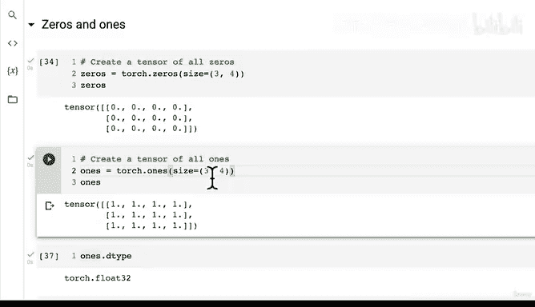

# Daniel Bourke《PyTorch 深度学习｜PyTorch 101 Crash Course For Beginners in 2025》中英字幕 - P19：019_02_015 创建全零与全一张量.zh_en - GPT中英字幕课程资源 - BV1kTSKB1E9m

I hope you took on the challenge of creating random tensor of your own size。

 And just a little tidbit here。 you might have seen me in the previous video。

 I didn't use the size parameter， but in this case， I did here。 you can go either way。

 So if we go torch dot R size equals， we put in a topple here of 3，3。We've got that tens of air 3，3。

 But then also， if we don't put the size in there， it's the default， so。

It's going to create a very similar tenil。 So whether you have this size。Or not。

 it's going to have quite a similar output， depending on the shape that you put in there。

But now let's get started to another kind of tensor that you might see， zeros and ones。So。

So you wanted to create a tensor where that wasn't just full of random numbers。

 You wanted to create a tensor。Of all zeros。This is helpful for if you're creating some form of mask。

 Now， we haven't covered what a mask is， but。Essentially， if we create a tensor of all zeros。

What happens when you multiply a number by zero？All zeros。

 So if we wanted to multiply these two together， let's do zeros times random tensor。There we go。

 All zeros。 So maybe if you're working with this random tensor and you wanted to mask out。

 say all of the numbers in this column for some reason。

 you could create a tensor of zeros in that column， multiply it by your target tensor。

 and you would zero all those numbers。 That's telling your model， hey。

 ignore all of the numbers that are in here because I've zeroed them out。

 And then if you wanted to create a tensor of all ones。Create a tensor of all ones。 We can go。

Ones equals torch dot ones， size equals 3，4。And then if we have a look。

 there's another parameter I haven't showed you yet， but this is another important one。

Is the default type。 So the default data type。 So that's what D type stands for is torch dot float。

 We've actually been using torch dot floatat the whole time because that's whenever you create a tensor with pi torch。

 we're using a pi torch method unless you explicitly define what the data type is。

 we'll see that later on defining what the data type is。 It starts off as torch float 32。

 So these are float numbers。So that is how you create zeros and ones。

 zeros is probably I've seen more common than ones in use， but just keep these in mind。

 you might come across them。 There are lots of different methods to creating tensors。

 And truth be told like random is probably one of the most common。

 but you might see zeros and ones out in the field。

 So now we've covered that let's move on into to the next video where we're going to create a range。

 So have a go at creating a tensor full of zeros in whatever size you want and a tensor full of ones and whatever size you want。

 and I'll see you in the next video。

