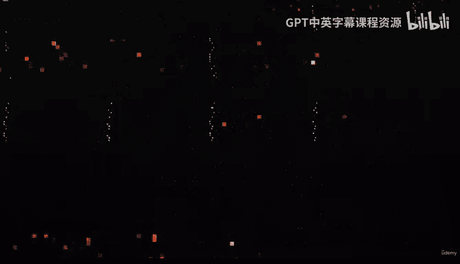
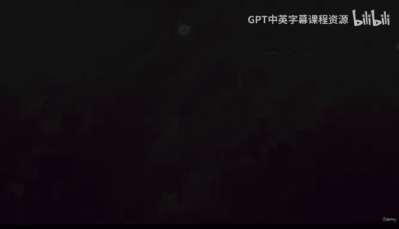

# Daniel Bourke《PyTorch 深度学习｜PyTorch 101 Crash Course For Beginners in 2025》中英字幕 - P1：001_01_001 PyTorch深度学习.zh_en - GPT中英字幕课程资源 - BV1kTSKB1E9m

🎼Machine learning and data science are already the hottest fields in the world and it's time to turn it up a notch Welcome to the hottest place to learn pieytorrch and become a master of deep learning。

😊。

🎼If you don't already know what PyToch is， here's the deal Py Toch is a machine learning framework written in Python code。

🎼It enables you to craft state of the art deep learning algorithms like neural networks。

 powering much of today's artificial intelligence applications。😊。

🎼Sounds hot right that's because Pytorch is on fire right now and I don't just mean the name of the logo it's used by leading tech companies like Tesla to build the computer vision systems for their self-driving cars Me to power the curation and understanding systems for their content timelines。

🎼Apple to create computationally enhanced photography and even automated weed killing tractors。😊。

🎼Plus， much of the latest machine learning research is done and published using Pytorrch code so knowing how to write and read Pytorch code means you'll be at the cutting edge of the field。

😡，🎼You know the best way to learn is by doing right Well consider this course a Pytorch momentum builder side by side line by line we'll be writing Pytorch code together apprenticeship style。

 helping you learn the Pytorch skills you'll use every day as a data scientist or a machine learning engineer。

😡，🎼We'll start with the barebone fundamentals， so even if you're new to machine learning。

 you'll be caught up to speed。🎼Then we'll explore more advanced areas including Pytorch workflows。

 Pytorch neural network classification， computer vision， custom data sets， experiment tracking。

 model deployment and my personal favorite transfer learning a powerful technique for taking what one machine learning model has learned on another problem and applying it to your own along the way you'll build three milestone project surrounding an overarching project called food Viion。

 a neural network computer vision model to classify images of food。😊。

🎼These milestone projects will help you practice using Pythtorch whilst covering important machine learning concepts and create a portfolio you can show to employers and say。

🎼Here's what I've done by the end of this course you'll have a vast amount of handson experience with Pytororch and will be comfortable interacting with public Py Toch projects。

 building your own Pytorch projects and accelerating your career in the wonderful world of machine learning。

😡，🎼And silly me， I almost forgot to introduce myself， I'm Daniel Burke， your Pytorch instructor。

 I'm a self tounent machine learning engineer with experience at one of Australia's fastest growing artificial intelligence companies。

😊，🎼And now I teach the latest in demand machine learning skills to thousands of students across the globe。

😊，🎼In this course we're going to learn to master Pytorch together I want you to be able to think and work through machine learning problems like a machine learning engineer does。

😡，🎼So when it comes time to apply your new skills as a machine learning engineer。

 you've already had plenty of practice。🎼Because that's the goal right。

 if you want to learn the skills required for a career in machine learning。

 if you want to learn the most popular machine learning framework used by companies like Tesla and Apple。

 if you like to learn by doing， if you'd like to master Pytorch， you've come to the right place。😊。

I'll see you inside。Let's code。