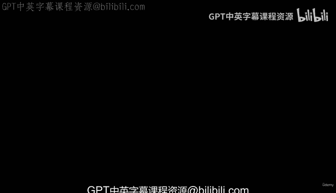
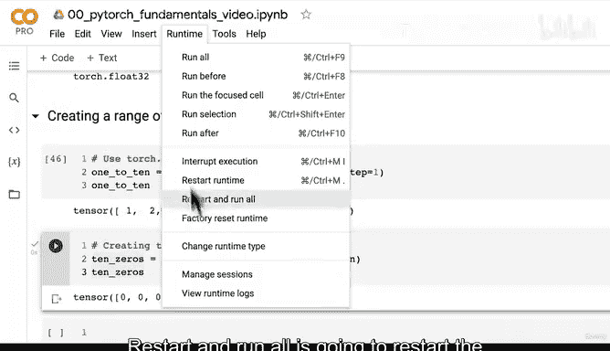
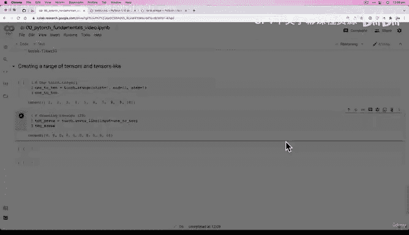
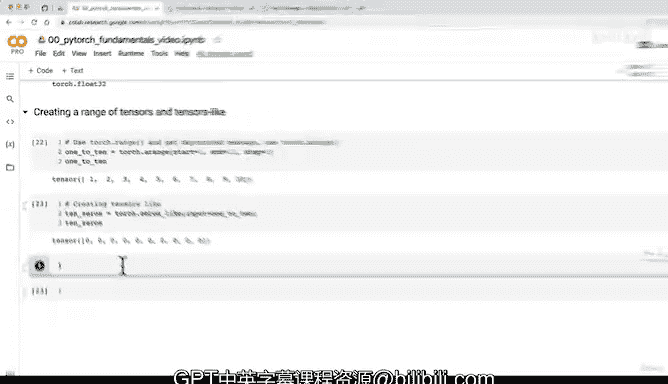

# Daniel Bourke《PyTorch 深度学习｜PyTorch 101 Crash Course For Beginners in 2025》中英字幕 - P20：020_02_016 创建范围张量与相似张量.zh_en - GPT中英字幕课程资源 - BV1kTSKB1E9m

Welcome back。 I hope you took on the challenge of creating a torch tensor of zeros of your own size and ones of your own size。

 But now let's investigate how we might create a range。😊，Of tenses and tensess like。

So these are two other very common methods of creating tensors。So let's start by creating a range。

 So we'll first use torch dot range because depending on when you're watching this video。

 torch dot range may be still in play or it may be deprecated。

If we write in torch dot range right now with the Pytorch version that I'm using。

 which is Torch dot version。Which is torch or pi torch， 1。10。0。

Torch range is deprecated and will be removed in a future release。

 So just keep that in mind if you come across some code that's using torch dot range。

 maybe out of whack。 So the way to get around that is to fix that is to use a range instead。

 And if we just write in torch dot a range。We've got tenors of 0 to 9 because it， of course。

 starts at zero index。 If we wanted one to 10， we could go like this。1，2，3，4，5，6，7，8，9，10。

 and we can go 0， or we go 1，2。10 equals torch a range。Wonderful， and we can also define the step。

 So let's， let's type in some start。 And where can we find the documentation on a range。

 Sometimes in Google Colla， you can press shift tab。 But I find that it doesn't always work for me。

Yeah， you could hover over it， but we could also just go torch a range and look for the documentation。

Torch a range。 So we've got start and step。 Let's see what all of these three do。

And maybe we start at 0， and maybe we want it to go to。1000。

And then we want a step of what should our step be， What's a fun number，77。

So it's not  one to 10 anymore。 but here we go。 We've got start at 0。

77 plus 77 plus 77 plus 77 all the way up to。 it finishes at 1000。

So if we wanted to take it back to one to 10， we can go up here。1，10。

 and the default step is going to be one。Oops， we needed the end to be that it's going to finish at end minus-1。

There we go。 beautiful。 Now， we can also create tenses like。So creating tensess like。So。

Tensors like is say you had a particular shape of a tensor you wanted to replicate somewhere else。

 but you didn't want to explicitly define what that shape should be So what's the shape of one to 10？

1 to1。 Now， if we wanted to create a tensor full of zeroes that had the same shape as this。

 we can use tensor like or zeros like， so 10 zeros。Zeros equals。

 I'm not even sure if I'm spelling zeros right then。 zeros。 Well。

 I might have a typepo spelling zeroes here， but you get what I'm saying is。Torch zeros。😡，Oh。

 torch spell it like that。 That's why I'm spelling it like that。 zeros like one to 10。

And then the input is going to be one to 10。And we have a look at 10 zeros。My goodness。

 this has taken quite the while to run。This is troubleshooting on the fly。

 If something's happening like this， you can try to stop。If something was happening like that。

 you can click run and then stop。 Well， it' is running so fast that I can't click stop。

 If you do also run into trouble， you can go runtime， restart runtime。

 We might just do that now just to show you restart and run all is going to restart the compute engine behind the coab notebook and run all the cells to where we are。

 So let's just see that。😡。

When you start a run runtime， if you're getting errors， sometimes this helps。

There is no set in stone way to troubleshoot arrow。 It's guess and check with this。 So there we go。

 We've created 10 zeros， which is torch zeros like。Our 1 to 10 tens sound。

 So we've got zeros in the same shape as 1 to 10。 So if you'd like to create tensors， use torch and。

Get。Deprecated。Message。Use torch a range instead for creating a range of tensors with a start and end in a step。

 and then if you wanted to create tensors or a tensor like something else。

 you want to look for the like method， and then you put an input which is another tensor and then it'll create a similar tensor with whatever this method here is like in that fashion or in the same shape as your input。

So with that being said， give that a try， create a range of tensesors。

 and then try to replicate that range shape that you've made with zeros。

I'll see you in the next video。

