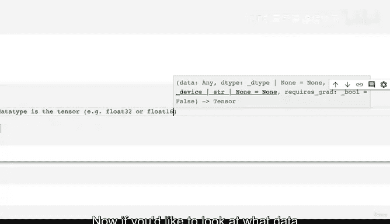
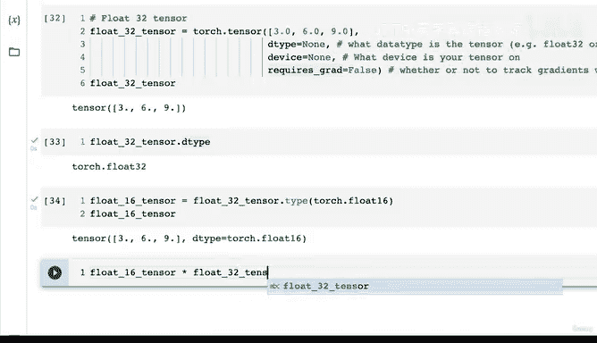

# Daniel Bourke《PyTorch 深度学习｜PyTorch 101 Crash Course For Beginners in 2025》中英字幕 - P21：021_02_017 处理张量数据类型.zh_en - GPT中英字幕课程资源 - BV1kTSKB1E9m

Welcome back。 Let's now get into a very important topic of tensor data types。

 So we've briefly hinted on this before。 And I said that。Let's create a tensor to begin with。

 Float 32。Tenssor， and we're going to go float 32 tensor。It calls tarch。tensor。

 and let's just put in a numbers three。6。9ine if've ever played near for speed underground。

 you'll know where 369 comes from， and then we're going to go D type equals。

 let's just put none and see what happens， Hey， float 32 tensor。Oh， what is the data time。

 F 32 Tensor。t D type？Float 32， even though we put none。

 This is because the default data type in pytorrch， even if specified as none。

 is going to come out as float 32。 What if we wanted to change that to something else， Well。

 let's type in here， Float 16。And now we've got Fat 32 tensor。

 This variable name is a lie now because it's a float 16 tensor。 So we'll leave that as none。

Let's go there。 There's another parameter when creating tenses it's very important， which is device。

So we'll see what that is later on。 And then there's a final one， which is also very important。

 which is requires grad equals。False，Now， this could be true， of course。

 We're gonna set this as false。 So these are three of the most important parameters when you're creating tensors。

 Now， again， you won't necessarily always have to enter these when you're creating tensors because because pi torch does a lot of tensor creation behind the scenes for you。

 So let's just write out what these are Data type is， what data type is the tensor。

E G float 32 or floatlo 16。 Now， if you'd like to look at what data types are available for Pytorch tensors。

 we can go tarch do tensor。

And right up the top unless the documentation changes， we have data types。

 It's so important that data types is the first thing that comes up when you're creating a tensor。

 So we have 32 B floating point，64 B floating point，161632 B complex。 Now。

 the most common ones that you will likely interact with are 32 B floating point and 16 B floating point。

 Now， what does this mean， What do these numbers actually mean。 Well。

 they have to do with precision in computing。 So let's look up that Preion in computing。Precision。

 computer science。So in computer science， the precision of a numerical quantity。

 We're dealing with numbers， right， is a measure of the detail in which the quantity is expressed。

 This is usually measured in bits， but sometimes in decimal digits。

 it is related to precision in mathematics， which describes the number of digits that are used to express a value。

 so。For us， precision is the numerical quantity is a measure of the detail。

 how much detail in which the quantity is expressed。

 So I'm not going to dive into the background of computer science and how computers represent numbers。

 the important takeaway for you from this will be that single precision floating point is usually called float 32。

 which means， yeah， a number contains 32 Bs in computer memory。

 So if you imagine if we have a tensor that is using 32 B floating point。

 the computer memory stores the number as 32 B。 or if it has 16 B floating point。

 it stores it as 16 Bs or 16 numbers representing or 16。

 I'm not sure if a bit equates to a single number in computer memory。

But what this means is that a 32 B tensor is single precision。 This is half precision。 Now。

 this means that it's the default is 32， Fat 32， torched off floatat 32， as we've seen in code。

 which means it's going to take up a certain amount of space in computer memory。

 Now you might be thinking， why would I do anything other than the default。 Well。

 if you'd like to sacrifice some detail in how your number is represented。 So instead of 32 Bs。

 it's represented by 16 Bs。You can calculate faster on numbers that take up less memory。

So that is the main differentiator between 32 bit and 16 bit。 but if you need more precision。

 you might go up to 64 bit。So just keep that in mind as you go forward。 S precision is 32。

 halflf precision is 16。 What do these numbers represent。

 They represent how much detail a single number is stored in memory。There was a lot to take in。😡。

But we're talking about tensor data types。 I'm spending a lot of time here because I'm gonna put a note here。

 Note， Tensor data times is。One of the three big issues with pieytorrch and deep learning。

 or not not issues they're going to be errors that you run into and deep learning。3 big。Errors。

You'll run into with Pytorch and deep learning。 So one is Tensor's not right data type。Two tensors。

 not right shape。 We've seen a few shapes before and three tensors not on the right device。And so。

 in this case。If we had a tensor that was floatat 16 and we were trying to do computations with a tensor that was float 32。

 we might run into some errors。 And so that's the tensors not being in the right data type。

 So it's important to know about the D type parameter here。

 and then tensor is not being the right shape， well， that's once we go onto matrix multiplication。

 We'll see that if one tensor is a certain shape in another tens is another shape。

 and those shapes don't line up。 We're going to run into shape errors。

 And this is a perfect segue to the device。 device equals none by default。 This is going to be CPU。

This is why we are using Google Co Lab because it enables us to have access to， oh。

 we don't want to restart， enables us to have access to a GPU。As I've said before。

 a GPU enables us so we could change this to Kuda。That would be。

 we'll see how to write device agnostic code later on。 But this device。

 if you try to do operations between two tensors that are not on the same device。 So， for example。

 you have one tensor that lives on a GPU for fast computing and you have another tensor that lives on a CPU and you try to do something with them while Pytorch is going to throw you an error。

 And then finally， this last requires grad is if you want pytorch to track the gradients。

 we haven't covered what that is of a tensor when it goes through certain numerical calculations。

 This are a bit of a bombardment。 But I thought I'd throw these in as important parameters to be aware of since we're discussing data type。

 And really， it would be reminisce of me to discuss data type without discussing not the right shape or not the right device。

So， with that being said。Let's write down here。What device is your tensor on？And。

Whether or not to track gradients。With。This tenses operations。So we have a float 32 tensor。 Now。

 how might we change the tensor data type of this， Let's create float 16 tensor。

And we saw that we could explicitly write in floatat 16 tensor， or we can just type in here。

 Float 16 tensor equals float 32 tensor dot type。 And we're going to type in torch dot float 16。

 Why float 16， because well。That's how we define our float ex。 or we could use half。

 So the same thing。These things are the same。 Let's just do half。

Or flights exchange more explicit for me。And then let's check out Float 16 tensor。Beautiful。

 we've converted our float 32 tensor into Fat 16。 So that is one of the ways that you'll be able to tackle the tensors not in the right data type issue that you run into。

 And just a little note on the precision and computing。 If you'd like to read more on that。

 I'm going to link this in here。 And this is all about how computer store numbers。

 So precision in computing。😊，There we go。I'll just get rid of that。Wonderful， so give that a try。

 createate some tensors， research or go to the documentation or Torch dot tensor and see if you can find out a little bit more about De type device and requires grad and create some tensess of different data types。

 play around with whatever the ones you want here and see if you can run into some errors。

 maybe try to multiply two tensesors together。 So if you go float。😊，16 tensor times F 32 tensor。

Give that a try and see what happens。 I'll see you in the next video。

