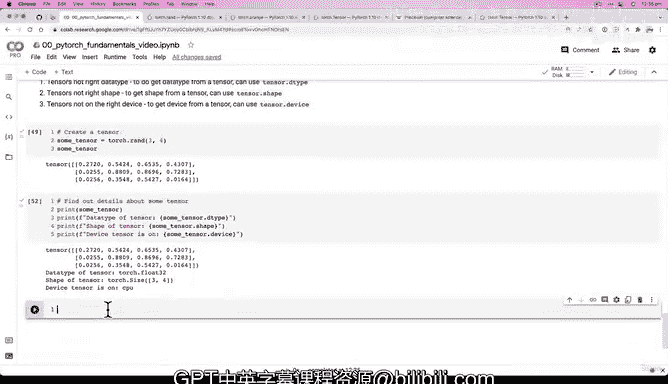

# Daniel Bourke《PyTorch 深度学习｜PyTorch 101 Crash Course For Beginners in 2025》中英字幕 - P22：022_02_018 获取张量属性.zh_en - GPT中英字幕课程资源 - BV1kTSKB1E9m

Welcome back。 In the last video， we covered a little bit about tensor data types。

 as well as some of the most common parameters you'll see passed to the torch dot tensor method。

 And so I issued do the challenge at the end of the last video to create some of your own tensors of different data types。

 And then to see what happens when you multiply a float 16 tensor by a float 32 tensor。Oh， it works。

 And but you've like Daniel， you said that you're gonna have tensors not in the right data type。

 Well， this is another kind of gotcha or caveat of piytorch and deep learning in general。

 is that sometimes you'll find that even if you think something may error because these two tens are different data types。

 it actually results in no error。 But then sometimes you'll have other operations that you do。

 especially training large neural networks， where you'll get data type issues。

 The important thing is to just be aware of the fact that some operations will run an error when your tensors are not in the right data type。

 So let's try another type， maybe we try。A 32 bit integer。So torch dot N 32。

 and we try to multiply that by a float。 Wo what what will happen then。So let's go in 32。

 in 32 tensor equals torch。Dot。Tenssor， and we'll just make it3。

Notice that there's no floats there or no dot points to make it aloat。

369 and D type can be torch and 32。And then int 32 tensor， what does this look like？Typo， of course。

 one of many Mmp 32 tensor。 So now let's go floatat 32 tensor and see what happens。

 Can we get Py toch to throwr an error。And 32 tensor。H。It worked as well。 Or maybe we go into 64。

 What happens here。Still works。 Now， see， this is， again。

 one of the confusing parts of doing tensor operations。 What if we do a long tensor。Toorched along。

 Is this going to still work。Torch has no attribute called long。 That's not a data dive issue。

 I think it's long tensor。Long。这长。Does this work？De type must be torch D type。 h torch， long tenser。

 I could have sworn that this was。Toched at tensa。Oh， there we go。 Torch dot long Tensor。

 That's another word for 64 B。 So what is this saying， CPU tensor， okay。Let's see。

 this is some troubleshooting on the fly here。Then we multiply it。This is a float 32 times long。

 It works。 Okay， so it's actually a bit more robust than what I thought it was。

 But just keep this in mind when we're training models。

 we're probably going run in some errors at some point of our tensess not being the right data type。

 And if Pytoch throws us scenario error saying your tensesors are in the wrong data type。 Well。

 at least we know now how to change that data type or how to set the data type if we need to。

And so with that being said， let's just formalise what we've been doing a fair bit already。

 and that's getting information from tensors。So the three big things that we'll want to get from our tensors in line with the three big errors that we're going to face in neural networks and deep learning is let's copy these down。

I's going to get this。Copy this down below。 So if we want to get some information from tensors。

 How do we check the shape， How do we check the data type， How do we check the device。

 Let's write that down。 So to get information from this， to get。D type。Or let's write data time。😊。

From a tensor。Can use。Ter。Dot D type。 And let's go here to get shape。我没猜测。Can use。Tser dot shape。

And to get。Devicice from a tensor， which device is it on CPU or GPU？Can use。Tensor dot device。

 Let's see these three in action。So if we run into one of the three big problems in deep learning and neural networks in general。

 especially with Pytorch， Tensor is not the right data type。

 Tensor is not the right shape or tensor is not on the right device， let's create a tensor。

try these three out， We've got some tensor es torch。t R and we'll created a 34。

 Let's have a look at what it looks like。There we go。 random numbers of shape 3 and 4。 Now。

 let's find out some details about it。Find out details。About some tensor。

So print or print some tensor。And oops。Didn't want that print。

 and let's format it or make an F string of shape of tensor。Oh， let's do data type first。

 We'll follow that order。Data type of tensor。 And we're going to go， how do we do this。

 Some tensor dot， what。Dot D type， beautiful。And then we're going to print tenors not in the right shape。

 So let's go。Shape。Of tensor。E callss some tensa dot。Shape， oh， I went a bit too fast。

 but we could also use size。Let's just confirm that actually， we'll code that out together。

From my experience。Some tense啊。Dot size。And some tents are。Dot shape result in the same thing。

Is that true。 Oh， function。 Oh， that's what it is。 Some tens dot size is a function。Not an attribute。

There we go。 Which one should you use。 For me， I'm probably more used to using shape。

 You may come across dot size as well， but just realize that they do quite the same thing except one's a function and one's in attribute。

 And attribute is written dot shape without the curly brackets。

 a function or a method is with the brackets at the end。

 So there's a difference between these are attributes here。 De type size。

 We're going to change this to shape。Tentor attributes。 This is what we're getting。

 I should probably write that down。This is tenor。Attributes。That's the formal name for these things。

 And then finally， what else do we want， Tensors， what device are we looking for。

Let's get rid of this。 Get rid of this。And then print F device。Tensor is on By default。

 our tensor is on the CPU。So some Tensor dot device。There we go。 So now we've got our tensor here。

 some tensor。 The data type is a torch float 32 because we didn't change it to anything else and torch float 32 is the default。

 The shape is 34， which makes a lot of sense because we passed in 34 here。

 and the device tensor is on is the CPU， which is of course。

 the default unless we explicitly say to put it on another device。

 All of the tensors that we create will default to being on the CPU rather than the GP。

 and we'll see later on how to put tensors and other things in torch onto a GP。

But with that being said， give it a shot， createate your own tensor。

 get some information from that tensor and see if you can change these around。

 So see if you could create a random tensor， But instead of float 32， it's a float 16。

 And then probably another extracurrula we haven't covered this yet。

 But see how to change the device a Pytorrch tensor is on。😊，Give that a crack。

 and I'll see you in the next video。

