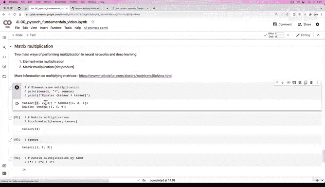

# Daniel Bourke《PyTorch 深度学习｜PyTorch 101 Crash Course For Beginners in 2025》中英字幕 - P24：024_02_020 矩阵乘法（第一部分）.zh_en - GPT中英字幕课程资源 - BV1kTSKB1E9m

Welcome back。 In the last video， we discussed some basic tensor operations such as addition。

 subtraction， multiplication， element wise， division and matrix multiplication。

 But we didn't actually go through what matrix multiplication is。 So now let's start on that。

 more particularly discussing the difference between element Y and matrix multiplication。

 So we'll come down here。 Let's write another heading。😊。

Matrix multiplication。So there's two ways。 Well， two main ways。 Yeah， let's write that。

 two main ways of performing multiplication in neural networks。And deep learning。

So one is the simple version， which is what we've seen， which is element wise。Multipplication。

And number two is matrix multiplication。 So matrix multiplication is actually possibly the most common tensor operation you will find inside neural networks。

 And in the last video， I issued the extra curriculum of having a look at the math fund co page for how to multiply matrices。

 So the first example they go through is element wise multiplication which just means multiplying each element by a specific number。

 And this case we have two times 4 equals 8，2 times 0 equals 0。

2 times 1 equals22 times negative9 equals negative 18。

 But then if we move on to matrix multiplication which is multiplying a matrix by another matrix。

 we need to do the dot product。 So that's something that you'll also hear matrix multiplication referred to as the dot product So these two are used interchangeably matrix multiplication。

😊，dotAnd if we just look up the symbol for dot product。You'll find that it's just a dot。😡。

There we go。 A heavy dot images。There we go， A dot B， So this is vector A dot product B。

A few different options there， but let's look at what it looks like in Plyto code。

But first is a little bit of a difference here。 So how did we get from multiplying this matrix here of 1。

2，3，4，5，6， times 7，8，9，101112， How did we get 58 there？ Well， we start by going。

 This is the difference between element wise and dot product， by the way，1 times 7。

We' going record that down there。 So that's 7。 And then  two times 9。 So this is first row。

 first column，2 times 9。Is 18， and then  three times 11 is 33。

 And if we add those up 7 plus 18 plus 33， we get 58。

 And then if we were to do that for each other element， that's throughout these two matrices。

 We end up with something like this。 So that's what I'd encourage you to go through step by step and reproduce this。

 a good challenge would be to reproduce this by hand with Pytoch code。

But now let's go back and write some Ptor code to do both of these。I just want to link here， as well。

More information on multiplying。Nrices。So I'm going to turn this into markdown。

 Let's first see element wise。Element wise multiplication。

 We're going to start with just a rudimentary example。 So if we have our tensor。

What is it at the moment， It's 1，2，3。 And then if we multiply that by itself。We get 1，4，9。

 but let's print something out so it looks a bit prettier than that。So print。

 and I'm going to turn this into a string。And then。We do that。 So if we print tensar times tensar。

 element wise multiplication is going to give us。Print equals。And then let's do in here。

 tensor times tensor。Let we go like that。Wonderful， so we get one times 1， equals 1。

2 times 2 equals 4，3 times 3 equals 9。 Now， for matrix multiplication。😊。

Pietorrch stores matrix multiplication similar to Torch。mll。In the torch dot Mamo space。

Which stands for Matri multiplication。 So let's just test it out。

Let's just chew the exact same thing that we did here。 Instead of element wise。

 we'll do matrix multiplication on our 1，2，3， Tensor。 What happens here， Oh my goodness，14。 Now。

 why did we get 14 instead of 1，4，9。😊，Can you guess how we got to 14 or think about how we got to 14 from these numbers。

So if for we call back。We saw that for we only multiplying two smaller tensors， by the way，1，2，3。

 this example is with a larger one， but the same principle applies across different sizes of tensesors or matrices。

And when I say matrix multiplication， you can also do matrix multiplication between tenseors。

And in our case， we're using vectors just to add to the confusion。But。😡。

What is the difference here between element wise and dot product。We've got one main edition。

And that is addition。So if we were to code this out by hand。Mattrix multiplication by hand。

We'd have recall that the elements of our tensor are。1，2，3。

 So if we wanted to matrix multiply that by itself， we'd have one times 1。

Which is the equivalent of doing one times 7 in this。Visual example。 And then we'd have plus。

It's going to be2 times 2，2 times 2。 What does that give us。Plus。3 times 3。 What does it give us。

3 times 3。That gives us 14 so that's how we got to that number there。Now。

 we could do this with a for loop。 So let's have a geese at when I say geese， it means have a look。

 That's an Australian colloquialism for having a look。

 But I want to show you the time difference in it might not actually be that bigger difference if we do it by hand versus using something like Matt Ma。

 And that's another thing to note is that if Pytorch has a method already implemented。

 chances are it's a fast calculating version of that method。 So I know for basic operators。

 I said it's usually best to just use the straight up basic operator。

 But for something like matrix multiplication or other advanced operators instead of the basic operators。

 you probably want to use the torch version rather than writing a for loop。

 which is what we're about to do。 So let's go。😊，Value equals 0。

 This is matrix multiplication by hand。 So for I in range La tensor。

 So for each element in the length of our tensor， which is 1，2，3。

 we want to update our value to be plus equal， which is doing this plus reassignment here。

The I element in each tensor。Times the I element， so times itself。And then。

How long is this going to take？Let's now return the value we should get 14。Print。14， there we go。

 So 1。9 milliseconds on whatever CPU that Google coab is using behind the scenes。

 But now if we time it and use the torch method， torch dot map more， equals tensor dot sensor。

 And again， we're using a very small tensor， so。Okay， there we go。

 It actually showed how much quicker it is， even with such a small tensor。 So this is 1。

9 milliseconds。 This is 252 microseconds。 So this is 10 times slower using a four loop。

 Then pi tors vectorized version。 I'll let you look into that。

 If you want to find out what vectorization means。😊。

It's just a type of programming that rather than writing four loops because as you could imagine。

 if this tensor was， let's say， had a million elements instead of just three。

 if you have to loop through each of those elements one by one， that's going to be quite cumbersome。

 So a lot of pinto's functions behind the scenes implement。Optimized functions 2。Perform。

Mathematical operations such as matrix multiplication， like the one we did by hand。

 in a far faster manner， as we can see here。 And that's only with a tensor of three elements。

 So you can imagine the speed ups on something like a tensor with a million elements。

But with that being said， that is the crux of matrix multiplication。 For a little bit more。

 I encourage you to read through this documentation here by mathsf dot com。 Otherwise。

 let's look at a couple of rules that we have to satisfy for larger versions of matrix multiplication。

 because right now， we've done it with a simple tenor。 only 1，2，3。

 Let's step things up a notch in the next video。😊。

