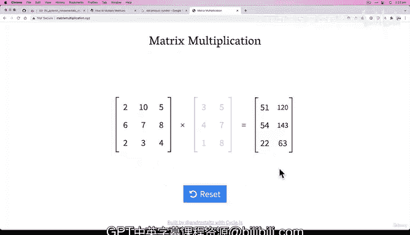

# Daniel Bourke《PyTorch 深度学习｜PyTorch 101 Crash Course For Beginners in 2025》中英字幕 - P25：025_02_021 矩阵乘法（第二部分）：两大核心规则.zh_en - GPT中英字幕课程资源 - BV1kTSKB1E9m

Welcome back in the last video we were introduced to matrix multiplication。

 which although we haven't seen it yet， is one of the most common operations in neural networks and we saw that you should always try to use tors implementation of certain operations。

 except if that basic operations like plus multiplication and whatnot。

 because chances are it's a lot faster version than if you were do things by hand and also it's a lot less code like compared to this。

 this is pretty ver code compared to just hey matrix multiply these two tensors。

 but there's something that we didn't allude to in the last video。

 there's a couple of rules that need to be satisfied when performing matrix multiplication。

 It worked for us because we have a rather simple tensor， but once you start to build larger tensors。

 you might run into one of the most common errors in deep learning。

 I'm going to write this down actually here。This is one to be very familiar with。

 One of the most common errors in deep learning。 We've already alluded to this as well。

 is shape errors。So let's jump back to this in a minute。 I just want to ride up here so。

There are two rules that。Performing or two main rules that performing matrix multiplication。

Needs to satisfy， otherwise we're going to get an error。So number one is the inner dimensions。

Must match。 Let's see what this means。 So if we want to。Have two tensesors of shape three by two。

And then we're going to use the at symbol。Now， you might be asking why the at symbol。 Well。

 the at symbol is another is a like a operator symbol for matrix multiplication。

 So I just wantan to give you an example if we go tensar at。At stands for Matri multiplication。

 We get Tensor 14， which is exactly the same as what we got there。

 Should you use at or should you use mat Ma， I would personally recommend to use mat Ma。

 It's a little bit clearer at sometimes can get confusing because it's not as common as seeing something like mat Ma。

So we'll get rid of that， but I'm just using it up here for brevity。And then we're going to go three。

 two。 Now this won't work。We'll see why in a second。 But if we go 2，3。At and then we have three， two。

This will work。Or， and then we we go the reverse， say threes on the outside， twos here。

 And then we have twos on the inside and threes on the outside。 This will work。 Now， why is this。

 Well， this is the rule number one。 The inner dimensions must match。

 So the inner dimensions what I mean by this is let's create。Torch R will create of size 3，2。

And then we'll get it shape。So we have， say if we created a tensor like this，3，2。

 And then if we created another tensor， Well， let me just show you straight up。Torch dot mapmo。

Torch dot RA， watch this won't work。We're get error。There we go。

 So this is one of the most common errors that you're going to face in deep learning is that matrix 1 and matrix 2 shapes cannot be multiplied because it doesn't satisfy rule number one。

 The inner dimensions must match。And so what I mean by inner dimensions is this dimension multiplied by this dimension。

So say we were trying to multiply。3，2 by3，2。 these are the inner dimensions。Now。

 this will work because why the inner dimensions match。2， three by three，2。2，3。By3， two。

 now notice how the inner dimensions。In know。你 know。Match， let's see what comes out here。

Look at that and now this is where Rule 2 comes into play。😊，two。The resulting。

Matrix has the shape of the outer dimensions。Soir。We've just seen this one，2，3。At 3，2。

Which is at remember， is matrix multiply。So we have a matrix of shape 2，3。

 matrix multiply a matrix of 3，2， the inner dimensions match so it works。

 The resulting shape is what。2，2。Just as we've seen here。We've got a shape of 2，2。 Now。

 what if we did。The reverse， what if we did this one that also will work？Three on the outside。

What do you think is going to happen here？In fact， I encourage you to pause the video and give it a go。

 So this is going to result in a 3，3。Matrix， but don't take my word for it。 Let's have a look，3。

Put two on the inside。And we'll put two on the inside here and then three on the outside。

 What does it give us。 look at that。 A 3，3，1，2，3，1，2，3。 Now， what if we were to change this 2 and 2。

 This can be almost any number you want。 Let's change them both to 10。 What's going to happen。

Will this work？What's the resulting shape going to be。So the inner dimensions match。

What's rule number 2， The resulting matrix has the shape of the outer dimension。

 So what do you think is going to be the shape of this resulting matrix multi。Well。

 let's have a look。It's still 3，3。Wow， now what if we go 10。10 on the outside。

And 10 and 10 on the inside， what do we get。Well we get， I'm not going to count all of those。

 but if we just go shape， we get 10 by 10。Because these are the two main rules of matrix multiplication。

 is if you're running into an error that the mattress multiplication can't work。

 So let's say this was 10。 and this was 7。 Watch what's going to happen。

We can't multiply them because the inner dimensions do not match。 We don't have 10 and 10。

 we have 10 and 7。 But then when we change this so that they match， we get 10 and 10。Beautiful。

 so now let's create a little bit more of a specific example。 We'll create two tensesors。😊。

We'll come down actually， to prevent this video from being too long。

 I've read an error in the word error。 That's funny。

 We'll go on with one of those common errors in deep learning shape errors。 We've just seen it。

 but I'm going to get a little bit more specific with that shape error in the next video。

 Before we do that。 have a look at matrix multiplication。😊，There's a website。

 my other favourite website。 I told you I've got two。 This is my other one。

 Matri multiplication dot X， Y， Z。 This is your challenge before the next video。

 Put in some random numbers here， whatever you want，2，10，5，6，7。8， whatever you want。

 change these around a bit，3。4， oh， that's a 5， not a4。

 And then multiply and just watch what happens。 That's all I'd like you to do。

 Just watch what happens。 And we're going to replicate something like this in Pytorrch code in the next video。

I'll see you there。

