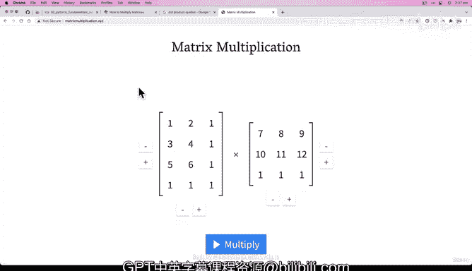

# Daniel Bourke《PyTorch 深度学习｜PyTorch 101 Crash Course For Beginners in 2025》中英字幕 - P26：026_02_022 矩阵乘法（第三部分）：处理张量形状错误.zh_en - GPT中英字幕课程资源 - BV1kTSKB1E9m

Welcome back。 in the last video we discussed a little bit more about matrix multiplication。

 but we're not done there。😊。

We looked at two of the main rules of matrix multiplication。

 and we saw a few errors of what happens if those rules aren't satisfied。

 particularly if the inner dimensions don't match。 So this is what I've been alluding to as one of the most common errors in deep learning。

 and that is shape errors。 because neural networks are comprised of lots of matrix multiplication operations。

 If you have some sort of tensor shape error somewhere in your neural network。

 Chances are you're going to get a shape error。 So now let's investigate how we can deal with those。

 So let's create some tensess。Shapes for matrixtri multiplication。 And I also showed you the website。

 sorry matrixtri multi dot x Y Z。 I hope you had a go at typing in some numbers here and visualizing what happens because we're going to reproduce something very similar to what happens here。

 but with Pytoch code。Shampees for matrix multiplication， we have。Tenssor a。

 let's create this as torchdo tensor。 We're gonna create a tensor with just the elements，1，2。

 all the way up to。Let's just go to 6。 Hey， that'll be enough，6， wonderful。 And then tensor B。

Can be equal to a torch tensor。Of where we're gonna go for this one。 Let's go 7。10。

 this would be a little bit confusing this one， but then we'll go 8，11。And this will go up to 12，9。

12。 So it's the same。Sort of sequence is what's going on here， but they've been swapped around。

 So we've got the vertical axis here instead of 1，2，3，4。 This is just 7，8，9，1011，12。

 But let's now try and perform a matrix multiplication。 How do we do that。

 Torch dot mapm for matrix multiplication， P S Torch also has torch dot M M。

 which stands for matrix multiplication， which is a short version。

 So I'll just write down here so that you know， Tensor A， Tensor B。I'm going to write torch。

mm is the same as torch。mma。It's an alias。For writing less code。

 this is literally how common matrix multiplications are in pytorrch is that they've made torch dot M M as an alias for matmle。

 So you have to type four less characters using torch dot M M instead of matm。

 But I like to write matm because it's a little bit。

 like it explains what it does a little bit more than M M。

So what do you think is going to happen here。It's okay， if you're not sure。

 but what you could probably do to find out is check the shapes of these。

 Does this operation matrix multiplication satisfy the rules that we just discussed。

Especially this one。 This is the main one。 The inner dimensions must match。Well， let's have a look。

Oh， no， mat 1 and mat 2 shapes cannot be multiplied 3 by 2 and 3 by 2。

 This is very similar to what we went through in the last video。

 But now we've got some actual numbers there。 Let's check the shape。torch size 3，2， torch size 3，2。

 Now， in the last video， we created a random tensor and we could adjust the shape on the fly。

 But these tensors already exist。 How might we adjust the shape of these。😊，Well。

 now I'm going to introduce you to another very common operation or tensor manipulation that you'll see。

 and that is the transpose to fix our tensor shape issues。We can manipulate。The shape of one of our。

Tenssors using。Let's go transpose and。All right， here。We're going to see this anyway。

 but I'm going to define it in words。 I transpose switches。The axes or dimensions of a given tensor。

 So let's see this in action。If we go， and the way to do it is you can go tensor。B。Dot T。

 let's see what happens。Let's look at the original tensor be， as well。So dot T stands for transpose。

 and that's a little bit hard to read。 So we might do these on different lines。Tenssively。

Get rid of that。So you see what's happened here。Instead of tensor B， this is the original one。

 We might put the original on top。Instead of the original one， having 7，8，9，101112 down the vertical。

 the transpose has transposed it to 7，8，9 across the horizontal and 101112 down here。 Now。

 if we get the shape of this。Tensor B dot shape。 Let's have a look at that。

 Let's have a look at the original shape。 Tensor B dot shape。What's happened。Oh， no。

 we've still got 3，2。 Oh， that's what I've missed out here。 I've got a typo。 Excuse me。

 I thought I was。You think code that you've written is working。

 but then you realize you've got something as small as just a dot T missing。

 and it throws off your whole train of thought。So you see in these arrows on the fly here。 Now。

 Tensor B is this， but its shape is torched at size 3，2。 And if we try to matrix multiply 3，2 and 3。

2， tensor A and tensor B。We give an error。 why， Because the inner dimensions do not match。

 But if we perform a transpose on tensor B， we switch。The dimensions。Around。

 so now we perform a transpose with Tensor B， dot T。Ts for transpose。 We have。

 this is the important point as well。 We still have the same elements。

 It's just that they've been rearranged。 They've been transposed。

 So now tensor B still has the same information encoded， but rearranged。 So now we have torch size 2。

3。 And so when we try to matrix multiply these we satisfy the first criteria。

 And now look at the output of the matrix multiplication of tensor A and tensor B dot T transposed is 3。

3。And that is because of the second rule of matrix multiplication。

 The resulting matrix has the shape of the outer dimensions。 So we've got 3，2 matrix multiply 2。

3 results in a shape of 3，3。 So let's pretify some of this。 And we'll print out what's going on here。

Just so we know we can step through it because right now， we've just got coal over the place a bit。

 Let's see。Here， the matrix。Mulipplication。Operation works when tensor B。Is。Transpose。

 and in a second， I'm going to show you what this looks like visually。 But right now。

 we've done it with Pyto code， which might be a little confusing。 And that's perfectly fine。

 Matrix multiplication takes a little while and a little practice。 So original shapes is going to be。

Tensor A dot shape。 Let's see what this is and Tensor B。As。Tenssor be dot shape。

But the reason why we're spending so much time on this is because。As you'll see。

 as you get more and more into neural networks and deep learning。

 the matrix multiplication operation is one of the most or if not the most common。

Same shape as above because we haven't changed Tensor A shape。 We've only changed Tensor B shape。

 or we've transposed it。And then inor B dot transpose equals。W one。Tend to be。Dot T dot shape。

 wonderful。 And then if we print。Let's just print out oops。Pt I felt the wrong word there。Print。

We want。 What are we multiplying here。 This is one of the ways。 Remember our motto of visualize。

 visualize， visualize。 Well， this is how I visualize， visualize， visualize things Sha。

 Let's do the at symbol for brrevity。Tensa。And let's get B dot T。t shape。

We'll put on our little rule here in a dimensions must match。And then， print。Let's get the output。

Output， we'll put that on a new line。 The output is going to equal torch dot。

 or our output's already here。 But we're going to rewrite it for a little bit of practice。 Tensor A。

 Tensor B， dot T。And then we can go。Print output。And then， finally。Print。

 let's get it on a new line as well。 The output shape， a fair bit going on here。

 But we're going to step through it。 and it's going help us understand a little bit about what's going on。

That's the data visualizes motto。There we go。 Okay， So the original shapes are what torch size 3。

2 and torch size 3，2。 The new shapes， Tensor A stays the same。 We haven't changed Tensor A。

 And then we have Tensor B dot T is torch size 2，3。Then we multiply a3 by2 by a2 by3。

 So the inner dimensions must match， which is correct。 They do match 2 and 2。

 Then we have an output of tensor at 27，30，33，61，68，75， et cetera。

 And the output shape is what the output shape is the outer dimensions 3，3， Now， of course。

 you could rearrange this， maybe transpose tensor A instead of tensor B。 have a play around with it。

 See if you can create some more errors trying to multiply these two。

 And see what happens if you transpose tensor A instead of tensor B。 That's my challenge。

 But before we finish this video。😊，How about we just recreate what we've done here with。

This cool website matrix multiplication。 So what did we have， We had tensor a， which is  one to 6。

 Let's recreate this。Remove that。 This is gonna be one。2，3，4。5，6。 And then we want to increase this。

 And this is going to be 7，8，9，10，11，12。Is that the right way of doing things。

So this is already transposed just to let you know。

 So this is the equivalent of tensor B on the right here。Tensor B dot T。 So let me just show you。

If we go， tend0 to be。Dot transpose。Which original version was that。

 But we're just passing in the transpo version to our matrix multiplication website。

 And then if we click multiply。This is what's happening behind the scenes with our Pytor code of Mamore。

We have one times 7 plus  two times 10。 Did you see that little flippy thing that it did。

 That's where the 27 comes from。And then if we come down here。What's our first element，27。

 when we matrix multiply them。Then if we do the same thing， the next step。

We get 30 and 61 from a combination of these numbers。 Do it again。33，68。

95 from a combination of these numbers again and again， and finally。

 we end up with exactly what we have here。 So that's a little bit of practice for you to go through is to create some of your own tensess can be almost whatever you want and then try to matrix multiply them with different shapes see what happens when you transpose and what different values you get。

 And if you'd like to visualize it， you could write out something like this。

 that really helps me understand matrix multiplication。 And then if you really want to visualize it。

 you can go through this website and recreate your target tensesors。😊，In something like this。

 I'm not sure how long you can go。But yeah， that should be enough to get started。 So give that a try。

 and I'll see in the next video。

