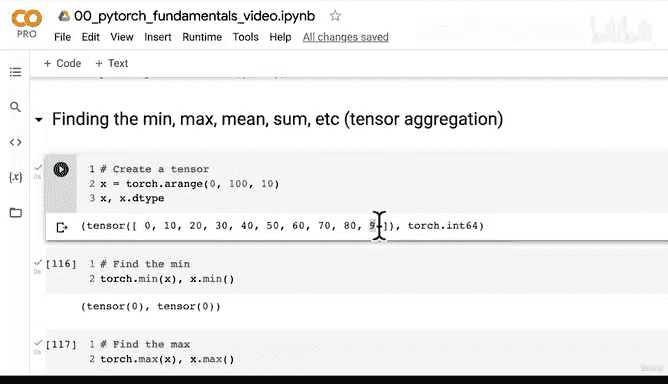

# Daniel Bourke《PyTorch 深度学习｜PyTorch 101 Crash Course For Beginners in 2025》中英字幕 - P27：027_02_023 张量聚合：极值均值求和.zh_en - GPT中英字幕课程资源 - BV1kTSKB1E9m

Welcome back。 In the last few videos， we've covered one of the most fundamental operations in neural networks。

 and that is matrix multiplication。 But now it's time to move on。 And let's cover tensor aggregation。

 And what I mean by that is finding the min max mean， sum etc cetera。

 tensor aggregation of certain tensor values。 So for whatever reason。

 you may want to find the minimum value of the tensor， the maximum value， the mean， the sum。

 what's going on there。 So let's have a look at some few pytorch methods that are inbuil to do all of these。

 And again。😊，If you're finding one of these values。

 it's called tensor aggregation because you're going from what's typically a large amount of numbers to a small amount of numbers。

 So the min of this tensor would be 27。 So you're turning it from 9 elements to one element。

 hence aggregation。So let's create a tensor。😊，Create a tensor。X es Torch dot。

 let's use a range will create maybe a zero to 100 with a step of 10。😊。

Sounds good to me and we can find them in。By going， can we do torchdo men， maybe we can。

or we could also go。X dotmin。And then we can do the same。 Find the max。Torch shot Max。

And X stopt mass。Now， how do you think we might get the average？So let's try it out。Or find the mean。

To on the main。Torch dot mean X Os， so we don't have an X。Is this going to work？What's happened？

Mean input data type should be either floating point or complex D types。 Got long instead。 Ha ha。

 Finally， I knew that error would show its face eventually。

 Remember how I said it right up here that。We've covered a fair bit already。 But right up here。

 some of the most common errors that you're going to run into is tensor is not the right data type。

 not the right shape。 We've seen that with matrix multiplication， not the right device。

 We haven't seen that yet， but not the right data type。 This is one of those times。

 So it turns out that the tensor that we created。 X is of the data type X dot D type。😊，In 64。

 which is long。 So if we go to， let's look up torch tensor。This is where they're getting long from。

 we've seen long before is N64。Where's that or long， Yeah。 So long tensor， That's what it's saying。

 And it turns out that the torch mean function can't work on tensors with data type long。

 So what could we do here。Well， we can change the data type of X。

 So let's go torch mean X type and change it to float 32， or before we do that。

If we go to torch dot mean， is this going to tell us。That it needs。A D type， Art D time。

Optional the desired data type。Does it have F 32？Doesn't tell us。

 So this is another one of those little hidden things that you're going to come across and you only really come across this by writing code is that sometimes the documentation doesn't really tell you explicitly what D type the input should be。

 the input tensor。 However， we find out that with this error message that it should either be a floating point or a complex D type not a long。

 So we can convert it to torch float 32， So all we've done is gone X type as type floatat 32。

 Let's see what happens here。45 beautiful。 And then the same thing if we went， can we do X dot mean。

 Is that going to work as well。😊，same thing。 So if we go X dot type torch dot Fat 32。

 get the mean of that。There we go。 So that is， I knew it would come up eventually。

 a beautiful example of finding the right data type。 Let me just put a note here。😊，Note。

 the torch dot mean。Function requires。A tensor of float。32。

So so far we've seen two of the major errors in Pytorrch。Is data type and shape issues。

 What's another one that we said， sum。 So find the sum。When in the sum。

 we want x dot sum or maybe we just do torch dot sum first。

 keep it in line with what's going on above and x dot sum。

Which one of these should you use like torch do something X or x。 sum personally， I prefer torch。

 maxax， but you'll also probably see me at points write this， it really depends on what's going on。

 I would say a pick whichever style you prefer and because behind the scenes they're calling the same methodology pick whichever style you prefer and stick with throughout your code。

😡，For now。Let's leave it at that。 Tensor aggregation。 There's some finding min Max means some。

 in the next video we're going to look at finding the positional min and max。

 which is also known as Ag max and Arg min or vice versa。 So actually。

 that's a little bit of a challenge for the next video is see how you can find out what the positional。

Min and maxes of this。 And what I mean by that is which index does the max value occur at and which index of this tensor does the min occur at。

 You'll probably want to look into the methods Arg min Torch dot arg min for that one and torch dot arg max for that。

 But we'll cover that in the next video。

我是一的。