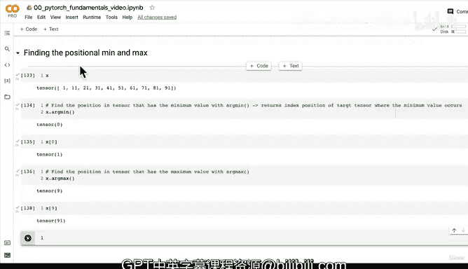

# Daniel Bourke《PyTorch 深度学习｜PyTorch 101 Crash Course For Beginners in 2025》中英字幕 - P28：028_02_024 定位张量极值位置.zh_en - GPT中英字幕课程资源 - BV1kTSKB1E9m

Welcome back。 In the last video， we learned all about tensor aggregation。 and we found the min。

 the max， the mean and the sum。 And we also ran into one of the most common issues in by torch and deep learning and neural networks in general。

 And that was wrong data types。 And so we solved that issue by converting because some functions such as torch dot mean require a specific type of data type as input。

 And we created our tensor here， which was of by default， Torch in 64。 However。

 torch dot mean requires torch dot float 32， we saw that in an error。

 we fixed that by changing the type of the inputs。 I also issued you the challenge of finding。😊。

Finding their're positional。Main and max。And you might have found that you can use the。Ag min。

For the minimum， let's remind ourselves of what x is。X。So this means at Tensar。Index of tensor x。

 If we find the argument that is the minimum value， which is 0。 So at index 0， we get the value。0。

 so that's that 0 there，0 there。 This is an index value， so。This is what Arg Min stands for。

 Find the。Position in tensor。That has the minimum value with argumentrgmin。And then。Returns。

Index position。Of target Tensor。Where the minimum。Value occurs。

Now let's just change x to start from one。Just so。There we go。 So the argman is still position 0。

 position 0。 So this is an index value。 And then if we index on x at the zeroth index， we get one。

 So the minimum value in x is one。 And then the maximum you might guess is find the position in tensar。

That has the maximum value。With ag max。 And it's going to be the same thing。

 except it'll be the maximum， which is which position。Index 9。 So if we go 0，1，2，3，4，5，6，7，8，9。

 and then if we index on x for the9。Element， we get 91 beautiful。 Now， these two are useful for， if。

 yes， you wanted to find the minimum of a tensor。You can just use min。

 but if you sometimes you don't want the actual minimum value。 just want to know where it appears。

 particularly with the Arg max value， This is helpful for when we use the softm activation function later on。

 Now， we haven't covered that yet。 So I'm not going to allude too much to it。

 But just remember to find a positional mini max。 You can use Arg min and arg max。

 So that's all we need to cover with that。 Let's keep going in the next video。

I'll see you then。