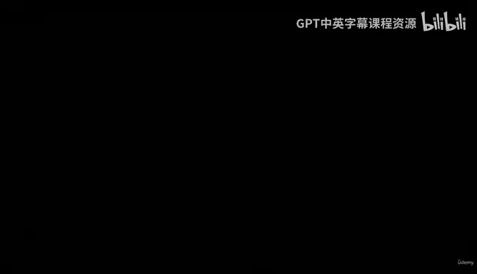
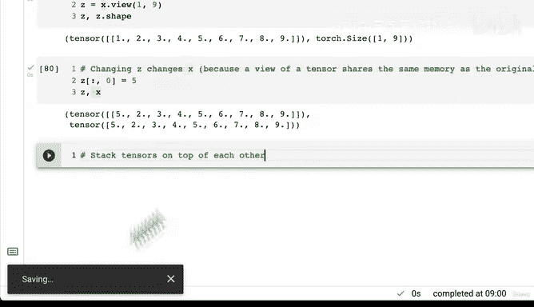
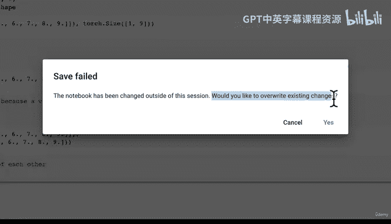
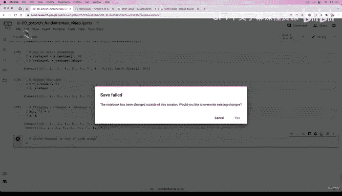
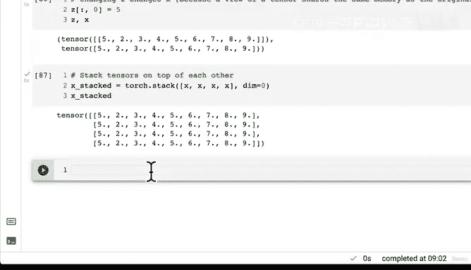
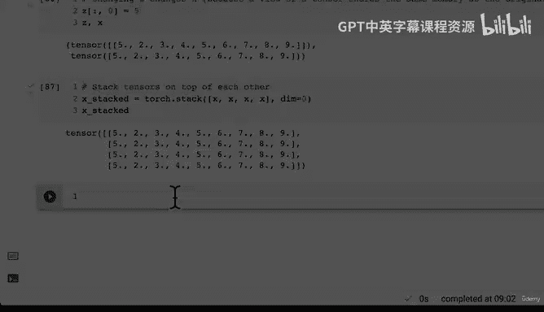

# Daniel Bourke《PyTorch 深度学习｜PyTorch 101 Crash Course For Beginners in 2025》中英字幕 - P29：029_02_025 张量重塑视图堆叠.zh_en - GPT中英字幕课程资源 - BV1kTSKB1E9m

Welcome back so we've covered a fair bit of ground and just to let you know I took a little break after going through all of these and I'd just like to show you how I get back to where I'm at because if we tried to just write X here and press shift and enter。

😊，Because our coabab was disconnected， it's now connecting because as soon as you press any button in collab。

 it's going to reconnect。It's going to try to connect， initialize and then。😊。

X is probably not going to be stored in memory anymore。So there we go。 name X is not defined。

 That's because the coabab state gets reset if you take a break for a couple of hours。

 This is to ensure Google can keep providing resources for free and it deletes everything to ensure that there's no compute resources that are been wasted。

 So to get back to here I'm just going to go restart and run all。

 you don't necessarily have to restart the notebook you could also go we have run all。 yeah。

 we could run before， that'll run every cell before this。

 we could run after we could run the selection， which is this cell here。

 I'm going to click run all which is just going to go through every single cell that we've coded above and run them all However。

 it will also stop at the errors where I've left in on purpose。

 So remember when we ran into a shape error， Well， because this error。 we didn't fix it。

 I left it there on purpose so that we could keep seeing a shape error。

 It's going to stop at this cell So we're going to have to run every cell after the error cell。

So see how it's going to run these now。 They run fine。 And then we get right back to where we were。

 which was X。 So that's just a little tidbit of how I get back into coding。

 Let's now cover reshaping。Stacking。Squeezing and unsqueezing。

 You might be thinking squeezing and unsqueezing。 What are you talking about， Daniel。 Well。

 it's all to do with。Tenses。And you're like are we going to squeeze our tensors。

 give them a hug we're going to let them go by unsqueezing them well let's quickly define what these are so reshaping as we saw before one of the most common errors in machine learning and deep learning is shape mismatches with matrices because they have to satisfy certain rules so reshape reshapes and input tensor to a defined shape。

😊，Now， we're just defining these things in words right now。

 but we're going to see it in code in just a minute。 There's also view。

 which is return a view of an input tensor。Of certain shape。

 But keep the same memory as the original tensor。 So we'll see what view is in a second。

 Reshaping and view are quite similar， but a view always shares the same memory as the originalsor。

 It just shows you the same tensor， but from a different perspective， a different shape。

 And then we have stacking， which is combine multiple tensors on top。Of each other。

 this is a V stack for vertical stack or side by side。😊，Haagetack。Let's see what different types of。

Torch stacks there are again， this is how I research different things If I wanted to learn something new。

 I would search torch something Sta concatenate our sequence of tenses along a new dimension。 Okay。

 so maybere not Ht or v stack we can just define what dimension we'd like to combine them on I wonder if there is a torch v stack。

Torch v stack， there there is， and is there a torch Htack for horizontal stack？😊。

There is a Htack beautiful so we'll focus on just the plain stack if you want to have a look at VStack。

 it'll be quite similar to what we're going to do with stackck and saying with Htack again this is just words for now we're going to see the code in a minute。

😊，So there's also a squeeze which removes all one dimensions， I'm going to put one in code。

Dimenssions from a tensor， we'll see what that looks like and then there's unsqueze， which。

Adds a one dimension。To our target tensor。And then finally， there's Purmute， which is。Return a view。

Of the import。With。Dimenssions permuted， so swapped。In a certain way。So a fair few methods here。

 but essentially the crust of all of these， the main point of all of these is to manipulate our tensors in some way to change their shape or change their dimension because again one of the number one issues in machine learning and deep learning is tensor shape issues so let's start off by creating a tensor。

And have a look at each of these。 Let's create a tensor。 And then we're going to just import torch。

 We don't have to。 but this will just enable us to run the notebook directly from this cell if we wanted to。

 instead of having to run everything above here。So let's create another X torch dot。

A range because range is deprecated， I'm just going to add a few code cells here。

So that I can scroll and that's in the middle of the screen there。 Beaiful。

 So let's just make it between1 and 10， nice and simple。

 And then let's have a look at X and X dot shape。 What does this give us。😊，Okay， beautiful。

 So we've got the numbers from one to 9。 Our tensor is of shape， Torch size 9。😊。

Let's start with reshape。 So how about we add。An extra dimension。

So then we have X reshaped equals x dot reshape。 Now。

 a key thing to keep in mind about the reshape is that the dimensions have to be compatible with the original dimensions。

 So if we're going to change the shape of our original tensor with a reshape and we try to change it into the shape 1。

7。 Does that work with the number 9。Well， let's find out， hey。

 let's check out x reshad and then we'll look out x reshad dot shape。😊，What's this going to do？Oh。😮。

Why do we get an error there？😡，Well， it's telling us here。

 this is what Pyto is actually really good at。 is giving us errors for what's going wrong。 We have 1。

7 is invalid for input size of 9。 why is that？ Well。

 we're trying to squeeze 9 elements into a tensor of one times 7 into 7 elements。

 But if we change this to 9， what do we get。So do you notice what just happened here。

 we just added a single dimension， See the single square bracket with the extra shape here。

 What if we wanted to add2， can we do that， No， we can't。 Why is that？ Well， because 2。

9 is invalid for input size 9 because2 times 9 is what，18。

 So we're trying to double the amount of elements without having double the amount of elements。

So if we change this back to one， what happens if we change these around9，1？😊，What does this do。

 a little bit different there。 So now， instead of adding one on the first dimension or the zeroth dimension。

 because Python is 0 indexed， we added it。On there。First dimension。

 which is giving us a square bracket here if we go back。

So we add it to the outside here because we've put the one there。

 and then if we wanted to add it on the inside。😊，We put the one on the outside there。

 so then we've got the torch size，9， one。 Now let's try change the view。Change the view。

 So just to reiterate， the reshape has to be compatible with the original size。

 So how about we change this to  one to 10 So we have a size of 10 and then we can go 52。

 What happens there。It's compatible because five times 2 equals 10。

 And then what's another way we could do this。 How about we make it。Up to 12。

So we've got 12 elements， and then we can go3。4our。My code cells's taken a little while run here。

Then we go back to9。😡，Just so we've got the。Original。They。Oops。They're going to be incompatible。

 so this is another thing。 This is good。 We're getting some errors on the fly here。

 Sometimes you'll get saved failed with Google Coab。😊，And automatic a saving failed。

 what you can do to fix this is just either keep coding。😊。

Keep running some cells and collab will fix itself in the background， or restart the notebook。

 close it and open again。So we've got size nine or size eight， sorry incompatible。😡，But this is good。

 You're seeing the errors that come up。On the fly rather than me sort of just telling you what the errors are。

 you're seeing them as they come up for me。 I'm trying to live code this and this is what's going to happen when you start to use Google Coabab and subsequently other forms of Jupyter notebooks。

 But now let's get into the view。So we can go Z equals， let's change the view of x。

V will change it to 19 and then we'll go Z。And then Z dot shape。We get the same thing here。

 So view is quite similar to reshape。 Remember， though。

 that a view shares the memory with the original tensor。 So Z is just a different view of x。

 So Z shares the same memory as what X does。 So let's exemplify this。 So changing Z changes X。

Because a view of a tensor shares the same memory。As the original input。So let's just change Z。

 let' change the first element by using indexing here， so we're targeting one。

 we'll set this to equal 5， and then we'll see what Z and x equal。Yeah， so we see we've got Z。

 the first one here。 We changed the first element， the 0th element to 5。

 and the same thing happens with x。 We change the first element of Z。 So because Z is a view of x。

 the first element of x changes as well。 But let's keep going。

 How about we stack some tensesors on top of each other。

 And we'll see what the stack function does in torch。 So stack tensesors。On top。

Of each other and I'll just see if I press command S to save。

 maybe we'll get this fixed or maybe it just will fix itself。

Nobook is saved。Unless you've made some extensive changes that you're worried about losing。

 you could just download this notebook， so file， download and upload it to coLab。

 but usually if you click yes。

It sort of resolves itself。Yeah， there we go。 All changes safe。

 So that's beautiful troubleshooting on the fly。 I like that， so。😊，X stack。

 let's stack some tenses together， equals torch stack。Let's go Xxx。

 because if we look at what the dock string of stack is。

Will we get this in coab or we just go to the documentations？Yeah， so list。

 it takes a list of tensesors and concatenateates a sequence of tenses along a new dimension。

 and we define the dimension。 The dimension by default is 0。 That's a little bit hard to read for me。

 So tensess Dm equals 0。 If we come into here， the default dimension is 0。

 Let's see what happens when we play around with the dimension here。 So we've got four x's。

 And the first one will' just do it by default x stack。Okay， wonderful。

 so they're stacked vertically。 Let's see what happens if we change this to one。

They're rearranged a little and stack like that。 What happens if we change it to 2。

 Does it have a dimension2， Oh， we can't do that？ Well。

 that's because the original shape of X is incompatible with using dimension 2。

So the only real way to get used to what happens here by stacking them on top of each other is to play around with the different values for the dimension。

So Dm0， Dm 1， they look a little bit different there。

 now they're on top of each other and so the first zeroth index is now the zeroth tensor and then same with two being there。

3 and so on， but we'll leave it at the default。And there's also VStack and Htack。😊。

I'll leave that to you to practice those， but I think from memory V stack is using dimension equals0 or Ht is like using dimension equals1。

 I may have those back the front。 you can correct me if I'm wrong there Now let's move on。

We're going to now have a look atSqueze and unsqueeze。😡。

So actually I'm going to get you to practice this， so see if you can look up torch squeezeze and torch unsqueeze and see if you can try them out。

 we've created a tensor here we've used reshape and view and we've used stack the usage of squeezequee and unsqueeze is quite similar so give that a go and to prevent this video from getting too long。

 we'll do them together in the next video。😊。

