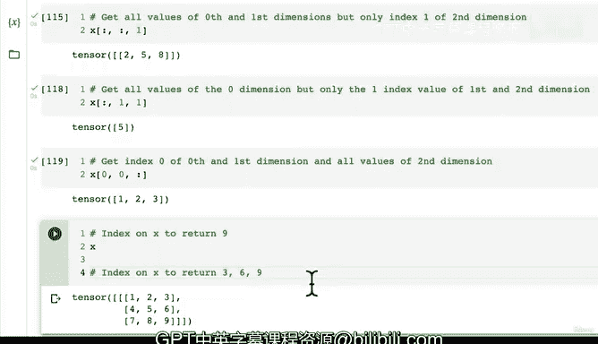

# Daniel Bourke《PyTorch 深度学习｜PyTorch 101 Crash Course For Beginners in 2025》中英字幕 - P31：031_02_027 张量数据索引.zh_en - GPT中英字幕课程资源 - BV1kTSKB1E9m

Welcome back。 In the last video， we covered squeezing， unsqueezing and permuting。

 which I'm not going to lie these concepts are quite a lot to take in。

 but just so you're aware of them。 remember， what are they working towards They're helping us fix shape and dimension issues with our tensors。

 which is one of the most common issues in deep learning and neural networks。

 and I issued you the little challenge of changing a value of x original to highlight the fact that permute returns a different view of the original tensor and a view in pitorrch shares memory with that original tensor。

 So if we change the value at 00，0 of x original to， in my case，728，21，8。

 it happens the same value gets copied across to X permuted。😊，So with that being said。

 we looked at selecting data from tensesors here and this is using a technique called indexing。

 So let's just rehash that because this is another thing that can be a little bit of a hurdle when first working with multidimensional tensesors。

 so let's see how we can select data from tensesors with indexing。So if you've ever done indexing。

Indexing。With Ptorrch is similar to indexing with nuy。

 If you've ever worked with nuumppy and you've done indexing， selecting data from arrays。

 Numpy uses an array as its main data type。 Pytorrch uses tensors。 It's very similar。

 So let's again start by creating a tensor。And again。

 I'm just going to add a few code cells here so I can make my screen right in the middle。

 Now we're going to import torch。Again， we don't need to import torch all the time just so you can run the notebook from here later on。

 X es torch dot。Let's create a range again， just nice and simple。

This is how I like to work out the fundamentals too is just create the small range， reshape it。

 and the reshape has to be compatible with the original dimension。 So we'll go 1，3，3。

 And why is this because torche range is going to return us9 values because it's from the start here to the end minus1 and then one times 3 times 3 is what is 9。

 So let's have a look X。X dot shape。Beautiful， so we have 1，2，3，4，5，6，7，8，9 of size 1。

 So we have this is the outer bracket here。Which is going to contain all of this。

 And then we have three， which is this one here，1，2。ree。And then we have three， which is one，2，3。

 Now let's work with this。Let's index on our new tenon， So let's see what happens when we get x0。

 This is going to index on the first bracket。So we get this one here。

So we've indexed on the first dimension here， the zeroth dimension on this one here。

 which is why we get what's inside here。And then let's try again， let's index。On the middle bracket。

So， dimension。1。So weve got to go x and then0， and then 0。Let see what happens there。Now。

 is this the same as going x 0，0。It is。 There we go。 So it depends on what you want to use。

 Sometimes I prefer to go like this。 So I know that I'm getting the first bracket and then the zeroth version of that first bracket。

 So then we have these three values here。 Now， what do you think was's going to happen if we index on the third dimension or the second dimension here。

Well， let's find out。 So let's index on the most。In a bracket。Which is last dimension。So we have x0。

Z， zero， what number is this going to give us back？

Of x0 on the0th dimension gives us back this middle tensor。

 and then of x 00 gives us back the0th index of the middle tensor。 If we go， x 0，0。

0 is going to give us the0th。Tensor， the zeroth index and the zeroth element。A lot to take in there。

😡，But what we've done is we've just broken it down step by step。 we've got。

This first0 targets this outer bracket and returns us all of this。 and then 0。

0 targets this first because of this first0。 and then the0 here targets this。And then if we go 0，0，0。

 we target this， then we target this， and then we get this back because we are getting the zeroth index here。

 So if we change this to one， what do we get back。2， and if we change these all to one。

 what will we get， This is a bit of our。Trivia here。Or a challenge。So we're going 1，1，1。

I'll see what happens。 Oh， no。 Did you catch that before I ran the code。

 I did that one quite quickly。 We have index 1 is out of bounds。 Why is that， Well。

 because this dimension is only one here， So we can only index on the 0。

 That's where it gets a little bit confusing， because this says  one。

 Butca it's only got 0 dimension。 We can only index on the 0th dimension。 But what if we do0，1，1。

What does that give us 5， beautiful。 So I'd like to issue you the challenge of how about getting。

Number nine， how would you get number nine so rearrange this code to get number nine That's your challenge Now I just want to show you as well is you can use。

You can also use， you might see this， the semicolon to select。All。Of a target dimension。

 So let's say we wanted to get all of the zeroth dimension， but the zeroth element from that。

We can get 1，2，3。 And then let's say we want to say。

 get all values of the zeroth and first dimensions， but only index one of the second dimension。 Oh。

 that was a mouthful， but get all values of zeroth and first dimensions。

But only index one of second dimension。 So let's break this down step by step。

 We want all values of0th and first dimensions， but only index  one of the second dimension。

 we press enter， shift enter2，5，8。 So what did we get there，2，5，8。 Okay。

 so we've got all elements of the0th and first dimension。 But then so which will return us。

This thing here。 But then we only want 2，5，8， which is the first element。

Here of the second dimension， which is this three there。So quite confusing。 But with some practice。

 you can figure out how to select almost any numbers you want from any kind of tensor that you have。

 So now let's try again， get all values of the zero dimension。But only the one index。

Value of the first and second dimension。 So what might this look like， Let's break it down again。

 So we' come down here X， and we're going to go all values of the zero dimension because 0 comes first。

 and then we want only the one index value of the first and only the one index value of the second。

What is this going to give us 5 Oh， we selected the middle tensor。

 So really this line of code is exactly the same as this line of code here。

 except we've got the square brackets on the outside here because we've got this semico there。

 So if we change this to a0。😊，We remove that， but because we've got the semicolon there。

 we've selected all the dimensions so we get back。😊，square bracket there， something to keep in mind。

 Finally， let's just go one more。 So get index 0 of。0ero and first dimension。

And all values of second dimension。So， x 0，0。So zeroth index of 0 and first dimension，0，0。

 and all values of the second dimension。 What have we just done here。We've got tenor，1，2， three。

Lovely。This code again is equivalent to what we've done up here。This has a semicolon on the end。

 but what this line explicitly says without the semicolon is， hey。

 give us all the values on the remaining dimension there。

So my challenge for you is to take this tensor that we've got here and。Index on it to return 9。

 So I'll write down here。Index on x to return9。 So if we have a look at x。As well as index on。

X to return 3，6，9。 So these values here。 So give those both a go， and I'll see you in the next video。

