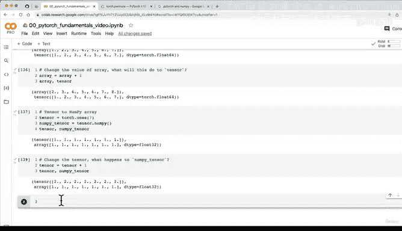

# Daniel Bourke《PyTorch 深度学习｜PyTorch 101 Crash Course For Beginners in 2025》中英字幕 - P32：032_02_028 PyTorch张量与NumPy.zh_en - GPT中英字幕课程资源 - BV1kTSKB1E9m

Welcome back。 How'd you go。 Did you give the challenge go。

 I finished the last video with issuing the challenge to index on x to return 9 and index on x to return 3。

6，9。 And here's what I came up with。 Again， there's a few different wayss that you could approach both of these。

 But this is just what I've found。 So because X is 1，3，3 of size。 Well， that's his dimensions。😊。

If we want to select 9， we need0， which is this first outer bracket to get all of these elements。

 and then we need two to select this bottom one here。

 and then we need this final two to select the second dimension of this bottom one here and then for 3。

6，9， we need all of the elements in the first dimension， all of the in the zeroth dimension。

 all of the elements in the first dimension， and then we get two which is。This3，6，9 set up here。

 So that's how I would practice indexing。 Start with whatever shape tensor you like。

 create something like this。 and then see how you can。

Write different indexing to select whatever number you pick。So now let's move on to the next part。

Which is pietorrch。Tenss and numpy。So nuumpy is a popular scientific。

 very popular Py to actually requires nuumpy when you install Py toch P scientific。Python。

Nummerical computing library。 that's a bit of a mouthful。And because of this。Pine torch。

As functionality to interact with it。So quite often。You might start off with。

 let's change this into markdown， you might start off with your data because it's numerical format。

 you might start off with data in Numpy。Numpie array。

Want in Py torch Tensor because your data might be represented by Numppyy because its started in Numppyy but say you want to do some deep learning on it and you want to leverage pi torches。

 deep learning capabilities Well you might want to change your data from nupyy to a piy torch tensor and Py torch has a method to do this which is torch。

Fromumpy which will take in an ND array which is NumpI's main data type and change it into a torch tensor we'll see this in a second and then if you want to go from P torch Tensor to nuy because you want to use some sort of nuumpy method well the method to do this is torch do Tensor and you can call dot nuumpy on it。

But this is all just talking about in words。 Let's see it in action。 So nuy array to tensor。

 Let's try this out first。 So we'll import torch so we can run this cell on its own and then import。

NumpI as N， a common naming convention for Numpy， we're going to create an array in Numpy。

And we're going to just put one to eight。A range， and then we're going in to go tensor。

Equals torch from nuumpy。Because we want to go from Numpy array to a torch tensor。

 so we use from Numpy and then we pass in array and then we have array and tensor。Wonderful。

 so there's our Numpy array and our torch tensor with the same data。

 But what you might notice here is that the D type for the tensor is torch dot float 64。 Now。

 why is this， It's because Numpys default data type。De type。Is floatat 64， whereas Tensor。

 What have we discussed before， What's Pi Torch's default data type。Float 64 Well。

 that's not Pi Torchs default data type if we were to create torch a range 1。0 to 8。0。😊，By default。

 Pto is going to create it in。Float 32。 So just be aware of that。

 if you are going from nupy to pi torch， the default nupy data type is floatat 64。

 and Pytorrch reflects that data type when you use the from Npy method。 I wonder if there's a D type。

 Can we go D type equals torch dot float 32。Takes no keyword， okay？

But how could we change the data type here or we could go type torch Float 32？Yeah。

 that will give us a tensity type of floatat 32 instead of floatloat 64 beautiful。

 but I'll just keep that there so you know。Warning when converting。From Namai。Pie to watch。

Pinetorrch reflects。Numpys default data type。Of Fat 64， unless specified。Otherwise。

 because what have we discussed？When you're trying to perform certain calculations。

 you might run into a data type issue， so you might need to convert the type from Float 64 to Float 32。

Now。Let's see what happens， What do you think will happen if we change the array？

We change the value of an array。Well， let's find out。So change the value of array。 The question is。

 what will this do to。Tensa。Because we've used the from nu P method。

 do you think if we change the array？The tensor will change。

So let's try this array equals array plus one。So we're just adding one to every value in the array。

Now， what is the array and the tens are going to look like？Aha。So array。

 we only change the first value there or sorry， we change every value because we have  one to 7。

 Now it's 2，3，4，5，6，7，8。 We change the value from the array。

 It doesn't change the value of the tensor。So that's just something to keep in mind。

 If you use from nuumpy， we get a new tensor in memory here。 So the original。

 the new tensor doesn't change if you change the original rate。

 So now let's go from tensor to nuumpy。If you wanted to go back to Numpy， Tensor to Numpy array。

 so we'll start with the tensor， we could use the one we have right now。

 but we're going to create another one but we'll create one of ones just for fun。One rhymes with fer。

 nuy tensor equals。How do we go to Numpy？Well we have torch。tensor。Numpy。

 so we just simply call nuumpy on here and then we have Tensor and nuy tensor。

 What data type do you think the nuumpy tensor is going to have because we've returned it to Nump？

Py Todge's default data type is。Float 32。 So if we change that to Ny。

 what's going to be the D type of the nuy tensor。Numbietenser。d type。

It reflects the original D type of what you set the tensor as。

 So just keep that in mind if you're going between Pytorrch and nuy default data type of nu is float 64。

 whereas the default data type of pytorr float 32， so that may cause some errors if you're doing different kinds of calculations Now what do you think iss going to happen if we went from our tensor to an array。

 if we change the tensor。Change the tensor。What happens to？Numpie。T so。

So we go tensa equals tensa plus1。And then we go nuie tensor。we'll get tener as well。

So our tensor is now all twos because we added one to the ones， but our nuy tensor remains the same。

 remains unchanged， so this means they don't share memory。

So that's how we go in between pietorrch and nuumpy if you'd like to look up more I'd encourage you to go pietorrch and nuumpy。

So warm up nuumpy beginner， there's a fair few tutorials here on Pytorrch because Numpy is so prevalent。

They work pretty well together。 So have a look at that。 There's a lot going on there。

There's a few more links I'd encourage you to check out。

 but we've covered some of the main ones that you'll see in practice。With that being said。

 let's now jump into the next video where we're going to have a look at the concept of reproducibility and if you'd like to look that up I'd encourage you to search Py towards reproducibility and see what you can find otherwise I'll see in the next video。

😊。

