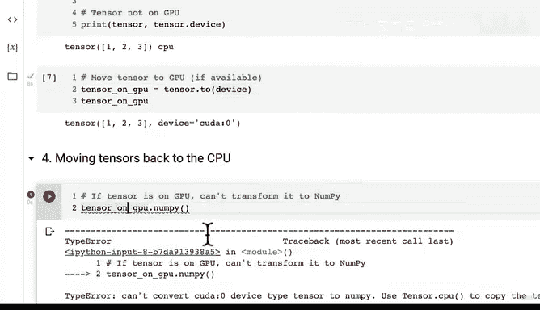

# Daniel Bourke《PyTorch 深度学习｜PyTorch 101 Crash Course For Beginners in 2025》中英字幕 - P35：035_02_031 设备无关代码与GPU张量迁移.zh_en - GPT中英字幕课程资源 - BV1kTSKB1E9m

Welcome back。 In the last video， we checked out a few different options for getting a GPU and then getting Pytorch to run on the GPU。

 And for now， we're using Google Coab， which is the easiest way to get set up because it gives us free access to a GPU faster ones if you set up with coab Pro。

 and it comes with Pytorch automatically set up to use the GPU if it's available。

 So now let's see how we can actually use the GPU。 So。😊，To do so。

 we'll look at putting tensesors and models。On the GPU。So the reason。

We want our tensors slash models on the GPU。Is because using a GPU results in faster computations and if we're getting our machine learning models to find patterns and numbers。

 GPUs are great at doing numerical calculations and the numerical calculations we're going to be doing are tensor operations like we saw above。

So the tensor operations， well we've covered a lot。三回气啊。Tensor operations， there we go。

lyulating tensors， Tensor operations。 So if we can run these computations faster。

 we can discover patterns in our data faster。 We can do more experiments。

 and we can work towards finding the best possible model for whatever problem that we're working on。

😊，So let's see。We'll create a tensor as usual。😊，Create a Tensor now the default is on the CPU。So。

 ten0 sum equals。Torch dot tensor。 and we'll just make it a nice， simple 1，1，2，3， and。

Let's right here。 Tensor， not on GPU will print out Tensor。 And this is where we can use。

We saw this parameter before， device。Can we pass it in here？Device equals CPU。

Let's see what this comes out with。There we go。 So if we print it out， Tenor 123 is on the CPU。

 but even if we got rid of that。Deeve parameter by default。 It's going to be on the CPU。 Woful。

 so now。Pytoch makes it quite easy to move things to and I'm saying two for a reason。

 to the GPU or to even better the target device。 So if the GPU is available。

 we use Kuda if it's not it uses CPU this is why we set up the device variable。 So let's see。😡。

Move Tensor to GPU if available。Tenensor on GPU equals。Tensor。

2 device Now let's have a look at this Tensor on GPU。So this is going to shift。

The tensor that we created up here to the target device。Wonderful， look at that。 So now our tensor 1。

2，3 is on device Ka 0。 Now， this is the index of the GPU that we're using because we only have one is's going to be at index 0。

 So later on， when you start to do bigger experiments and work with multiple GPUus。

 you might have different tensors that are stored on different GPUus。 But for now。

 we're just sticking with one GPU keeping it nice and simple。😊。

And so you might have a case where you want to move actually。

 the reason why we set up device agnostic code is again， this code would work if we run this。

 regardless if we had， so it won't error out， but regardless if we had a GPU or not this code will work。

 So whatever device we have access to whether it's only a CPU or whether it's a GPU。

 this Tensor will move to whatever target device， but since we have a GPU available， it goes there。

You'll see this a lot， this two method。Moves， tenses and it can be also used for models we're going to see that later on。

 so just keep two device in mind。And then you might want to。

 for some computation such as using NumpI， NumpI only works with the CPU。

 so you might want to move tensors back to the CPU。Moving tensors back to the CPU。

So can you guess how we might do that's okay， if you don't know。We haven't covered a lot of things。

 but I'm going to challenge you anyway， because that's a fun part of thinking about something。

 So let's see how we can do it。😊，Once write down， if Tensor is on GPU， can't transform it to NI。

So let's see what happens if we take our tensor on the GPU and try to go nuy。What happens？

Well we get an error。 So this is another huge error。

 Remember the top three errors in deep learning or pi toch。 there's lots of them。

 but number one shape errors， number two， data type issues。

 And with pitorch number3 is device issues。 So can't convert co to0 device type tensor to nu pi。

 So nupy doesn't work with the GP use tensor dot CPU to copy the tensor to host memory first。

 So if we call tensor do CPU， it's going to bring our target tensor back to the CPU。

 And then we should be able to use it with nu Pi。 so。To fix。The GPU Tensor with numpy。Issue。

 we can first set it。To the CPU。So Tensor back on CPU。Eals Tensor on GPU do CPUU。

 we're just taking what this said here。 That's the beautiful thing about Pi torch is very helpful error messages。

 and then we're going to go nu Pi。And then if we go Tensor back on CPU， is this going to work。

 let's have a look。Oh， of course， its not because I talked it wrong。And I've typed it again twice。

 third time， third times a charm。There we go。 Okay。

 so that works because we've put it back to the CPU first before calling nu Pi。

 And then if we refer back to our tensor on the GPU。Because we've reasciated this again。

 we got typoicalore， classic。Because we've reassigned Tensor back on CPUU。

 our Tensor on GPU remains unchanged。So that's the four main things about working with Piytorrch on the GPU。

 There are a few more tidbits， such as multiple GPUus。 but now you've got the fundamentals。

 We're going to stick with using one GPU。 And if you'd like to later on once you've learned a bit more research into multiple GPUus。

 Well， as you might have guessed， Pytorch has functionality for that 2。

 So have a go at getting access to a GPU using coabab， check to see if it's available。

 set up device agnostic code， create a few dummy tensors and just set them to different devices。

 See what happens if you change the device parameter。

Run a few errors by trying to do some nuy calculations with tensors on the GPU and then bring those tensors on the GPU back to Numpy and see what happens there。

So， I think we've covered。I think we've reached the end of the fundamentals。

 We've covered a fair bit。 Introuction to tensors， the min Maxs。

 a whole bunch of stuff inside the introduction to tensors， finding the positional min Maxs。

 reshaping， indexing， working with tensors and nuy reproducibility。

 using a GPU and moving stuff back to the GPU far out。 Now， you're probably wondering， Daniel。

 we've covered a whole bunch。 What should I do to practice all this。 Well， I'm glad you asked。

 let's cover that in the next video。😊。