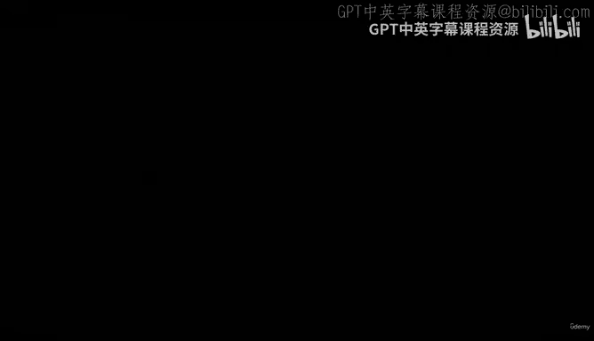
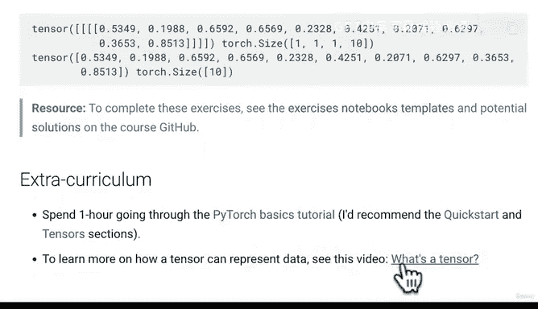

# Daniel Bourke《PyTorch 深度学习｜PyTorch 101 Crash Course For Beginners in 2025》中英字幕 - P36：036_02_032 PyTorch基础练习与拓展.zh_en - GPT中英字幕课程资源 - BV1kTSKB1E9m

Welcome back and you should be very proud of yourself right now we've been through a lot but we've covered a whole bunch of pieytorrch fundamentals。

 these are going to be the building blocks that we use throughout the rest of the course but before moving on to the next section I'd encourage you to try out what you've learned through the exercises and extra curriculum。

😊，Now， I've set up a few exercises here based off everything that we've covered。

 If you going to learn Pytor do Io， go to the section that we're currently on。

 This is going to be the case for every section， by the way。

 So just keep this in mind is we're working on pytorch fundamentals。 Now。

 if you go the pyt fundamentals notebook。 This is going to refresh but that if you scroll down to the table of contents at the bottom of each one is going to be some exercises and extracur。

 So these exercises here。 such as documentation reading。

 because a lot you've seen me refer to the pytorch documentation for almost everything we've covered a lot。

 but it's important to become familiar with that。 So exercise number one is read some of the documentation。

 Exse number two is create a random tensor with shape 7，73。

 perform a matrix multiplication on the tensor from2 with another random tensor。

 So these exercises are all based off what we've covered here。 So I don'd encourage you。😊。

To reference what we've covered in whichever notebook you choose could be this learn Pytoch。

 could be going back through the one we've just coded together in the video。

So I'm going to link this here。Exercises。See exercises for this notebook。Here呀。

So then how should you approach these exercises， So one way would be to just read them here。

 and then in coab or go file new notebook。Wait for the notebook to load。

Then you could call this00 pie torch exercises or something like that。And then。

You could start off by importing torch。And then away you go for me。

 I'd probably set this up on one side of the screen， this one up on the other side of the screen。

 and then I just have the exercises here。So number one。

 I'm not going to really write much code for that， but you could have documentation reading here。😊。

And then so this encourages you to read through Torch。tensor。Go through there。For 10 minutes or so。

 and then for the other ones， we've got create a random tensor with shape 7，7。

So just comment that out。 So torch R 7，7。And there we go。Some are as easy as that。

 some are a little bit more complex as we go throughout the course。

 these exercises are going to get a little bit more in depth as we've learned more。

But if you'd like an exercise template， you can come back to the Github。

 This is the home for all of the course materials。 You can go into extras。 and then exercises。

 I've created templates for each of the exercises。 So Pyto fundamentals exercises。

 if you open this up， This is a template for all of the exercises。 So you see there。

 create a random tensor with shapepe 7，7。 These are all just headings。

 And if you'd like to open this in coab and work on it。 How can you do that。 Well。

 you can copy this link here。 come to Google coabab， We'll go file， open notebook。😊，Gitthub。

You can type in the link there， click search。What's this going to do， Boom。

 Pto fundamentals exercises。 So now you can go through all of the exercises。

 This will be the same for every modular on the course and test your knowledge now。😊。

It is open book you can use。The notebook here， the ones that we've coded together。

But I would encourage you to try to do these things on your own first。 if you get stuck。

 you can always reference back。 And then if you'd like to see an example solutions。

 you can go back to the extras。 There's a solutions folder as well。

 And that's where the solutions live。 So the fundamental exercise solutions。 But again。

 I would encourage you to try these out。 at least give them a go before having a look at the solutions。

😊，So just keep that in mind at the end of every module there's exercises an extra curriculum。

 the exercises will be code based， the extra curriculum is usually like reading based。

 so spend one hour going through the Pytage basic tutorial。

 recommend the quick start in tensor sections and then finally to learn more on how a tensor can represent data watch the video what's a tensor which we refer to throughout this。

 but massive effort on finishing the pyt Funda section I'll see you in the next section。😊。

