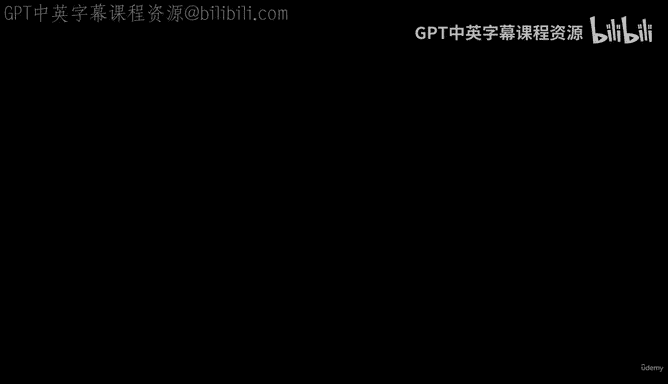
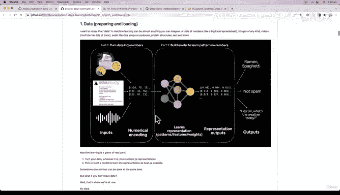
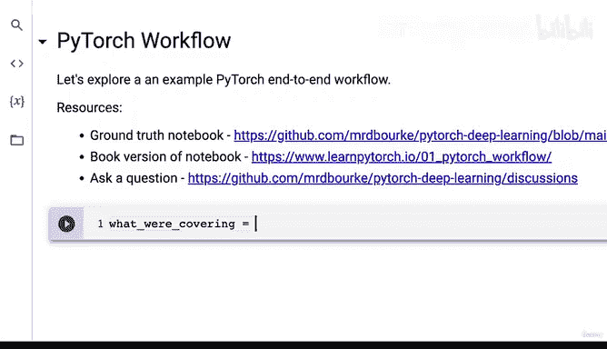
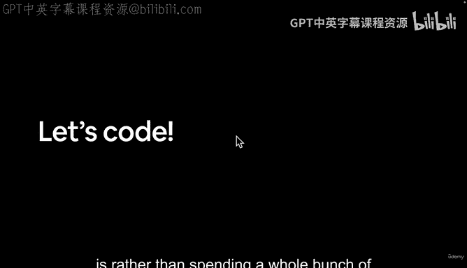
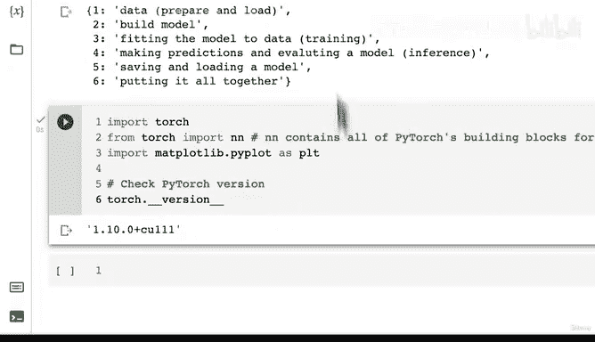
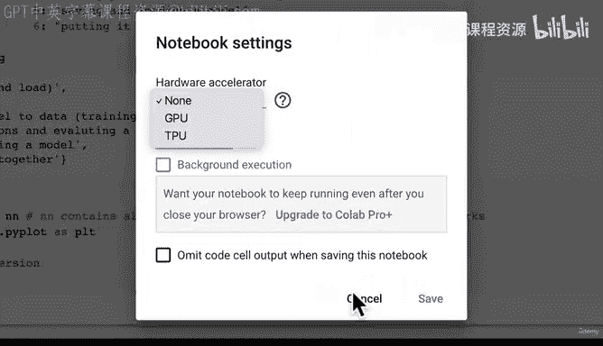
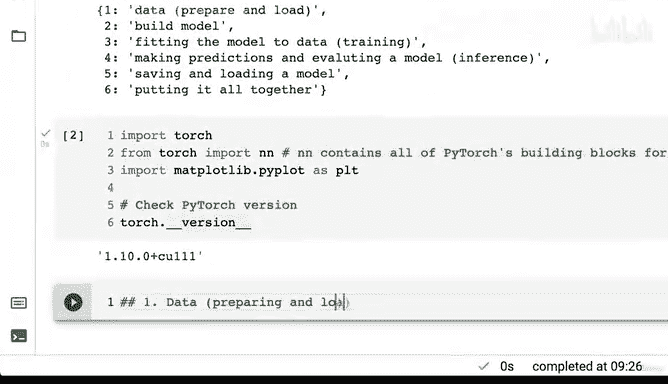

# Daniel Bourke《PyTorch 深度学习｜PyTorch 101 Crash Course For Beginners in 2025》中英字幕 - P38：038_03_002 环境配置与内容规划.zh_en - GPT中英字幕课程资源 - BV1kTSKB1E9m

Alrighty， let's get hands on with some code。'm going to come over to coabab dot research dot Google dot com。

 You may already have that bookmarked。😊，And I'm going to start a new notebook。

 So we're going to do everything from scratch here。We'll let this load up。

I'm just going to zoom in a little bit。刘如峰。And now I'm going to title this O1。Pie torch， workflow。

 And I'm going to put the video。Anding on here so that you know that this notebooks from the video。

 Why is that， Because in the course resources， we have the original notebook here。

 which is what this video notebook is going to be based off。 You can refer to this notebook。

As reference for what we're going to go through， It's got a lot of pictures and beautiful text annotations。

 We're going to be focused on the code in the videos。 And then， of course。

 you've got the book version of the notebook as well。

 which is just a different formatted version of this exact same notebook。

 So I'm going link both of these up here。 So let's write in here。😊。

Pietorrch， workflow。And let's explore an example， Pytorch end to end。Workflow。

And then I'm going to put the resources， so。Ground truth。Noebook。We go here。

And I'm also going to put the book version。Book version。Of notebook。And finally。Ask a question。

Which will be where at the discussions page。Then we'll go there。Beautiful。

 let's turn this into markdown。 So let's get started。

 Let's just jump right in and start what we're covering。😊。

So this is the trend I want to start getting towards is rather than spending a whole bunch of time going through keynotes and slides。

 I'd rather we just code together。 And then we explain different things as they need to be explained。

 because that's what you're going to be doing if you end up writing a lot of Pytorrch is you're gonna be writing code and then looking things up as you go。

 So I'll get out of these extra tabs。 I don't think we need them。

 Just these two will be the most important。 So what we're covering。

 let's create a little dictionary so we can check this if we wanted to later on。

 So referring to our Pytorrch workflow， at least the example one that we're going go through。😊。

Which is just here。So we're going go through all six of these steps， maybe a little bit of each one。

 but just to see it going from this to this。 That's what we're really focused on。

 And then we're going to go through the rest of the course， like， really。Dig deep into all of these。

 So what we're covering number one is data preparing and loading。

 Ner two is we're going to see how we can build a machine learning model in Pytorrch or a deep learning model。

And then we're going to see how we're going to fit our model to the data。 So this is called training。

 So fit is another word， As I said in machine learning。

 There's a lot of different names for similar things。 kind of confusing。

 but you'll pick it up with time。So we're going to once we've trained a model。

 we're going to see how we can make predictions and evaluate those predictions， evaluating a model。

 if you make predictions， it's often referred to as inference。😊，I typically say making predictions。

 but inference is another very common term。 And then we're going to look at how we can save and load a model。

And then we're going to put it all together。 So a little bit different from the visual version we have of the Pytorch workflow。

 So if we go back to here。I might zoom in a little。There we go。

 So we're gonna focus on this one later on， improve through experimentation。

 We're just gonna focus on the getting data ready， building a model， fitting the model。

 evaluating model， save and reload。 So we'll see this one more like in depth later on。

 But we'll hint at different things that you can do for this while we're working through this workflow。

😊，And so let's put that in here。And then if we wanted to refer to this later。

 we can just go what we're covering。Oh this is going to connect， of course。Beautiful。

 so we can refer to this later on if we wanted to。 and we're going start by import torch。

We're going to get pi torch ready to go import N N。 So I'll write a note here。

 and N we haven't seen this one before， but we're going to see a fair few things that we haven't seen。

 but that's okay。 We'll explain that as we go。 So N N contains all of pi tors building blocks。😊。

For neural networks。And how would we learn more about torchnn Well， if we just go to torch。nn。

Here's how I'd learn about it， Pytodge documentation。😊，Beautiful， look at all these。

 These are the basic building blocks for graphs。 Now， when you see the word graph。

 it's referring to a computational graph， which is， in the case of neural networks。

 let's look up a photo of a neural network。😊，Images。This is。A graph。 So if you start from here。

 you're going to go towards the right。 And there's gonna be many different pictures。 So you have。

 this is a good one。 input layer。 You have a hidden layer， hidden layer 2， output layer。

 So torch N N comprises of a whole bunch of different layers。 So you can see layers， layers， layers。

 And each one of these。 you can see input layer。 hidden layer 1， hidden layer 2。

 So it's our job as data scientists and machine learning engineers to combine these torch dot N N building blocks to build things such as these。

 Now it might not be exactly like this but that's the beauty of。😊。

Pytorch is that you can combine these in almost any different way to build any kind of neural network you can imagine。

And so， let's keep going。That's towards Gen N。 We're going to get hands on with it rather than just talk about it。

And we're going to need Mapl Libb because what's our other motto。

 our data explorelorers's motto is visualize， visualize， visualize。

 and let's check our Pi Toch version。😊，Pto version。Torch dot version。 So this is just to show you。

 you'll need。At least this version。 So 1。10 plus Kudar 1，1，1。

 That means that we've got C U stands for Kuda。 That means we've got access to Kudar。

 We don't have a GPU on this run time yet， because we haven't gone to。

GPU， we might do that later。

So if you have a version that's lower than this， say 1。8。0， you'll want p to 1。

10 at least if you have a version higher than this， your code should still work。

But that's about enough for this video。 We've got our。Workflow， ready to set up our notebook。

 our video notebook。 We've got the resources。 We've got what we're covering。

 We've got our dependencies。 Let's in the next one， get started on。😊，1， data， preparing and loading。

I'll see you in the next video。