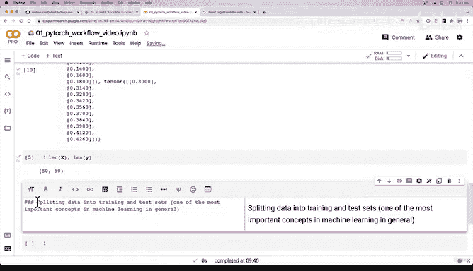
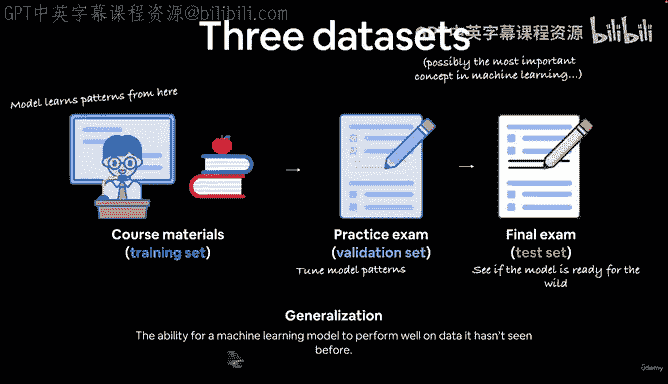
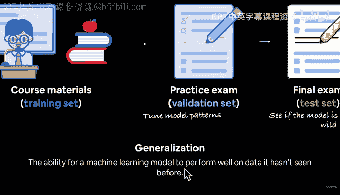
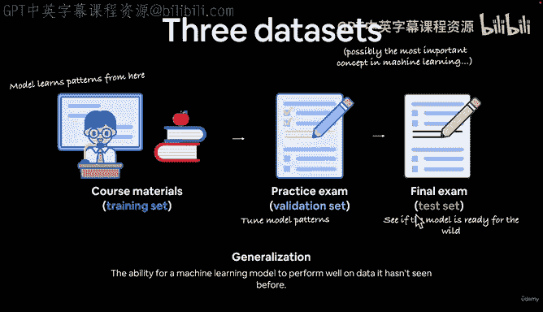
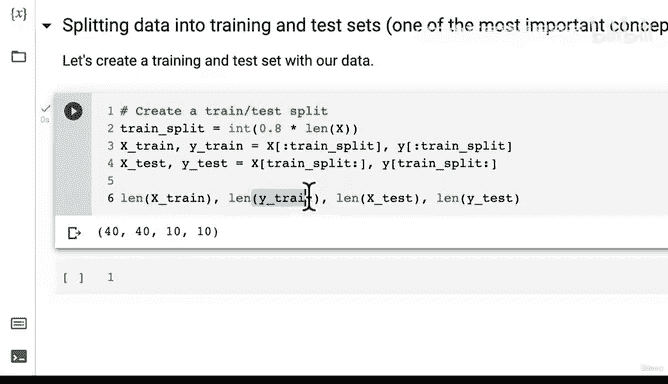
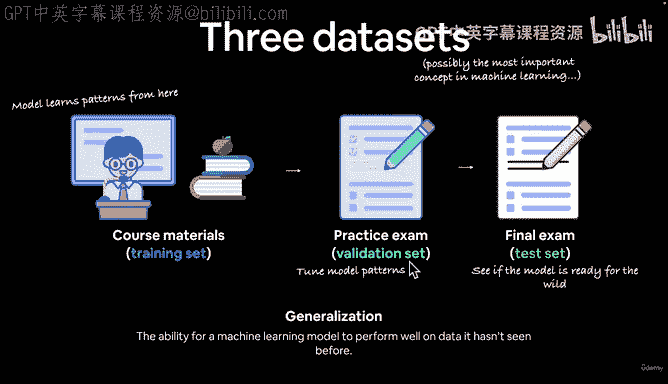
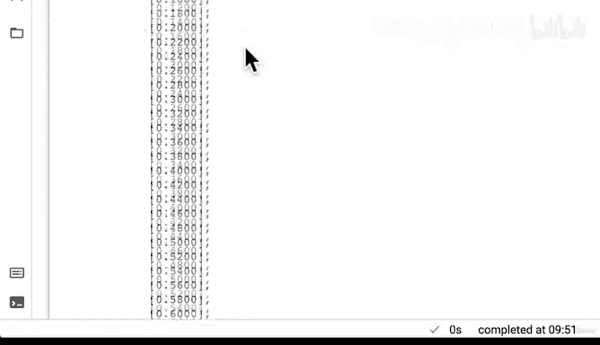

# Daniel Bourke《PyTorch 深度学习｜PyTorch 101 Crash Course For Beginners in 2025》中英字幕 - P40：040_03_004 划分训练集与测试集.zh_en - GPT中英字幕课程资源 - BV1kTSKB1E9m

Welcome back In the last video， we created some numbers on a page using the linear regression formula with some known parameters。

 Now there's a lot going on here， but that's all right。

 we're going to keep building upon what we've done and learn by doing。

 So in this video we're going to cover one of the most important concepts in machine learning in general。

 So splitting data into training and test sets。😊。

One of the most important concepts in machine learning。In general。Now。

 I know I've said this already a few times。One of the most important concepts。 But truly。

 this is possibly。In terms of data， this is probably the number one thing that you need to be aware of。

 And if you've come from a little bit of a machine learning background。

 you probably well and truly know all about this。 But we're going to recover it anyway。

 So let's jump in to some pretty pictures。 Oh， look at that one。 speakingea of pretty pictures， but。

That's not what we're focused on now。 We're looking at the three data sets。

 and I've written down here possibly the most important concept in machine learning。

 because it definitely is， from a data perspective。So the course materials。

 imagine you're at university。So this is going to be the training set。

 and then you have the practice exam， which is the validation set， then you have the final exam。

 which is the test set， and the goal of all of this is for generalization， so let's step back。😊。

So say you're trying to learn something at university or through this course。

 you might have all of the materials， which is your training set。

 so this is where our model learns patterns from。And。😊，Then to practice what you've done。

You might have a practice exam So the mid semesterster exam or something like that。

 Now that's to see if you're learning the course materials well。 So in the case of our model。

 we might tune our model on this plastic exam So we might find that on the validation set our model doesn't do too well。

 and we adjust it a bit。 and then we retrain it and then it does better before finally at the end of semester。

 the most important exam is your final exam and this is to see if you've gone through the entire course materials and you've learn some things。

 now you can adapt to unseen materials。 and that's a big point here。

 we're going to see this in practice is that when the model learns something on the course materials it never sees the validation set or the test set。

😊，So say we started with 100 data points。 You might use 70 of those data points for the training material。

 You might use 15% of those data points。 So 15 for the practice。

 And you might use 15 for the final exam So this final exam is just like if you're at university learning something is to see if。

 hey， have you learnt any skills from this material at all。

 Are you ready to go into the wild into the quote， unquote， real world。

 And so this final exam is to test your model's generalization， because it's never seen this data is。

Let's define generalization is the ability for a machine learning model or a deep learning model to perform well on data it hasn't seen before because that's our whole goal right。

 we want to build a machine learning model on some training data that we can deploy in our application or production setting and then more data comes in that it hasn't seen before and it can make decisions based on that new data because of the patterns it's learned in the training set。

So just keep this in mind， three data sets， training， validation test， and if we jump in。

To the B Pi Torch book。We've got split data。So we're going to create three sets， or in our case。

 we're only going to create two a training and a test。 Why is that。

 because you don't always need a validation set。There is often a use case for a validation set， but。

The main two that are always used is the training set and the testing set and how much should you split Well。

 usually for the training set， you'll have 60 to 80% of your data。 If you do create a validation set。

 you'll have somewhere between 10 and 20。 And if you do create a testing set。

 it's a similar split to the validation set， you'll have between 10 and 20%。

 So training always testing always validation often， but not always。So with that being said。

 I'll let you refer to those materials if you want。 But now let's create。

A training and test set with our data。 So we saw before that we have 50 points。 We have X and Y。

 We have one to one ratio。 So one value of x relates to one value of y。

 And we know that the split now for the training set is 60% to 80%。 and the test set is 10 to 20%。

 So let's go with the upper bounds of each of these，80% and 20%， which is a very common split。

 actually 8020。So， let's go。Create a train test split。 And we're going to go train split。

We'll create a number here so we can see how much so we want an integer of 0。8。

 which is 80% of the length of x。 What does that give us， Tra split should be about 40 samples。

 Wonder。 So we're going to create 40 samples of x and 40 samples of Y。

 Our model will train on those 40 samples to predict what。😊，The other 10 samples。

 So let's see this in practice。 So x train。Y train equals x。

 And we're going to use indexing to get all of the samples up until the train split。

 That's what this colon does here。 So hey， X up until the train split， Y up until the train split。

 and then for the testing oh。Thanks for that。 Auto correctr coab。 I didn't actually need that one。

X test。Why test equals。X， and then we're going to get everything from the train split onwards。

So the index onwards， that's what this notation means here。And why。

From the train split onwards as well。 Now， there are many different ways to create a train and test split。

 ours is quite simple here， but that's because we're working with quite a simple data set。

 One of the most popular methods that I like is Psyit learns train test split。

 We're gonna to see this one later on。 It adds a little bit of randomness into splitting your data。

 But that's for another video。 just to make you aware of it。So let's go length。X train。

We should have 40 training samples to。How many testing samples。Length X test and length Y test。

Wonderful，40，40，10，10， because we have training features。😊，Training labels， testing features。

 testing labels。 So essentially， what we've created here is now a training set。 We've split our data。

Training set could also be referred to as training split。

 Yet another example of where machine learning has different names for different things。 So set。

 split， same thing。 Tra， split， test split。 This is what we've created。 Remember。

 the validation set is used often， but not always because our data set is quite simple。

 We're just sticking with the necessities。 Tra and test。 But keep this in mind。

One of your biggest， biggest， biggest hurdles in machine learning will be creating proper training and test sets。

 So it's a very important concept。 with that being said。

 I did issue the challenge in the last video to visualize these numbers on a page。

 We haven't done that in this video。 So let's move towards that next。

 I'd like you to think of how could you make these more visual。

These are just numbers on a page right now。Maybe。

Matpltlibb can help。Let's find out， I。