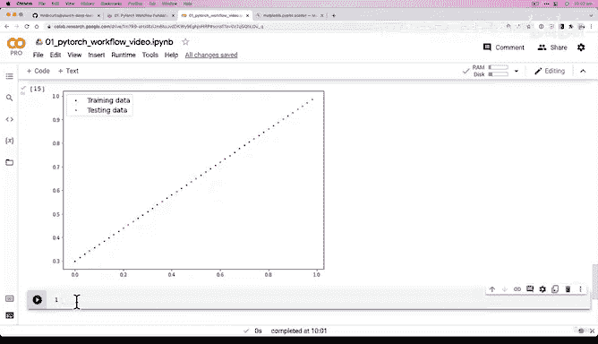
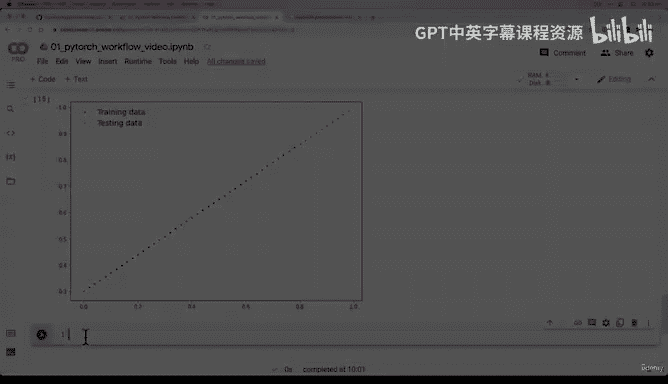

# Daniel Bourke《PyTorch 深度学习｜PyTorch 101 Crash Course For Beginners in 2025》中英字幕 - P41：041_03_005 构建数据可视化函数.zh_en - GPT中英字幕课程资源 - BV1kTSKB1E9m

Hey， hey， hey， welcome back。In the last video， we split our data into training and test sets。

 And now， later on， we're going to be building a model to learn patterns in the training data to relate to the testing data。

 But as I said， right now， our data is just numbers on a page。 It's kind of hard to understand。

 You might be able to understand this， but I prefer to get visual。 So let's write this down。

 How might we。Beta visualize our datata。And I'll put a capital here。 So we're grammatically correct。

 And this is where the data explorers。Motto comes in。Visualize。Visualize。Visualizing， ha ha。Right。

 so if ever you don't understand a concept， one of the best ways to start understanding it more for me is to visualize it。

 So let's write a function to do just that。 We're going to call this plot predictions。

 We'll see why we call it this later on。 That's the benefit of making these videos is that I've got a plan for the future。

 Although it might seem like I'm winging it。 There is a little bit of behind the scenes happening here。

 So we'll have the train data， which is our。😊，X train。 and then we'll have the train labels。

 which is our Y train。 And we'll also have the test data。 Yeah， that's a good idea。 X test。

 and we'll also have the test labels equals。Oh， why test。 excusecuse me。

 He's looking at too many x's there and then the predictions。

 Now we'll set this to none because we don't have any predictions yet。But as you might have guessed。

 we might have some later on。 So we'll put a little dock string here so that we're being nice and pythonic。

 So plot training data。Test data。And compares predictions。Nice and simple。Nothing too outlandish。

 And then we're going to create a figure。😊，This is where Matplot Libb comes in。Ploot figure。

 and we'll go fig size equals 107， which is my favorite hand in poker。

 and will plot the training data in blue also happens to be a good dimension for a map plot lib plot。

 plot dot Scar。Train data。And creating a scatter plot here， we'll see what it does in a second。

CoourWe're going to give this a color of B for blue， that's what C stands for in mappllib scatter。

 we'll go size equals 4 and label equals training data。Now。

 where could you find information about this scatter function here。We've got command shift space。

 Is that going to give us a little bit of a dock string？

Or sometimes if command lot spaces is not working， you can also hover over this bracket。

 I think you can even hover over this。There we go。 But this is a little hard for me to read like it's。

 it's there， but it's got a lot going on。 X， Y， S， C， C map。 I， I just like to go。Ma plot lib。

Scattle。There we go。We've got a whole bunch of information there。

 a little bit easier to read for me here。😊，And then you can see some examples beautiful。

 So now let's jump back into here。So in our function plot predictions。

 we've taken in some training data， test data， we've got the training data plotting in blue。

 what colour should we use for the testing data？How about green， I like that idea。

 P on scatter test data。 Greens my favorite color。What's your favorite color？C equals G。

 you might be able to just plot it in your favourite color here。Just remember， though。

 it'll be a little bit different from the videos。 And then we're going to call this testing data。

 So just the exact same line as above， but with a different set of data。 Now。

 let's check if there are predictions。 So are there predictions。 So if predictions。Is not none。Let's。

Ploot the predictions。Plot the predictions。If they。Exist。So plot， scatter， test data。

 And why are we plotting。The test data。 Remember， what is our scatter function。

 Let's go back up to here。 It takes in X and Y。So our predictions are going to be compared to the testing data labels。

 so that's the whole game that we're playing here we're going to train our model on the training data and then to evaluate it we're going to get our model to predict the Y values as with the input of X test and then to evaluate our model we compare how good our model's predictions are。

 in other words predictions versus the actual values of the test data set。

We're going to say this in practice。Rather than just talk about it。

 so let's do our predictions in red。😊，And。Label equals， predictions， wonderful。

So let's also show the legend because， I mean， we're legends。 So we could just put in a mirror here。

 Now I'm kidding。 The legend is going to show our labels on the mat plot Li but plot。

 So prop equals size and prop stands for properties well。It may or remain hot。

 I just like to think it does。 That's how I remember it。 So we have a beautiful function here。😊。

To plot our data。Should we try it out？Remember， we've got hard coded inputs here。

 So we don't actually need to input anything to our function。

 We've got our train and test data ready to go。 If in doubt， run the code。 Let's check it out。

 Do we make a mistake in our plot predictions function。😊，You might have caught it。Hey， there we go。

 Bea。 So because we don't have any predictions， we get no red dots。

 But this is what we're trying to do。 We've got a simple straight line。

 You can't get a much more simple data set than that。😊。

So we've got our training data in blue and we've got our testing data in green。

 So the whole idea of what we're going to be doing with our machine learning model is we don't actually really need to build a machine learning model for this。

 we could do other things but machine learning is fun。 So we're going to take in the blue dots。

 There's quite a pattern here right， This is the relationship we have an x value here and we have a y value。

 So we're going to build a model to try and learn the pattern of these blue dots。

 so that if we fed our model our model， the x values of the green dots。

 Could it predict the appropriate y values for that because remember these are the test data set So pass our model X test to predict Y test。

😊，So blue dots is input。Green dots as the ideal output。 This is the ideal output。

 A perfect model would have red dots over the top of the green dots。 So that's what we。

 we will try to work towards。 Now， we know the relationship between x and Y。 How do we know that。

 Well we set that up above here。 This is our weight and bias。 We created that line。

 Y equals weight times x plus bias， which is the simple version of the linear regression formula。

 So M X plus C， you might have heard that in high school algebra。 So gradient plus intercept。😊。

That's what we've got。With that being said， let's move on to the next video and build a model。 Oh。

 this is exciting。 I'll see you there。😊。

