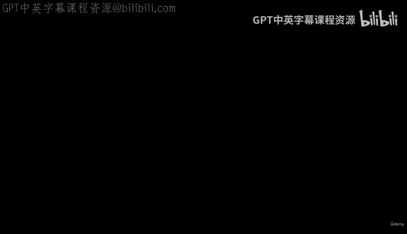
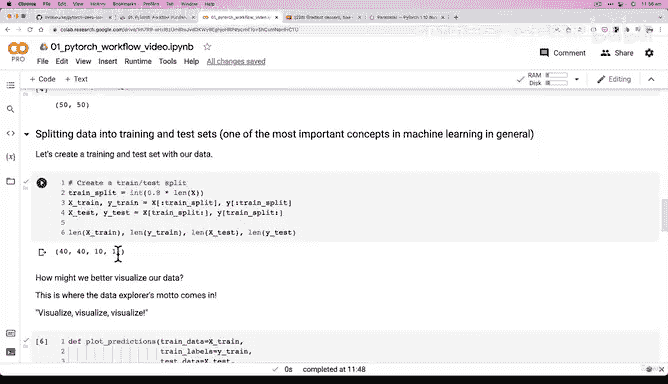
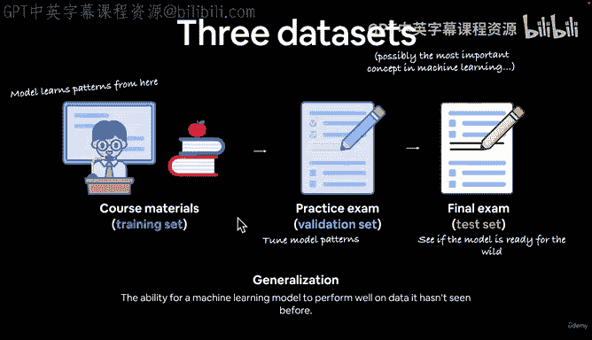
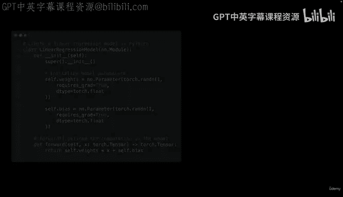
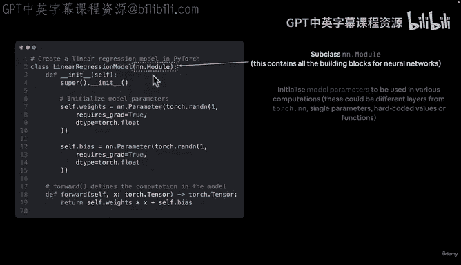
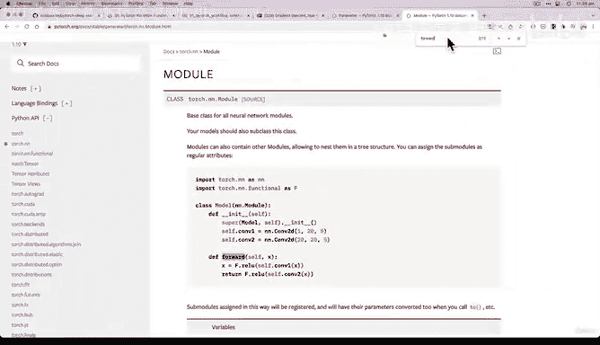

# Daniel Bourke《PyTorch 深度学习｜PyTorch 101 Crash Course For Beginners in 2025》中英字幕 - P43：043_03_007 解析线性回归模型运行机制.zh_en - GPT中英字幕课程资源 - BV1kTSKB1E9m

Welcome back。 In the last video， we covered a whole bunch in creating our first pytorrch model that inherits from N dot module。

 We talked about object oriented programming and how a lot of pytorch uses object oriented programming。

 I can't say that。 I might just say O O P for now。 What I've done since the last video。

 though I've added two resources here for gradient descent and back propagation。

 These are two of my favorite videos on YouTube by the channel3 blue1 brown。

 So this is on gradient descent。 I would highly recommend watching this entire series， by the way。

 So that's your extra curriculum for this video in particular， and for this course overall。

 is to go through these two videos， even if you're not sure entirely what's happening。

 you will gain an intuition for the code that we're going to be writing with pytorch。

 So just keep that in mind as we go forward a lot of what pytorrch is doing behind the scenes for us is taking care of these two algorithms for us。

😊，And we also created。2 parameters here in our model， where we've instantd them as random values。

 So one parameter for each of the ones that we use， the weight and bias for our data set。

 And now I want you to keep in mind that we're working with a simple data set here。

 So we've created our known parameters。 But in a data set that you haven't created by yourself。

 You've maybe gathered that from the Internet， such as images。

You won't be necessarily defining these parameters。Instead。

 another module from NN will define the parameters for you and will work out what those parameters should end up being。

But since we're working with a simple data set， we can define our two parameters that we're trying to estimate。

 This is a key point here。 is that our model is going to start with random values。

 That's the annotation I've added here。 Start with a random weight value using torch random。

 And then we've told it that it can update via gradient descent。

 So pi torch is going to track the gradients of this parameter for us。

 And then we've told it that the D type we want is float 32。

 We don't necessarily need these two set explicitly because a lot of the time the default and pi torch is to set these two requires gra equals true and D type eags torch do float。

 Does that for us behind the scenes。 But just to keep things as fundamental and as straightforward as possible。

 We've set all of this explicitly。So let's jump into the keynote。

 I'd just like to explain what's going on one more time in a visual sense。

 So here's the exact code that we've just written。 I've just copied it from here。

 and I've just made it a little bit more colourful。

But here's what's going on。 So when you build a model in Pytorch。

 it subclasses the N N dot module class。 This contains all the building blocks for neural networks。

 So our class of model subclasss N N dot module。

Now。Inside the constructor， we initialize the model parameters。 Now。

 as we'll see later on with bigger models， we won't necessarily always explicitly create the weights and biases。

We might initialize whole layers。 Now， this is a concept we haven't touched on yet。

 but we might initialize a list of layers or whatever we need。 So basically。

 what happens in here is that we create whatever variables that we need for our model to use。

And so these could be different layers from torchdot NN， single parameters。

 which is what we've done in our case， hard coded values or even functions。Now。

 we've explicitly set requires grad equals true for our model parameters。 So this， in turn。

 means that pytorch behind the scenes will track all of the gradients for these parameters here。

 for use with torch dot autograd。 So Torch dot autograd module of pytorrch is what implements gradient descent。

 Now， a lot of this will happen behind the scenes for when we write our pytorch training code。

 So if you'd like to know what's happening behind the scenes。

 I'd highly recommend you checking out these two videos， hences why I've linked them here。😊，Oh。

 and for many Pytorch Jot NN modules requires grad is true as set by default。Finally。

 we've got a forward method。Now。Any subclass of N N dot module， which is what we've done。

 requires a forward method。 Now， we can see this in the documentation。 if we go torch。

Dot NN dot module。Click on module。Do we have Ford。Yeah， there we go。 So Ford。

You've got a lot of things built into an end dot module， so。

You see here this is a subclass of N N dot module。 And then we have Ford。

 So Ford is what defines the computation performed at every core。

 So if we were to call linear regression model and put some data through it。

The forward method is the operation that this module does， that this model does。 And in our case。

 our forward method is the linear regression function。 So keep this in mind。

 any subclass of N end dot module needs to override the forward method。

 So you need to define a forward method If you're going to subclass N N dot module。

We'll see this very hands on。 but for now， I believe that's enough coverage of what we've done。

If you have any questions， remember， you can ask it in the discussions。

We've got a fair bit going on here， but I think we've broken it down a fair bit。

 The next step is for us to I know I mentioned this in a previous video is to cover some Pytorch model building essentials。

 but we're going to cover a few more of them。 We've seen some already。

 But the next way to really start to understand what's going on is to check the contents of our model。

 Tra one and make some predictions with it。 So let's get hands on with that in the next few videos。

 I'll see you there。😊。