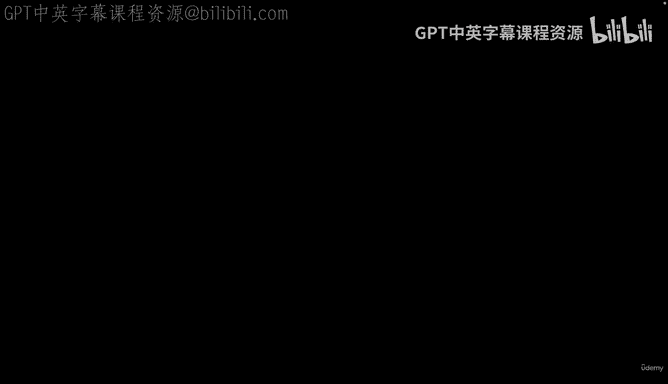
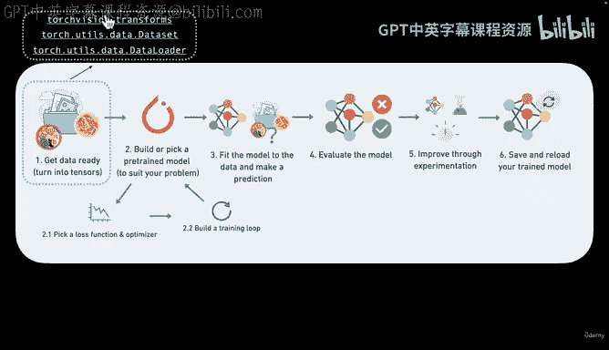
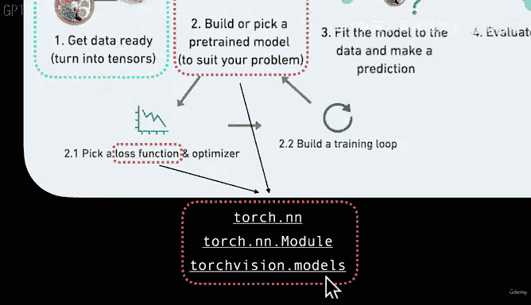
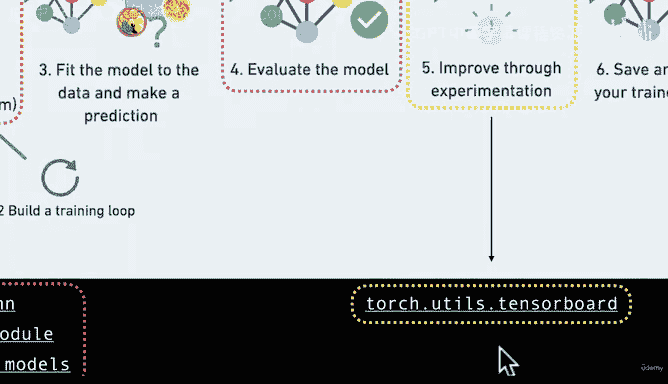
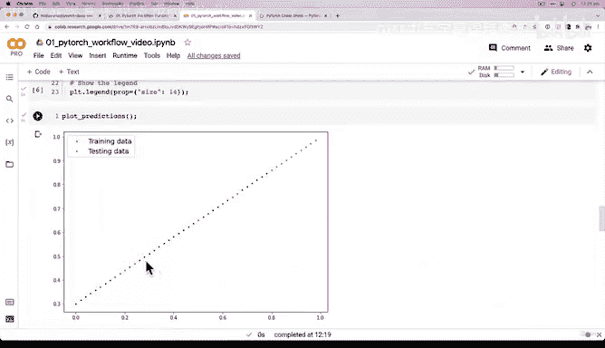
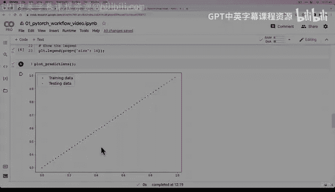

# Daniel Bourke《PyTorch 深度学习｜PyTorch 101 Crash Course For Beginners in 2025》中英字幕 - P45：045_03_009 探究模型内部结构.zh_en - GPT中英字幕课程资源 - BV1kTSKB1E9m

Welcome back。 In the last video， we covered some of the Pytorch model building essentials。 And look。

 I linked a cheat sheet here。 There's a lot going on。 There's a lot of text going on in the page。

 Of course， the reference material for here is in the learn Pytorch book。

 Pytorch model building essentials under 0。1， which is the notebook we work on here。

 But it couldn't help myself。 I wanted to add some color to this。 So before we inspect our model。

 let's just add a little bit of color to our text on the page。 we go to Here's our workflow。

 This is what we're covering in this video， right， or in this module，0。1。 But to get data ready。

 Here are some of the most important pytorrch modules。

 Torch visionion dot transforms we'll see that when we cover computer vision later on。

 Torch dot us data do data set。 So that's if we want to create a data set that's a little bit more complicated than because our data set is so simple。

 we haven't used either of these data set creator or data loader。😊。

And if we go build a picker model， well， we can use torch dot N， M。 We've seen that one。

 We've seen torch dot N， N dot module。So in our case， we're building a model。

 But if we wanted a pre trained model， well， there's some computer vision models that have already been built for us in torch visionion dot models。

 Now， Torch Vi stands for Pi Torch's computer vision module。 So we haven't covered that either。

 But this is just a spoiler of what's coming on later on。

Then at the optimizer， if we wanted to optimize our model's parameters to better represent a data set。

 we can go to torch。optdm。Then if we wanted to evaluate the model。 Well。

 we've got torch metrics for that。 We haven't seen that。

 but I'm going to be hands on with all of these later on。

 Then if we wanted to improve through experimentation， we've got torch dot us dot tensor board。

 what's this。 But again， if you want more。 there's some at the P torch cheat sheet。

 But now this is just adding a little bit of color and a little bit of code to our P torch workflow。

 And with that being said， let's get a little bit deeper into。😊。

What we've built， which is our first pyto model。 So checking the contents of our Py model， so。Now。

 we've created a model。Let's see what's inside。 You might already be our。To guess this。

By the fact of what we've created in the constructor here and the a knit function。

 So what do you think we have inside our model。And how do you think we'd look in that。 Now。

 of course， these are questions you might not have the answer to because you're just。

 you're like Daniel， I'm just starting to learn Py To。 I don't know these。

 but I'm asking you just to start thinking about these different things， you know， so。

We can check out。Our model parameters or what's inside our model using。Waiite for it。Dot parameters。

Oh。Don't you love it when things are nice and simple。 Well， let's check it out。 Hey， well。

 first things we're going do is let's create a random seed。😊，Now why are we creating a random seed？

Well， because recall， we're creating these parameters with random values。

 And if we were to create them with。Out to random seed。We would get different values every time。

 So for the sake of the educational sense， for the sake of this video。

 we're going to create a manual seed here， Torchshop manual seed。😊，I'm going to use 42 or maybe 43。

 I could use 43 now，42， because I love 42。 It's the answer to the universe。😊，And。

We're going to create an instance。Of the model that we created。So this is a subclass。

Of NN dot module。So let's do it Model zero because it's going to be the zeroth model。

 the first model that we've ever created in this whole course， How amazing。😊，Linear regression。Model。

 which is what our class is called， so we can just call it like that。That's all I'm doing。

 just calling this class。And so let's just see what happens there。 And then if we go model zero。

 what does it give us？😊，Oh， linear regression， okay， it doesn't give us much。

 but we want to find out what's going on in here。😊，So check out the parameters。

So Model0 dot parameters。What do we get from this？Oh a generator。Well。

 let's turn this into a list that'll be better to look at。There we go。 Oh how exciting is that。

 So parameter containing。 Look at the values。 Tensor requires gra equals true parameter containing。

 wonderful。 So these are our model parameters。😊，So why are they the values that they are？Well。

 it's because we've used torch Rand N。Let's see what happens。 If we go。

 let's just create torch dot Rand n1。 What happens。We get a value like that。 And now。

 if we run this again。We get the same values。 But if we run this again。 So keep this in mind，2，3，4，5。

 actually， that's。Wow， that's pretty cool that we got a random value that was all in order for in a row。

 can we do it twice in a row， probably not？😊，Oh， we get at the same one。 Now， why is that。Oh。

 we get a different one。 Do we just get the same one twice。Oh my gosh。

 we got the same value twice in a row。 You saw that。You saw that。 That's incredible。Now。

 the reason why we get this is because。This one is different every time because there's no random seed。

 What if we put the random seed here。Toorge do manual seed。42。3，3，6，7。 What happens？3367。

 what happens？3，3，6，7， okay。And what if we commented out the random seed here。

And this lies down model， different values，2，3，5，2，3，4，5。 It must like that value。Oh， my goodness。

Let me know if you get that value。Right， so if we keep going。

 we get different values every single time。 Why is this。

Why are we getting different values every single time。 You might be Daniel。

 you sound like a broken record， but I'm trying to really drive home the fact that we initialize our models with random parameters。

So this is the essence of what our machine learning models and deep learning models are going to do。

 Start with random values。 weights and bias。 It may be we've only got two parameters here。

 but the future models that we build might have thousands。 So， of course。

 we're not going to do them all by hand。 We'll see how we do that later on。 But for now。

 we start with random values and our ideal model， We'll look at the training data and adjust these random values。

 But just so that we can get reproducible results。 I'll get rid of this cell。

 I've set the random seed here。 So。😊，You should be getting similar values to this。 If you're not。

 because there's maybe some sort of py toch update and how the random see calculated。

 you might get slightly different values。 But for now， we'll use torch dot manual C dot 42。

 And I want you to just be aware of。This can be a little bit confusing。

If you just do the list of parameters。For me， I understand it better if I list the name parameters。

 So the way we do that is with model 0， and we call state dip。On it。

This is going to give us our dictionary of the parameters of our model。 So as you can see here。

 we've got weights and we've got bias， and they are random values。

 So where did weights and bias come from， Well， of course， they came from here， weights bias。

 but of course， as well up here。We've got known parameters。 So now our whole goal is what。

Our whole goal is to build code or write code that is going to allow our model to look at these blue dots here and adjust。

This weight and buying us value to B。Wints as close as possible to wait and bias us。Now。

 how do we go from here and here？To here and here。 Well， we're going to see that in future videos。

But the closer we get these values。To these two， the better we're going to be able to predict and model our data。

 Now， this principle， I cannot stress enough。Is。The fundamental entire foundation。

 the fundamental foundation。 Wow， good description， Daniel， the entire foundation of deep learning。

We start with some random values， and we use gradient descent and back propagation。

 plus whatever data that we're working with to move these random values as close as possible to the ideal values。

 And in most cases， you won't know what the ideal values are。 But in our simple case。

 we already know what the ideal values are。 So just keep that in mind going forward。

 The premise of deep learning is to start with random values and make them more representative closer to the ideal values。

With that being said， let's try and make some predictions with our model as it is。 I mean。

 it's got random values。 How do you think the predictions will go， So I think in the next video。

 we'll make some predictions on this test data and see what they look like。 I'll see you there。

