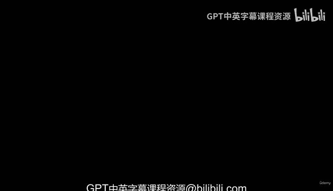
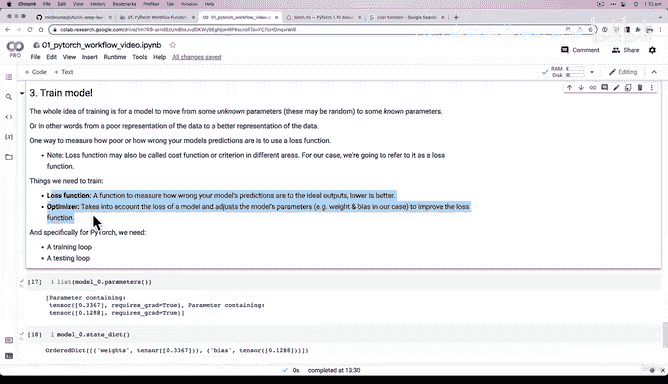

# Daniel Bourke《PyTorch 深度学习｜PyTorch 101 Crash Course For Beginners in 2025》中英字幕 - P47：047_03_011 模型训练直觉（必备要素）.zh_en - GPT中英字幕课程资源 - BV1kTSKB1E9m

Friends， welcome back。 In the last video。 We saw that our model performs pretty poorly。 Like ideally。

 these red dots should be in line with these green dots。 And we know that because why， Well。

 it's because our model is initialized with random parameters。

 And I just want to put a little note here。 You don't necessarily have to initialize your model with random parameters。

 You could initialize it with this could be 0。 here， these two values。

 Wes can bias could be 0 and you could go from there。

 or you could also use the parameters from another model。 But we're going to see that later on。

 that's something called transfer learning。 that's just a little spoiler for what's to come。 And so。

😊，We've also discussed that an ideal model will。Replate these known parameters。 So in other words。

 start with random unknown parameters。 these two values here。

 And then we want to write some code for our model to move towards estimating the ideal parameters here。

Now， I just want to be explicit here and write down some intuition before we jump into the training code。

 But this is very exciting。 We're about to get into training our very first machine learning model。

 So let's write here， the whole idea of training。😊。

Is for a model to move from some unknown parameters。 These may be random。To some known。Prameterters。

Or in other words， from aal representation。Representation of the data to a better representation。

Of the data。And so in our case， would you say that our model's representation of the green dots here with this red dots。

 is that a good representation or is that a poor representation？I mean， I don't know about you。

 but I would say that to me this is a fairly poor representation and one way to measure the representation between your model's outputs。

 in our case the red dots， the predictions and the testing data is to use a loss function。

 so I'm going to write this down here。This is what we're moving towards。

 we're moving towards training， but we need a way to measure how poorly our models' predictions are doing。

 So one way to measure。How。Poor or how wrong your models。Predictions are。Is to use a loss function。

And so if we go pie torch loss functions。We're going see that ptorch has a fair few loss functions built in。

But the essence of all of them is quite similar。So I just waiting for this to load。

 My internet's going a little bit slow today， but that's okay。 We're not in rush here。

 We're learning something fun。😊，If I search here for loss， loss functions， Here we go。 So yeah。

 this is torch and N。 These are the basic building blocks for graphs。

 whole bunch of good stuff in here， including loss functions。 Beai。

 And this is another thing to note as well。 Another one of those scenarios where there's more words for the same thing。

 you might also see a loss function referred to as a criterion。😊。

There's another word called cost function。So I might just write this down so you're aware of it。

 Yeah， cost function versus loss function。 and maybe some formal definitions about what all of these are。

 maybe they're used in different fields， but in the case of we're focused on machine learning right。

 So I'm just going to go note loss function may also be called cost function。

Or criterion in different areas。For our case。We're going to。Refer。To it as。A loss function。

 And let's just formally define a loss function here。

 because we're going to go through a fair few steps in the upcoming video。 So this is a warning。

 Nothing we can't handle， but I want to put some formal definitions on things。

 We're gonna see them in practice。 That's what I prefer to do。

 rather than just sit here defining stuff。 This lectures already had an enough text on the page。

 So hurry up and get into coding。 Daniel。 A loss function is。😊。

A function to measure how wrong your model's predictions are to the ideal outputs。So lower is better。

 so ideally。Think of a measurement。 How could we measure？

The difference between the red dots and the green dots。

 One of the simplest ways to do so would be just measure the distance here， right。So if we go。

 let's just estimate this as 035 to 0。8 thereabouts。 So what's the difference there， about 0。45。

 Then we could do the same again for all of these other dots and then maybe take the average of that。

Now， if you've worked with loss functions before， you might have realized that I've just reproduced mean absolute error。

 but we're going to get to that in a minute。 So we need a loss function。

I'm going to write down another little dot point here。

 This is just setting up intuition things we need。To train。We need a loss function。 This is pi torch。

 and this is machine learning in general。 actually， but we're focused on pitorrch。

 We need an optimizer。 What does the optimizer do， takes into account the loss of a model and adjust。

The models parameters。 So the parameters recall are our weight and bias values， weight and biases。

 We can check those or bias。 We can check those by going model。Dot parameter。Or parameters。

But I also like， oh， that's gonna give us a generator， isn't it。do we not define the model yet。

What do we call our model， our model zero， excusecus me。I forgot告喂。

We' goinging to build a lot of models in this course， so we're giving them numbers。

Modelled up parameters。 Yeah， we've got a generator。 So we'll turn that into a list。 But model 0。

 if we want to get them labeled， we want state。Dict here。There we go。 So our weights is this value。

 That's a random value we've set， and there's the bias。

 And now we've only got two parameters for our model。 So it's quite simple。 However。

 the principles that we're learning here are going to be the same principles， Ta a loss function。

 trying to minimize it。 So getting it to lower。 So the ideal model will predict exactly what our test data is。

And an optimizer will take into account the loss and will adjust a model's parameter in our case。

 weights and bias to be。Let's finish this definition。

 takes into account the loss of a model and adjust the model's parameters， EG， weight and bias。

In our case， to improve the loss function。And specifically。For pie torch。We need。A training loop。And。

A testing loop。Now， this is what we're going to work towards building。

Throughout the next couple of videos。 are they're going to focus on these two first。

 the loss function and optimizer。 There's the formal definition of those。

 You're going to find many different definitions。 That's how I'm going to define them。

 Loss function measures how wrong your models' predictions are lower is better optimizer takes into account the loss of your model。

 So how wrong it is and starts to move these two values into a way that improves where these red dots end up。

 But these， again， these principles of a loss function and an optimizer can be for models with two parameters or models with millions of parameters can be for computer vision models or could be for simple models like ours that predict the dots on a straight line。

😊，So with that being said， let's jump into the next video。

 We'll start to look a little deeper into loss function for our problem and an optimizer。

I'll see you there。