# Daniel Bourke《PyTorch 深度学习｜PyTorch 101 Crash Course For Beginners in 2025》中英字幕 - P48：048_03_012 配置优化器与损失函数.zh_en - GPT中英字幕课程资源 - BV1kTSKB1E9m

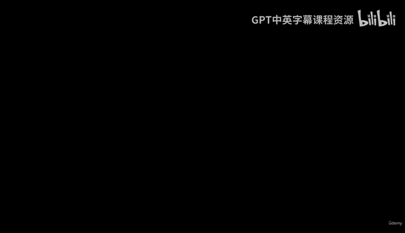

Welcome back。 We're an exciting streak of videos coming up here。 I mean， the whole course is fun。

 Trust me， but this is really exciting because training your first machine learning model seems a little bit like magic。

 but it's even more fun when you're writing the code yourself， what's going on behind the scenes。

 So we discuss that the whole concept of training is from going unknown parameters。

 random parameters such as what we've got so far to parameters that better represent the data。

 And we spoke of the concept of a loss function。 we want to minimize the loss function。

 That is the whole idea of a training loop in piytorrch or an opt loop in pytorrch。

 and an optr is one of those ways that can nudge the parameters of our model in our case。

 weights or bias towards values rather than just being random values like they are now towards values that lower the loss function。

 And if we lower the loss function， what does the loss function do。

 it measures how wrong our models predictions are compared to the ideal outputs。😊，If we lower that。

 well， hopefully we move these red dots towards the green dots。And so。As you might have guessed。

 Piytorrch has some built in functionality for implementing loss functions and optimizes。

 And by the way， what we're covering so far is in the train model section of the pytorrch workflow fundamentals。

 I've got a little nice table here， which describes a loss function， What does it do。

 Where does it live in Piytorrch， Common values， We're going to see some of these hands on。

 If you'd like to read about it。 Of course， you have the book version of the course here。😊。

So loss functions in plytorrch。 I'm just in docs torch dot N， N。 Look at this。

 Look at all these loss functions。 It's far too many for us to go through all in one hit。

 So we're just going focus on some of the most common ones。 Look at that。

 Weve got about what's that 15 loss functions， something like that。Well。

 truth be told is that which one should use you're not really gonna know unless you start to work hands on with different problems。

 And so in our case， we're gonna be looking at L 1 loss。 And this is an， again， once more。

 Another instance where different machine learning libraries have different names for the same thing。

 This is mean absolute error， which we kind of discussed in the last video。

 which is if we took the distance from this red dot to this green dot and say it's 0。4 thereabouts，0。

40。4。 and then took the mean。 Well， we've got the mean absolute error， But in Pitorrch。

 they call it L 1 loss， which is a little bit confusing because then we go to M E loss。

 which is mean squared error， which is L 2。 So naming conventions just takes a little bit of getting used to。

 This is a warning for you。So let's have a look at the L1 loss function。 Again。

 I'm just making you aware of where the other loss functions are。

 We'll do with some binary cross entropy loss later in the course。

 And maybe even is there categorical cross entropy。We'll see that later on。

 but all the others will be problem specific。For now。Coup of loss functions like this。 L1 loss。

 MS E loss we use for regression problems。 So that's predicting a number。

 Cross entropy loss is a loss that you use with classification problems。

 But we'll see those hands on later on。 Let's have a look at L1 loss。So L1 loss creates a criterion。

 As I said， you might hear the word criterion used in ptorrch for a loss function。

 I typically call them loss functions。 The literature typically calls it loss functions。

 That measures the mean absolute error。 There we go。

 L1 loss is the mean absolute error between each element in the input X and target Y。 Now。

 your extracurr， as you might have guessed， is to read through the documentation。

 for the different loss functions。 especially L1 loss， But for the sake of this video。

 let's just implement it for ourselves。😊。

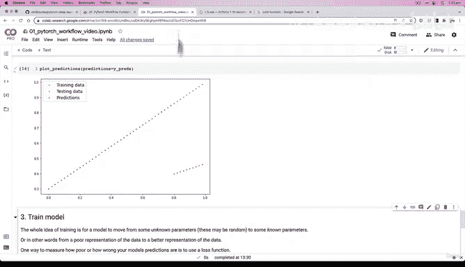

Oh， and if you want a little bit of a graphic， I've got one here。This is where we're up to。

 by the way， picking a loss function optimizer for step 2。 This is a fun part。 right。

 We're getting into training a model。😊，So we've got mean absolute error。

 Here's that graph we've seen before。 Ho ho， look at this。 Okay， so weve got the difference here。

 I've actually measured this before in the past。 So I kind of knew what it was。

 meanan absolute error is if we repeat for all samples in our。😊，Set that we're working with。

 And if we take the absolute difference between these two dots。 Well， then we take the mean。

 we've got mean absolute error。 So M A E loss equals torch mean。 we could write it out。

 That's the beauty of applying torch。 right。 We could write this out。

 or we could use the torch and N version， which is recommended。 So let's jump in。

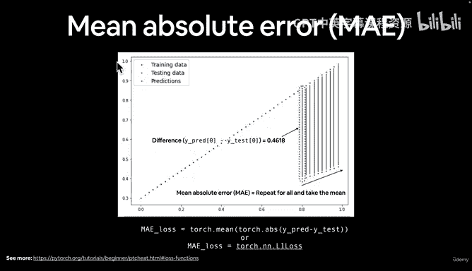

There's a colorful slide describing what we're about to do。 So let's go set up a loss function。

And then we're also going to put in here。Set up an optimizer。So let's call it loss FN。

Equals NN dot L1 loss。Simple as that。 And then if we have a look at what's our loss function。

 what does this say？My goodness， my internet is going quite slow today。It's raining outside。

 So there might be some delays somewhere。 But that's right。

 givess us a chance to sit here and be mindful about what we're doing。Look at that。 Okay。

 loss function。 L 1 loss， beautiful。 So we've got a loss function。

 Our objective for training a machine learning model will be 2。 Let's go back。

 look at the colour graphic will be to minimize these distances here。 And in turn。

 minimize the overall value of M Ae。 That is our goal。 If our red dots line up with our green dots。

 we will have a loss value of 0， the ideal point for a model to be。😊。

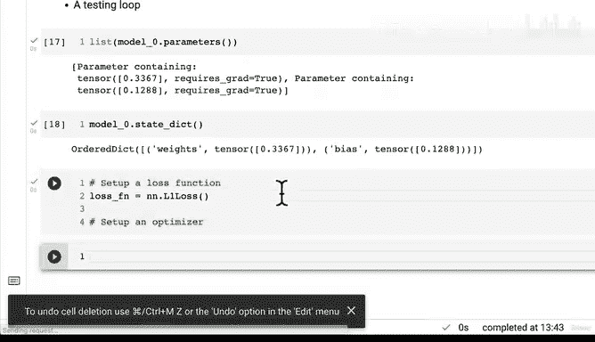

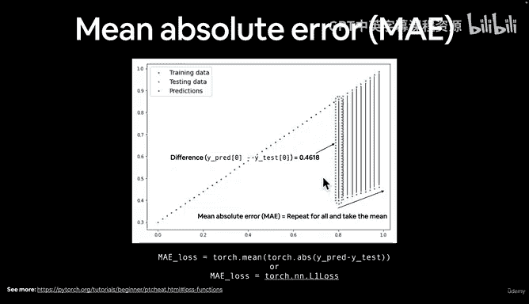

And so let's go here。 We now need an optr。 As we discussed before。

 the optr takes into account the loss of a model。 So these two work in tandem。

 That's why I've put them as similar steps。 If we go back a few slides。

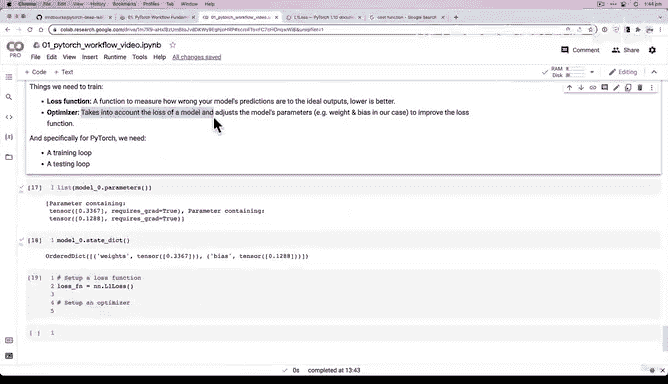

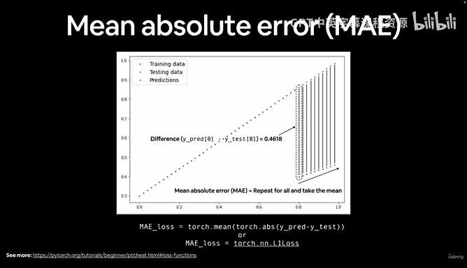

So this is why I put these as 2。1， Often picking a loss function and optimizer and pytorch come as part of the same package because they work together。

 The optimizer's objective is to give the model values。

 So parameters like a weight and a bias that minimize the loss function， they work in tandem。

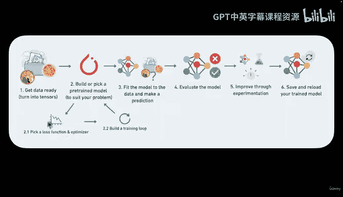

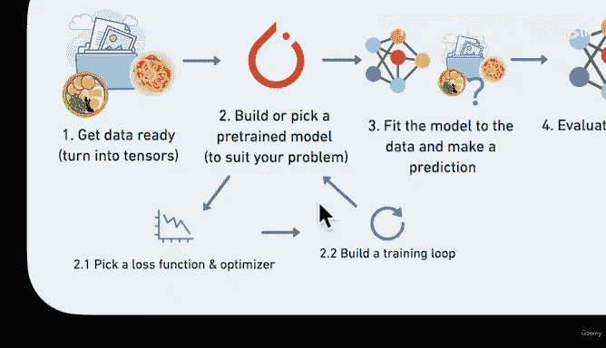

And so let's see whatre an optimizer。Optimises， where might that be。 What if we search here。

 I typically don't use this search。Because I prefer just using Google search， but。

Does this give us optimizer， hey。There we go。 So again， Piytorrch has torch dot optt M。

Which is where the optimizers are， Torch dot optim。Let me put this。Link in here。

This is another bit of your extra curriculum。 if you want to read more about different optimizes in Pytorch。

 as you might have guessed， they have a few。Torchopdm is a package implementing various optimization algorithms。

 Most commonly used methods are already supported， and the interface is general enough so that more sophisticated ones can also be easily integrated into the future。

 So if we have a look at what algorithms exist here。Again。

 we're going to throw a lot of names at you。 But in the literature。

 a lot of them that have made it into here are already good working algorithms。

 So it's a matter of picking whichever ones best for your problem。 How do you find that out， Well。

 S G D， stochastic gradient descent。Is possibly the most popular。 However。

 there are some iterations on S GD， such as Adam， which is another one that's really popular。

 So again， this is one of those other machine learning is part art。

 part science is trial and error of figuring out what works best for your problem for us。

 we're going to start with S GD because it's the most popular。

 And if you were paying attention to a previous video。

 you might have seen that I said look up gradient descent。 Where have we got this。Graadient descent。

 There we go。 So this is one of the main algorithms that improves our models。

 So gradient descent and back propagation。 So if we have a look at this stochastic gradient descent。

 bit of a tongue twister is random gradient descent。 So that's what stochastic means。 So basically。

 our model improves by taking。😊，Random numbers。 Let's go down here。Here啊。

And randomly adjusting them so that they minimize the loss。 And once our optimizer。

 that's right here。 Once our optimizer torch dot optim， let's implement S GD。S Ging。

 stochastic gradient descent。 We're going write this here， stochastic。Graient descent。

It starts by randomly adjusting these values。 And once it's found some random values or random steps that have minimized the loss value。

 We're going to see this in action later on。 It's going to continue adjusting them in that direction。

 So say it says， oh， weights。 if I increase the weights。 it reduces the loss。

 So it's going to keep increasing the weights until the weight no longer reduce the loss。

 maybe it gets to a point。 at say 0。65。 If you increase the weights anymore。

 the loss is going to go up。 So the optimizes like， well， I'm going to stop there。

 And then for the bias， the same thing happens。 If it decreases the bias and finds that the loss increases。

 well， it's going to go， well， I'm going to try increase the bias instead。So again。

 one last summary of what's going on here。 A loss function measures how wrong our model is。

 and the optimizer adjusts our model parameters， no matter whether there's two parameters or millions of them to reduce the loss。

There are a couple of things that an optr needs to take in。 It needs to take in as a。

An argument parameters Rams。 So this is， if we go to SGD， I'm just going to link this as well。S G D。

 there's the formula of what S GD does。 I look at this， and I go， hm， there's a lot going on here。

 It take me a while to understand that。 So I like to see it in code。 So we need parameterss。

This is short for what parameters should I opt as an optimr， And then we also need an L R。

 which stands for， I'm gonna write this in a comment。 L R equals learning rate。 possiblyss the most。

 oh， I don't even type rate。 Did I possibly the most important hyperparameter you can set。So。

Let me just remind you， I'm throwing lots of words out here。

 but I'm kind of like trying to write notes about what we're doing。 Again。

 we're gonna see these in action in a second。 So check out our。😊，Models and parameters。So。

 a parameter。Is a value。That the model sets itself。So， learning rate。Equals， possibly。

The most important learning hyperparameter。 I no， I don't need learning。 there。

 do I Hyparameter and a hyperparameter is a value that us。

 as a data scientist or a machine learning engineer， set ourselves。You can set。

So the learning rate is， in our case， let's go 0。01。 You're like， Daniel。

 where did I get this value from？ Well， again， these type of values come with experience。

 I think it actually says it in here， L R。LR 0。1。 Yeah， Okay， so the default is 0。1。

 But then if we go back to opt dimm。I think I saw it somewhere。 Did I see it somewhere，0 points。

 something 0。Yeah， there we go。Yeah， so a lot of the default settings are pretty good in torch optimizes。

 however。The learning rate， what does it actually do， We could go 0。01。

 These are all common values here， triple 01。I'm not sure exactly why。 Oh， model， it's model 0。

The learning rate says to our optimizer， yes， it's going to optimize our parameters here。

 But the higher the learning rate， the more it adjusts each of these parameters in one hit。

 So let's say it's 0。01。 and it's going to optimize this value here。

 So it's going to take that big of a step。 If we changed it to here。

 It's going to take a big step on this three。And if we changed it to all the way to the end 0，0，1。

 it's only going to change this value。 So the smaller the learning rate。

 the smaller the change in the parameter， the larger the learning rate。

 the larger the change in the parameter。So we've set up a loss function， we've set up an optimizer。

 Let's now move on to the next step in our training workflow， and that's by building a training loop。

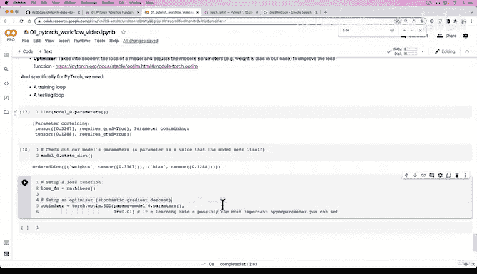

Far out。 This is acceleratingel。 I'll see you in the next video。😊。

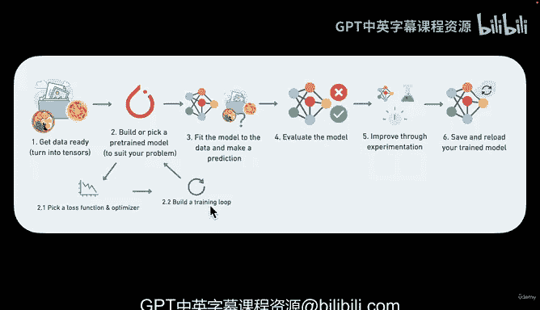