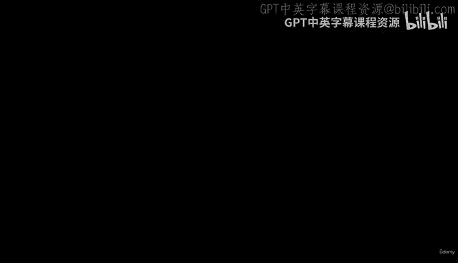
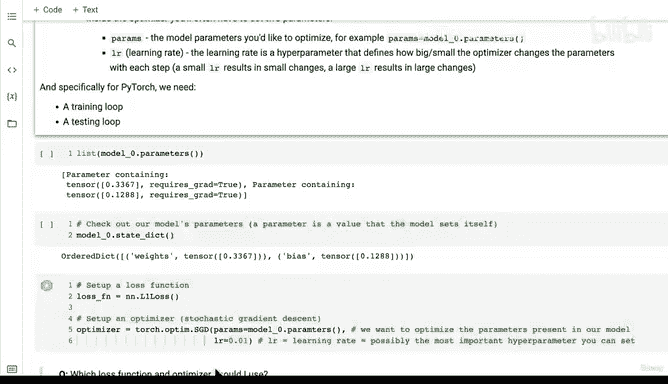
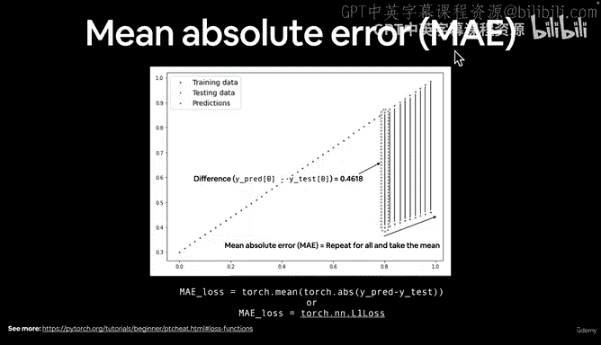
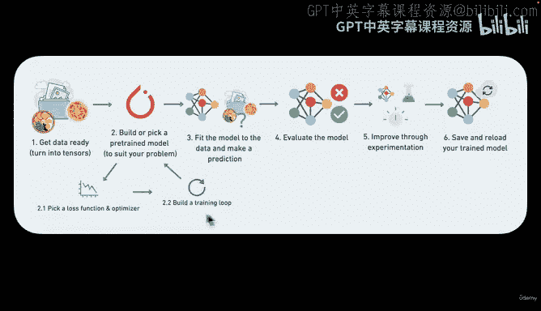
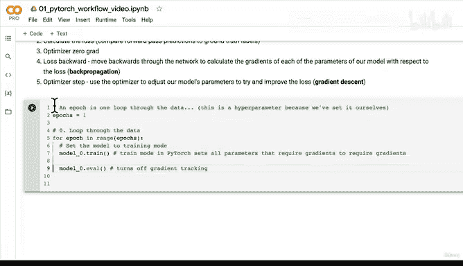

# Daniel Bourke《PyTorch 深度学习｜PyTorch 101 Crash Course For Beginners in 2025》中英字幕 - P49：049_03_013 PyTorch训练流程步骤与原理.zh_en - GPT中英字幕课程资源 - BV1kTSKB1E9m

Welcome back。 In the last video， we set up a loss function and we set up an optimizer and we discussed the roles of each。

 So loss function measures how wrong our model is。 The optimizer talks to the loss function and goes。

 well， if I change these parameters a certain way， does that reduce the loss function at all。

 And if it does， yes， let's keep adjusting them in that direction。 If it doesn't。

 let's adjust them in the opposite direction。😊，And I just want to show you。

 I added a little bit of text here just to concretely put down what we were discussing inside the optimizer。

 you'll often have to set two parameters， parameterss and Lr。

 where parameterss is the model parameters you'd like to optimize for an example in our case parameterss equals our model zero parameters which were of course a weight and a bias and the learning rate。

 which is Lr in optimizer Lr stands for learning rate and the learning rate is a hyperparameter remember a hyperparameter is a value that we。

 the data scientist or machine learning engineer sets。

 whereas a parameter is what the model sets itself defines how big or small optimizer changes the model parameters So a small learning rate So the smaller this value results in small changes a large learning rate results in large changes So another question might be very valid question。

 Hey， I've put this here already is which。

And which optimizer should I use。 So this is another tough one because it's problem specific。

 But with experience in machine learning， I'm showing you one example here。

 you'll get an idea of what works for your particular problem for a regression problem like ours。

 a loss function of L1 loss， which is Me torch and an optr like torch at optimum s S G D like srcchastic gradient descent。

 Well suffice。 But for a classification problem， we're going to see this later on。

 not this one specifically， whether a photo is a cat of a dog。

 that's just an example of a binary classification problem。

 you might want to use a binary classification loss。But with that being said。

 we now are moving on to。Well， his our whole goal is to reduce the Me of our model。

 Let's get the work flow。 We've done these two steps。 Now we want to build a training loop。

 So let's get back into here。 There's going to be a fair few steps going on。

 We've already covered a few。 but， hey， nothing we can't handle together。 So building。

A training loop in。Pietorch。So， I thought about just。

Talking about what's going on in a training loop。 But we can talk about the steps after we've coded them。

How about we do that， So we want to build a training loop。And a testing loop。 How about we do that。

So。A couple of things。We need。And a training loop。So there's gonna be a fair few steps here。

 if you've never written a training loop before， but that is completely fine because you'll find that the first couple of times that you write this。

 you'll be like， oh my gosh， there's too much going on here。 But then when you have practice。

 you'll go， okay， I see what's going on here。 And then eventually。

 you'll write them with your eyes closed。 I've got a fun song for you to help you out。

 remembering things。 It's called the unofficial pieytorch optimizationim loop song。

 We'll see that later on。 or actually， I'll probably Li date as an extension。 but。😊。

You'll see that you can also functionise these things。

 which we will do later in the course so that you can just write them once and then forget about them。

 But we're going to write it all from scratch to begin with。 so we know what's happening。

 So we want to。Or actually， step 0 is loop through。The data。

So we want to look at the data multiple times because our model is going to at first start with random predictions on the data。

 make some predictions。 We're trying to improve those。

 We're trying to minimize the loss to make those predictions we do a forwardd pass。So forwardd pass。

 Why is it called a forwardd pass？ So this involves data moving through our models， forwardd。

Functions。Now I say functions because there might be plural。 There might be more than one。

 and the forward method recall we wrote in our model up here。Ford。

A forward pass is our data going through this function here。 And if you want to look at it visually。

 let's look up a neural network graphic。Images a For pass is just data moving from the input to the output layer。

 So starting here， input layer moving through the model。 So that's a forwardd pass。

 also called Ford propagation。 Another time where more than one name is used for the same thing。

 So we'll go back down here。 For pass。 And I'll just right here。 also called。Affordward propagation。

Publication。Wonderful， and then we need to calculate。The loss。So。Ford pass， Let me write this。

To calculate or to make predictions。Make predictions on data。So calculate the loss， compare。

Forward pass。Predictions， oh， there's a thundering in the background here of my place。

 We might be in for a storm。 perfect time to write code。

 compareare forward past predictions to ground truth labels。

We're gonna see all this in code in a second。 Calulate the loss。

 And then we're going to go optimize a0 grad。 We haven't just spoken about what this is。

 but that's okay。 We're going to see that in a second。 I'm not going to put too much there。

 Los backward。 we haven't discussed this one either。

 There's really three steps that we haven't really discussed。 We've discussed the idea behind them。

 but not too much in depth。 Opim our step。 So this one is。Loss backwards is move。Backwards。

 if the Ford passes forwards， like through the network。The forward pass is data goes in to out。

 The backward pass data goes or calculations happen backwards。 So we'll see what that is in a second。

Where were we over here。 Weve got too much going on。

 I'm getting rid of these moves backwards through。The network。To calculate the gradients， oh。Oh。

 the gradients of each of the parameters。Of our model with respect to the loss。 Oh my gosh。

 that is an absolute mouthful， but that'll do for now， optimize a step。

 This is going to use the optimizer to adjust our models's parameters。To try and improve the loss。

Remember how I said in a previous video that I'd love you to watch the two videos I linked above one on gradient descent and one on back propagation。

 If you did， you might have seen like there's a fair bit of math going on in there。 Well。

 that's essentially how our model goes from random parameters to better parameters。 usingsing math。

 Many people， One of the main things I get asked from machine learning is。

 how do I learn machine learning if I didn't do math。 Well。

 the beautiful thing about pitorrch is that it implements a lot of the math of back propagation。

 So this is back propagation， I'm gonna write this down here。

 This an algorithm called back back propagation。 hence the loss backward。

 We're gonna to see this encode code in a second。 Don't you worry， And this is gradient descent。😊。

So these two algorithms drive the majority of our learning。 So back propagation。

 calculate the gradients of the parameters of our model with respect to the loss function and optimize our step。

 We'll trigger code to run gradient descent， which is to minimize the gradients。

 because what is a gradient。Let's look this up。 What is a gradient。

I know we haven't written the code yet， but we're going to do that。Images。Graadient， there we go。

 change in Y， change in X。 gradient is from high school math。 gradient is a slope。😊。

So if you were on a hill， let's find a picture of a hill。Pture。Of a hill。There we go。

 This is a great big hill。So。If you're on the top of this hill and you wanted to get to the bottom。

How would you get to the bottom。Well， of course， you just walk down the hill。

 But if you're a machine learning model， what are you trying to do。

Let's imagine your loss is the height of this hill。

 you start off with your loss is really high and you want to take your loss down to 0。

 which is the bottom， right， Well， if you measure the gradient of the hill。

The bottom of the hill is in the opposite direction to where the gradient is steep。

Does that make sense of the gradient here is an incline？

 We want our model to move towards the gradient being nothing， which is down here。

 And you could argue， yeah， the gradients probably nothing at the top here。

 But let's just for argument's sake， say that we want to get to the bottom of the hill。

 So we're measuring the gradient。 And one of the ways an optimization algorithm works。

 is it moves our model parameters so that the gradient equals 0。

 And then if the gradient of the loss equals 0， while the loss equals 0，2。

 So now let's write some code。 So we're going to set up a parameter called or a variable called epoch。

 And we're going to start with one。 Even though this could be any value。

 let me define these as we go。 So we're going to write code to do all of this。

So epochs and epoC is one loop through the data。Dot dot dot。 So epos， we're going start with one。

 So one time through all of the data， we don't have much data。 And so for epoch。So let's go this。

 This is step 0。0ero， loop through the data。By the way， when I say loop through the data。

 I want you to do all of these steps within the loop。And do dot dot dot。Love through the data。

 so for epoch in range epochs。Even though it's only gonna to be one， we can adjust this later。

 And because epochs， we've set this ourselves， it is a。This is。A hyperparameter。

Because we've set it ourselves。And I know you could argue that， hey。

 our machine learning parameters of model 0 or our model parameters。

 Model 0 aren't actually parameters because we've set them。

 But in the models that you build in the future， they will likely be set automatically。

 rather than you setting them explicitly like we've done when we created model 0。 And oh my gosh。

 this is taking quite a while to run。 That's all right。 We don't need it to run fast。 We just。

 we need to write some more code Then you'll come on。 There's a step here。

 I haven't discussed either， set the model to training mode。

So Pytoch models have a couple of different modes， the default is training mode。

So we can set it to training mode by going like this。Train。

So what does train mode do in a piy torch model。 My goodness。

 is there a reason my internet is going this slow。That's all right。

 I'm just gonna discuss this with talking。Again。List。Train mode。Train mode in Pitorrch。Seets， oh。

 there we go。 requiresquires grad equals true。 Now， I wonder if we do with torch dot no grad。

 Remember， no grad is similar to inference mode。Will this adjust， See。

 I just wanted to take note of requires grads true。 Actually。

 what I might do is we do this in a different cell。Watch this。

 This is just going to be rather than me just spit words at you。

 I reckon we might be able to get at work in doing this。Oh， that didn't list the model parameters。

 Why did that not come out。Model 0 dot ofval。So there's two modes。

 aval mode and train mode model gott aval parameters。 Hey。

 we're experimenting together on the fly here。 And actually。

 this is what I want you to do as I want you to experiment with different things。

It's not gonna say requires grand equals false。喂。Torch dot nograd。Model 0 dot parameters。

I don't know if this will work， but it definitely works behind the scenes。

 And what I mean by works behind the scenes and not here。

 It works behind the scenes when calculations are been made。

 but not if we're trying to explicitly print things out。Well。

 that's an experiment that I thought was going to work， and it didn't work。

 So train mode in Pytorrch sets all parameters。That require gradients to require gradients。

So do you remember with a picture of the hill？I spoke about how we're trying to minimize the gradient。

So the gradient is the statementness of the hill。If the height of the hill is a loss function and we want to take that down to 0。

 we want to take the gradient down to 0。 So same thing with the gradients of our model parameters。

 which are here with respect to the loss function， we want to try and minimize that gradient。

 So that's gradient descent。 is take that gradient down to 0。So model dot train。

 and then there's also model zero dot。A vow， so。Turns off gradient tracking。

So we're going to say that later on。But。For now， I feel like this video is getting far too long。

 Let's finish the training loop in the next video。

I'll see you there。