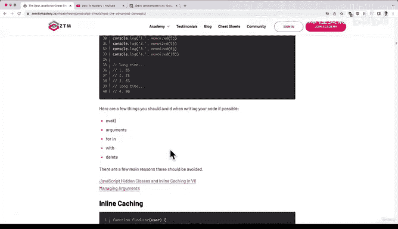
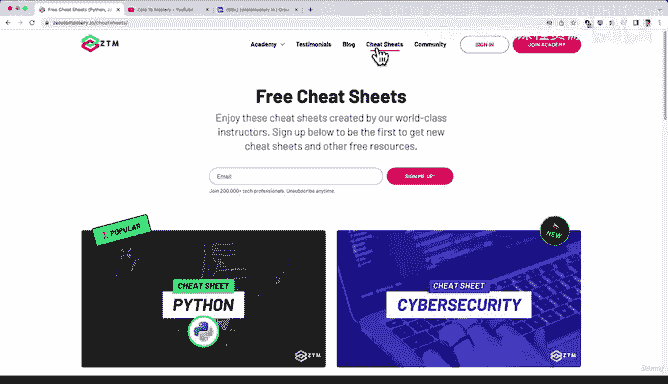
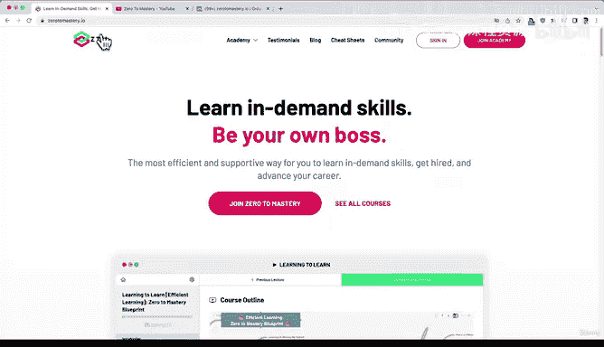

# Daniel Bourke《PyTorch 深度学习｜PyTorch 101 Crash Course For Beginners in 2025》中英字幕 - P4：004_01_006 ZTM资源.zh_en - GPT中英字幕课程资源 - BV1kTSKB1E9m

Hey， everybody。 welcomelcome to your Z TM course。 Now， as part of being a ZTM student。

 you get to have a couple of nice freebies， a little bonus。

 a little extras that all the students that are part of ZtM get。

 Let me show you some of the extra things you get as part of this course。 First off。

 we already talked about it， but we have a pretty big community of tech enthusiasts learners。

 So we have a ton of coding challenges。 If you go to our website and go to the community tab。

 We have coding challenges that you can practice some skills with。

 We have open source projects that are open to anybody that anybody can participate that's part of Z TM。

😊，We have our discourse server。 We have campus events。

 which is like a live virtual classroom that you get to meet other students and talk to them。

 And we also have events like advent of code or hacktober fest throughout the year。

 We also have cheat sheets。 Now， these are all free。 None of this requires any sign up。

 You can just open up a cheat sheet that is related to your course that you want to check out。

 let's say we want to check out the jascript one。 Well。

 you can actually go through the cheat sheet here。 and follow along with the course and maybe take notes along the way。

 These cheat sheets。 We add every month a new cheat sheet。

 So you can just keep an eye on this tab and check out different cheat sheets based on your interest。

 We also have our blog where we post two to three blog posts a week。 So quite a lot。

 and we have different topics for beginners for people that are already working in in the。😊。

IndustryDifferent instructor posts。 We also have posts about how to get hired， so on and so forth。

So you can check out our blog， and we have different taps here。

 obviously beginners start here advance your career。 But the most important one is right here。

 We have monthly industry newsletters。 So every month。

 myself and other ZTM instructors write a recap of what happened that month in the industry。

 You know how you're always overwhelmed with blog posts， what to read。

 how to stay up to date with the industry。 Well， we try to make it easy for you so that you don't have to read 100 blog posts。

 Watch 100 YouTube videos every month just to stay up to date。 instead。

 we recap what happened in the industry。 So we have a web developer monthly that recaps what happened in the industry that month。

 What are the best resources to read what is the big takeaway。

 All digest it into one blog posts like this one。But we also have one for Python。

 one for machine learning and a blockchain developer。 Now。

 we're going to add a few more throughout the year。

 but these should cover a lot of the interests that students have。Now， finally。

 you can also check out our career paths， so this， if you're looking for a certain career will give you advice on what path to follow when to apply for jobs。

 what sort of skill levels are required for each of these careers。 So again。

 this website you can use for free doesn't require any sign up and you can find different sort of information based on your needs。

Now， two last things， One is that we have a LinkedIn group for all our students。

 So this is great if you want to have a LinkedIn profile and you want to endorse each other' skills。

 get advice career advice from people。 So there's lots of things happening in our group and people are always sharing job openings。

 tips and advice on career and also endorsing each other's skill。

 So if you want to boost your LinkedIn profile， this is a great place to start。 And then finally。

 we also have a YouTube channel that we recently started and we're posting about three to four videos a week。

😊，Different topics that are free that you can kind of check out。 And as you see。

 we already have a ton here， we're gonna have a lot more coming up throughout the year。

 but you can check out our YouTube channel，0 to mastery as well。

 All of these you get for free as being part of the ZTM student。 So enjoy Good luck。

 Use these resources your advantage and welcome to ZtM。😊。

