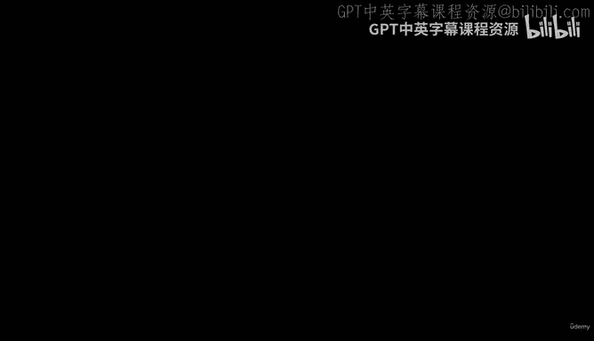
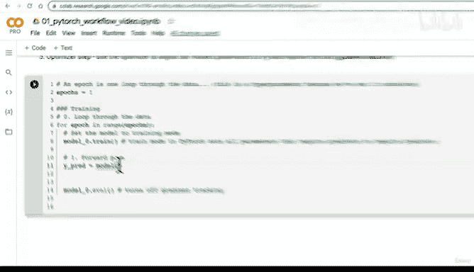
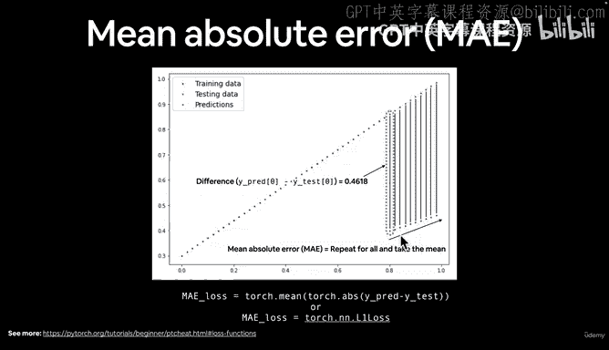
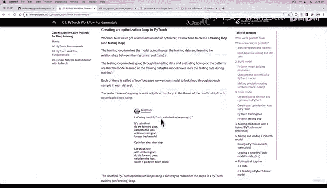
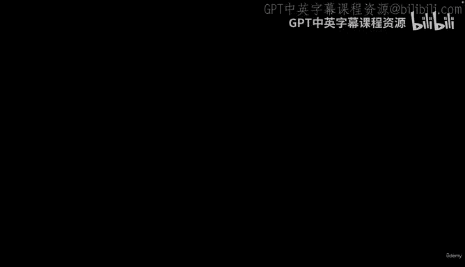
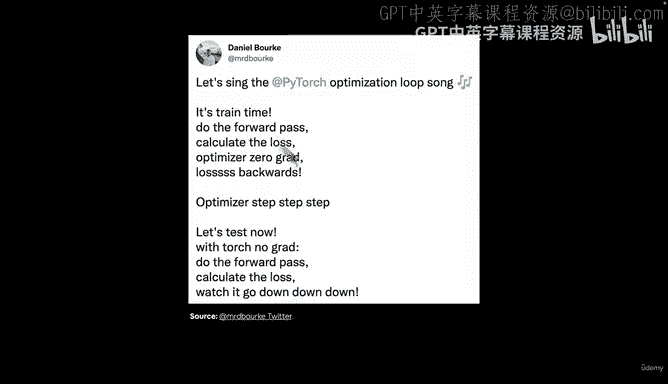
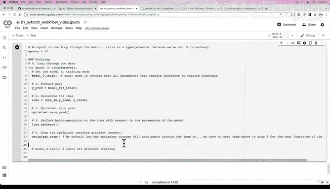

# Daniel Bourke《PyTorch 深度学习｜PyTorch 101 Crash Course For Beginners in 2025》中英字幕 - P50：050_03_014 编写PyTorch训练循环代码.zh_en - GPT中英字幕课程资源 - BV1kTSKB1E9m

Friends， welcome back。 In the last video， I promised a lot of code， but we didn't get there。

 We discussed some important steps。 I forgot how much behind the scenes there is to apply to a training loop。

And I think it's important to spend the time that we did discussing what's going on because there's a fair few steps。

 but once you know what's going on， I mean， later on。

 we don't have to write all the code that we're going to write in this video。 You can functionise it。

 We're going to see that later on in the course and it's going to run behind the scenes for us。

 but we're spending a fair bit of time here because this is literally the crux of how our model learns。

 So let's get into it。So now we're going to implement the Ford pass。

 which involves our model's Ford function， which we defined up here when we built our model。

The For pass runs through this code here。 So let's just write that。So in our case。

 because we're training， I'm just going to write here， this is training。

We're going to see Dot Val later on， we'll talk about that when it comes。Let's do the forward pass。

 So the forward pass， we want to pass data through our models For method。

 We can do this quite simply by going why pre。 So Y predictions， because remember。

 we're trying to use our ideal model is using X test to predict Y test on our test data set We make predictions on our test data set。

 We learn on our training data set。 So we're passing。

I going get rid of that because we don't need that。

 So we're passing our model X train and model 0 is going to be our current model。 There we go。

 So we learn patterns on the training data to evaluate our model on the test data。 Number two。

 where we at。

So we have to calculate the loss。 Now， in a previous video， we set up a loss function。

 So this is going to help us calculate the wat。 What kind of loss are we using。

 We want to calculate the MAe。 So the difference or the distance between our red dot and a green dot。

 and the formula would be the same if we had 10000 red dots and 10000 green dots。

 We're calculating how far they are apart。 and then we're taking the mean of that value。

So let's go back here。So。Calculate。The loss。 And in our case。

 we're going to set loss equal to our loss function， which is L1 loss in pitorrch， but it is MAE。

Why pre and why train。 So we're calculating the difference between our models predictions on the training data set and the ideal training values。

 And if you want to go into。Torch。t Nn loss functions。

That's going to show you the order because sometimes this confuses me too。

 What order the values going here， But it goes prediction first， then labels。

 and I may be be wrong there because I get confused here。 My dyslexia kicks in。

 but I'm pretty sure it's predictions first then。Actual libs。

Do we have an example of where it's used， Yeah， input first， Ta next， So there we go。

 and truth be told because it's mean absolute error， it shouldn't actually matter too much。

 but in the case of staying true to the documentation。

 let's do inputs first and then targets next for the rest of the course。Then we're going to go。

Optimizer0 grad。 haven't discussed this one， but that's okay。 I'm going to write the code。

 and then I'm going to discuss what it does。 So what does this do。Actually， before we discuss this。

 I'm going to write these two steps because they kind of all work together。

 and it's a lot easier to discuss what Opimr0 grad does in the context of having everything else。

Perform back。Proagation。On the loss。With respect to the parameters of the model。

Back propagation is going to take the loss value。 So lost backward， I always say backwards。

 but it's just backward。 That's the code there。 And then number 5 is step the optimizer。So， perform。

Graient descent。So optimizer dot step。 Look at us。 We just wrote the five major steps of a training loop。

 Now， let's discuss how all of these work together， so。

It's kind of strange like the ordering of these。 You might think， what should I do the order。

 Typically， the forwardd pass and the loss come straight up。

 Then there's a little bit of ambiguity around what order these have to come in。

 But the optimizer step should come after the back propagation。 So， I just like to keep this order。

 how it is， because this works。 Let's just keep it that way。 But what happens here。 Well。

 it also is a little bit confusing in the first iteration of the loop， because we've got0 grad。

 But what happens here is that the optimizer makes some calculations in how it should adjust model parameters with regards to the back propagation of the loss。

 And so by default， these will。By default。How the optimizer。Changes will accumulate。Through the loop。

So。We have to0 them。Above。And step three for the next iteration of the loop。

So a big long comment there。 But what this is saying is。

 let's say we go through the loop and the optimizer chooses a value of one。 Change it by one。

 And then it goes through a loop again， if we didn't zero it。

 if we didn't take it to 0 because that's what it is doing， it's going 1 to 0， it would go， okay。

 next1，2，3，4，5，6，7，8， all through the loop， right， because we we're looping here。 If this was 10。

 it would accumulate the value that it's supposed to change 10 times。 But we wanted to start again。

 start fresh each iteration of the loop。 And now the reason why it accumulates。

 that's pretty deep in the pytor documentation from my understanding。

 there's something to do with like efficiency of computing。 If you find out what the exact reason is。

 I'd love to know So we have to0 it， then we perform back propagation if you recall。😊。

Back propagation is discussed。In here。And then with optimizer step， we form gradient descent。

 So the beauty of Pytorch， This is the beauty of Pytorch， is that it will。Perform back propagation。

 We're going to have a look at this in a second and gradient descent for us。

So to prevent this video from getting too long， I know we've just written code。

 but I would like you to practice writing a training loop yourself。

 Just write this code and then run it and see what happens。 Actually， you can comment this out。

 We're going to write the testing loop in a second。So your extra curriculum for this video is to one。

 rewrite this training loop is to two。

Sing the Py Toch optimizationim Lo song， let's go into here。If you want to remember the stepss， well。

 I've got a song for you。 This is the training loop song。 We haven't discussed the test step。

 but maybe you could try this yourself。

So， and this is an old version of the song。 Actually， I've got a new one for you。😊。

But let's sing this together。 It's train time。 So we do the forward pass。 calculateulate the loss。

 Opimise 0 grad， loss backwards， Opise a step， step， step。

 Now you only have to call optimizer step once。 This is just for jingle purposes。 But for test time。

 let's test with Torch no grad。 do the forward pass。 Cal the loss。 watch to go down， down， down。

 that's for my Twitter。 but this is a way that I help myself。

 remember the steps that are going on in the code here。 And if you want the video version of it。

 Well， you're just gonna have to search unofficial。😊。

Pietorrch， Op Lo song。Oh， look at that。 Who's that guy。 Well， he looks pretty cool。

 So I'll let you check that out in your own time。 But for now。😊。

Go back through the training loop steps， I've got a colorful graphic coming up in the next video we're going to write the testing steps。

 and then we're going to go back one more time and talk about what's happening in each of them and again。

 if you'd like some even more extra curriculum， don't forget the videos I've shown you on back propagation and gradient descent。

😊，But for now。Let's leave this video here。 I'll see you in the next one。

