# Daniel Bourke《PyTorch 深度学习｜PyTorch 101 Crash Course For Beginners in 2025》中英字幕 - P51：051_03_015 逐步解析训练循环步骤.zh_en - GPT中英字幕课程资源 - BV1kTSKB1E9m

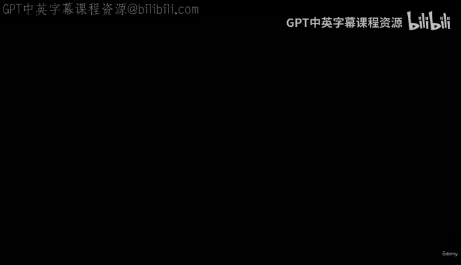

Friends， welcome back。 In the last few videos， we've been discussing the steps in a training loop in Pytorch。

 And there's a fair bit going on。 So in this video。

 we're going to step back through what we've done just to recap。

 And then we're going to get into testing。 And it's nice and early where I am right now。

 Sun's about to come up。 It's a very， very beautiful morning to be writing code。 So let's jump in。😊。

We've got a little song here for what we're doing in the training steps for an epo in， a。

 Commodal dot train。 do the forwardd pass， calculateulate the loss， Opimise a 0， grad。

 last backward Op a step， step， step。 That's the little jingle。

 I use to remember the steps in here because the first time you write it。

 there's a fair bit going on。 But subsequent steps and subsequent times that you do write it。

 You'll start to memorize this。 And even better later on。

 we're going to put it into a function so that we can just call it over and over and over and over again。

😊。

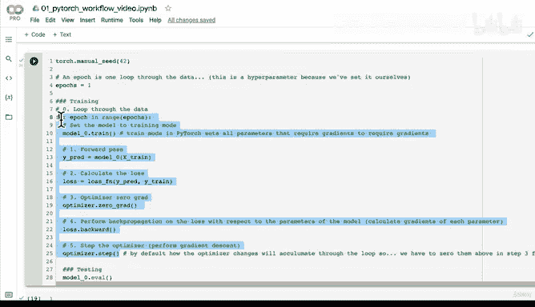

With that been said， let's jump in to a colourful slide， because that's a lot of code on the page。

 Let's add some color to it and understand what's happening that way you can refer to this and go。

 I see what's going on now。 So for the loop。 This is why it's called a training loop。

 We step through a number of epochs， one epoch is a single forwardd pass through the data。

 So pass the data through the model for a number of epochs。 epos is a hyperparameter。

 which means you could set it to 100。 You could set it to 1000。 You could set it to  one。

 as we're going to see later on in this video。😊。

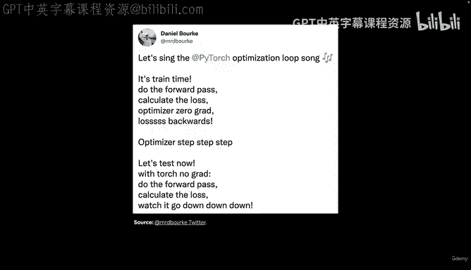

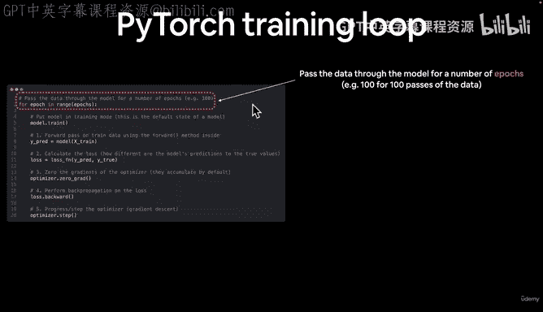

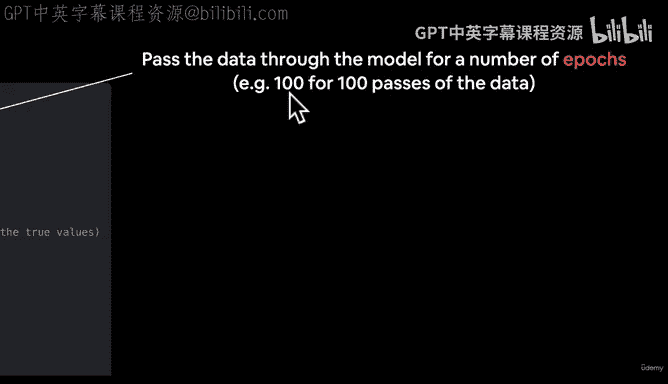

We skip this step with the colors but we put the model in we call model。train。

 this is the default mode that the model is in， essentially it sets up a whole bunch of settings behind the scenes in our model parameters so that they can track the gradients and do a whole bunch of learning behind the scenes with these functions down here。

 Pytorch does a lot of this for us。So the next step is the Ford pass We perform a forwardd pass on the training data in the training loop。

 this is an important note in the training loop is where the model learns patterns on the training data。

Whereas in the testing loop， we haven't got to that yet is where we evaluate the patterns that our model has learned or the parameters that our model has learned on unseen data。

 So we pass the data through the model。 This will perform the forward method located within the model object。

 So because we created a model object。 you can actually call your models whatever you want。

 But it's good practice to you'll often see it just called model。 And if you remember。

 we'll go back to the code。😊，We created a For method in our model up here。Which is this。

Because our linear regression model， class subclass is N N dot module。

 we need to create our own custom forward method。 So that's why it's called a Ford pass is because not only does it。

 Well， the technical term is Ford propagation。 So if we have a look at a neural network。赔偿。

Ford propagation just means going through the network from the input to the output。 there is a。

 I think called back propagation， which we're going to discuss in a second。

 which happens when we call loss stop backward， which is going backward through the model。

 But let's return to our colorful slide。We've done the Ford pass。

 called a For method which performs some calculation on the data we pass in。

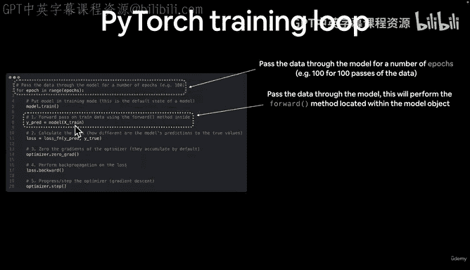

Next is we calculate the loss value， how wrong the model's predictions are。

 and this will depend on what loss function you use。

 what kind of predictions your model is outputting and what kind of true values you have。

 but that's what we're doing here we're comparing our models' predictions on the training data to what they should ideally be。

 and these will be the training labels。The next step。We zero the optimizer gradients。

 So why dont we do this？ Well， it's a little confusing for the first epoch in the loop。

But as we get down to optimizert step here， the gradients that the optimizer calculates accumulate over time so that for each epoch for each loop step。

 we want them to go back to0。 And now the exact reason behind why the optimizer accumulates gradients is buried somewhere within the Ptor documentation。

 I'm not sure the exact reason from memory， it's because of compute optimization。

 It just adds them up in case you wanted to know what they were。 But if you find out exactly。

 I'd love to know。😊，Next step is to perform back propagation on the loss function。

 That's what we're calling loss stop backward。 Now。

 back propagation is we compute the gradient of every parameter which requires grad equals true。

 And if you recall， we go back to our code。We've set requires grad equals true for our parameters。

 Now， the reason we've set requires grad equals true is not only so back provocation can be performed on it。

But。😡，Let me show you what the gradients look like。 So let's go loss function curve。

 That's a good idea。So we're looking for some sort of convex curve here。

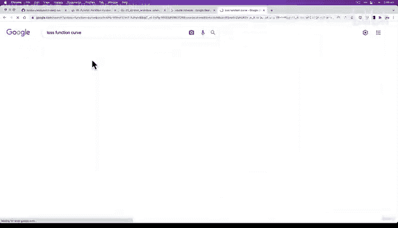

There we go， L2 loss， we're using L1 loss at the moment。Is there a better one here。

All we need is just a nice looking curve， here we go。So。

This is why we keep track of the gradients Behind the scenes。

 Pytorrch is going to create some sort of curve for all of our parameters that looks like this。 Now。

 this is just a 2D plot。 So the reason why we're just using an example from Google imagesmages is one because you're going to spend a lot of your time Googling different things and 2。

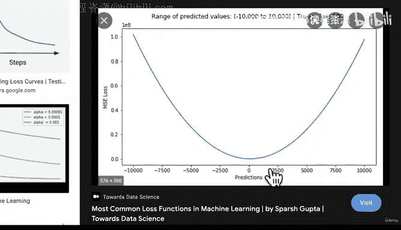

In practice， when you have your own custom neural networks， right now， we only have two parameters。

 So it's quite easy to visualize a loss function curve like this。 but when you have， say。

 10 million parameters， you basically can't visualize what's going on。

 And so pytorch again will take care of these things behind the scenes。

 But what it's doing is when we say requires grad， Pytorch is going to track the gradients of each of our parameters。

 And so what we're trying to do here with back propagation and subsequently gradient descent is calculate where the lowest point is。

Because this is a loss function， this is MSE loss， we could trade this out to be MAE loss in our case。

 or L1 loss for our specific problem。But this is some sort of parameter。

 and we calculate the gradients because what is the gradient。 Let's have a look。

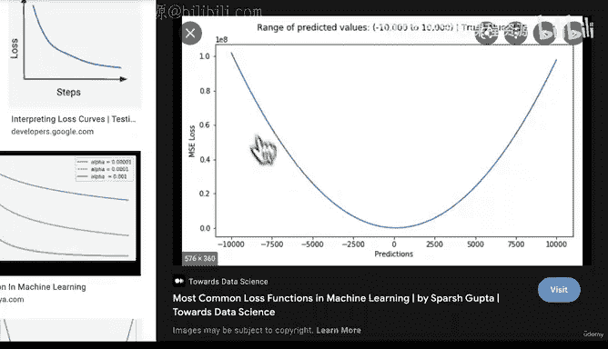

What is。A gradient。A gradient is。An inclined part of the road or railway。

 No we want it in machine learning。

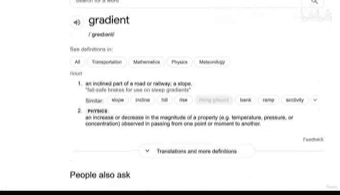

What's it going to give us in machine learning， a gradient is a derivative of a function that has more than one input variable。

 Okay， let's dive in a little deeper。 See， here's some beautiful lost landscapes。

 We're trying to get to the bottom of here。 This is what gradient descent is all about。😊，So oh。

 there we go。 So this is a cost function， which is also a loss function。

 We start with a random initial variable。 What have we done。

 We've started with a random initial variable， right， okay， and then we take a learning step。 Beai。

 This is W。 So this could be our weight parameter。 Okay， we're connecting the dots here。

 This is exciting。😊，We've got a lot of tabs here， but that's all right。 Well。

 we'll bring this all together in a second。 And what we're trying to do is come to the minimum。 Now。

 why do we need to calculate the gradients？ Well， the gradient is what。

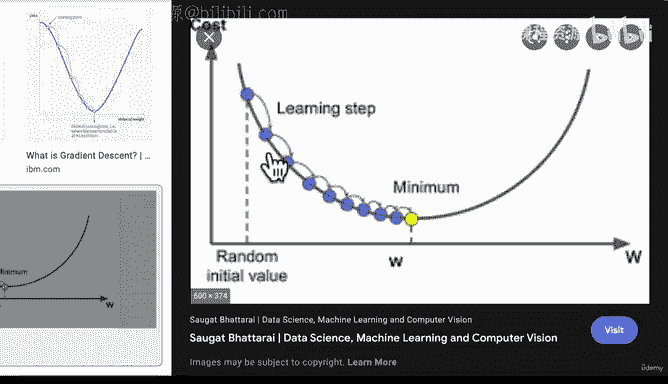

Oh value of weight。 Here we go。 This is even better。 I love Google imagesages。 So this is our loss。

 and this is a value of a weight。 So we calculate the gradients， why。😊。

Because the gradient is the slope of a line or the steepness。

 and so if we calculate the gradient here and we find that it's really steep。😊。

Right up the top of this， this incline， we might head in the opposite direction to that gradient。

 That's what gradient descent is。 And so if we go down here， now， what are these step points。

 This a little thing that I've wrote down in the last video at the end of the last video I haven't told you about yet。

 but I was waiting for a moment like this。And if you recall， I said kind of all of these three steps。

 optimize a zero grad loss backward， optimize a stepper altogether。

 So we calculate the gradients because we want to head in the opposite direction of that gradient to get to a gradient value of0。

 and if we get to a gradient value of 0 with a loss function， well then the loss is also0。

So that's why we keep track of the gradient with requires grad equals true and again。

 Pytorch does a lot of this behind the scenes and if you want to dig more into what's going on here。

 I'm going to show you some extra resources for back propagation which is calculating this gradient curve here and gradient descent which is finding the bottom of it towards the end of this video and again if we started over this side we would just go on the opposite direction of this。

So maybe this is a positive gradient here。 and we just go in the opposite direction here。

 We want to get to the bottom。 That is the main point of gradient descent。And so if we come back。

I said。Just keep this step size in mind here。 If we come back to where we created our loss function and optimizer。

I put a little tidbit here for the optimizer。Cause we've written a lot of code and we haven't really discussed what's going on。

 but I like to do things on the fly as we need them。

 So inside our optimizer we'll have main two parameters， which is parameterss。

 So the model parameters you'd like to optimize parameterss equals model zero dot parameters in our case。

 and ptorrch is going to create something similar to this curve。

 not visually but just mathematically behind the scenes for every parameter。

 Now this is a value of weight。 So this would just be potentially the weight parameter of our network。

 But again， if you have 10 million parameters， there's no way you could just create all of these curves yourself。

 that's the beauty of pitorrch it's doing this behind the scenes through a mechanism called torch autograd。

 which is auto gradient calculation。 And there's beautiful documentation on this。

 if you'd like to read more on how it works， please go through that。

 but essentially behind the scenes that's doing a lot of this for us for each parameter。

 that's the optimizer。😊，Then within the optr， once we've told it what parameters to optimize。

 we have the learning rate。 So the learning rate is another hyperparameter that defines how big or small the optimizer changes the parameters with each step。

So a small learning rate results in small changes whereas a large learning rate is in large changes。

 and so if we look at this curve here， we might at the beginning start with large steps so we can get closer and closer to the bottom。

 but then as we get closer and closer to the bottom to prevent stepping over to this side of the curve we might do smaller and smaller steps and the optimizer in Pytorch。

 there are optimizes that do that for us， but there is also another concept called learning rate scheduling。

Which is， again， something if you would like to look up and do more。

 But learning rate scheduling essentially says， hey， maybe start with some big steps。

 And then as we get closer and closer to the bottom， reduce how big the steps are that we take。

 because if you've ever seen a coin。Coin at backov couch。This is my favourite analogy for this。

 If you've ever tried to reach a coin at the back of a couch。

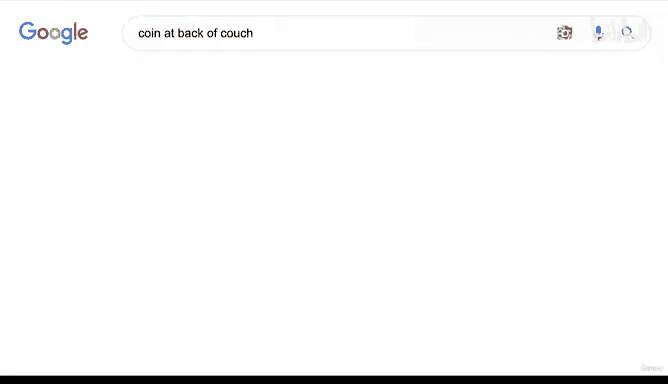

Like this excited young chap。If you're reaching towards the back of the couch。

 you take quite big steps as you say your arm was over here。

 You would take quite big steps until you get to about here。 And then the closer you get to the coin。

 the smaller and smaller your steps are otherwise， what's going to happen。

 the coins going to be lost。 Or if you took two small steps。 you'd never get to the coin。

 It would take forever ever to get there。 So that's the concept of the learning rate。 If you take。

Two big steps。 you're going to just end up over here。 If it takes two small steps。

 it's going to take you forever to get to the bottom here。

 And this bottom point is called convergence。 That's another term you're going to come across。

 I know I'm throwing a lot of different terms at you。

 but that's the whole concept of the learning rate。 How big is your step down here。

 in gradient descent， gradient descent is this back propagation is calculating these derivative curves or the gradient curves for each of the parameters in our model。

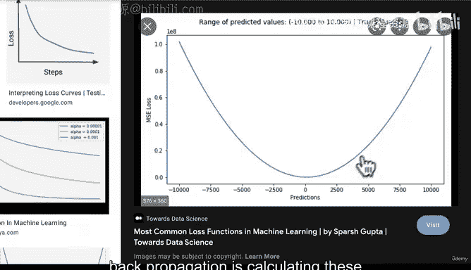

So let's get out of here。We'll go back to our training steps Where were we， I think we're up to。

Back propagation。 Have we done backward， Yes， So the back propagation is where。

We do the backward steps so the forwardd pass， forward propagation go from input to output back propagation。

 We take the gradient of the loss function with respect to each parameter in our model by going backwards。

 That's what happens when we call loss stop backward Py to does that for us behind the scenes。

And then finally， step number five is step the optimizer。 we've kind of discussed that。 As I said。

 if we take a step， let's get our loss curve back up。

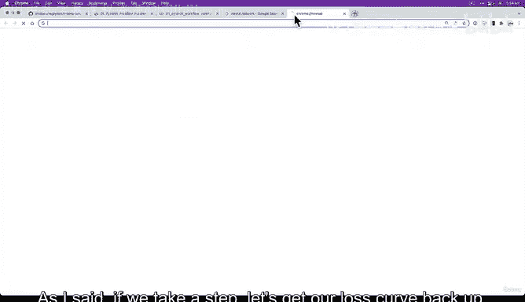

Lost function curve doesn't really matter what curve we use。

The optimizer step is taking a step this way to try and optimize the parameters so that we can get down to the bottom here。

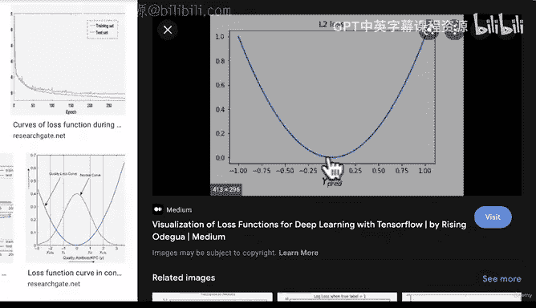

And I also just noted here that you can turn all of this into a function so we don't necessarily have to remember to write these every single time the ordering of this。

 you'll want to do the forwardd pass first and then calculate the loss because you can't calculate the loss unless you do the forwardd pass。

 I like this ordering here of these three as well。 but you also want to do the optimizer step after the loss backward。

 So this is my favorite ordering。 it works if you like this ordering， you can take that as well。

With that being said， I think this video has gotten long enough in the next video。

 I'd like to step through this training loop， one epoch at a time so that we can see。

 I know I've just thrown a lot of words at you that this optimize is going to try and optimize our parameters each step。

 but let's see that in action how our parameters of our model actually change every time we go through。

Each one of these steps。 So I'll see you in the next video。 Let's step through our model。

