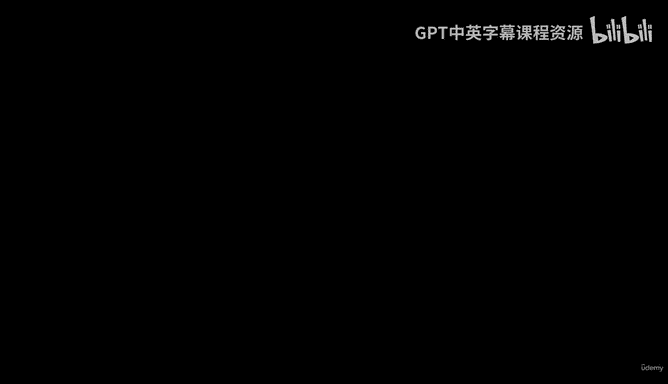
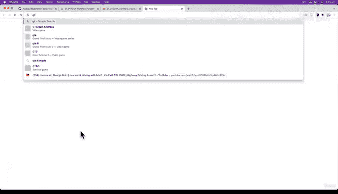
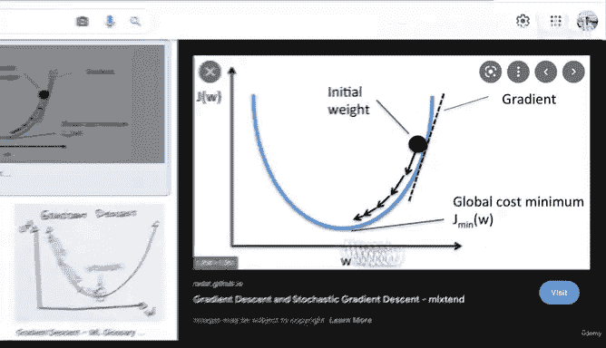
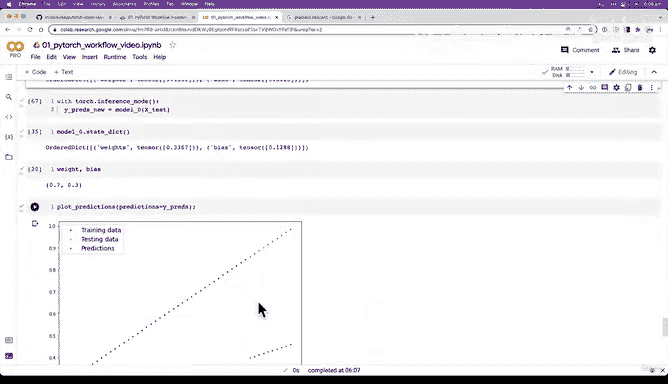

# Daniel Bourke《PyTorch 深度学习｜PyTorch 101 Crash Course For Beginners in 2025》中英字幕 - P52：052_03_016 逐轮次运行训练循环与效果观察.zh_en - GPT中英字幕课程资源 - BV1kTSKB1E9m

Welcome back Now we've spent a fair bit of time on the training loop and the testing loop where we haven't even got to that yet。

 but there's a reason behind this because this is possibly one of the most important things aside from getting your data ready。

 which we're going to see later on in P to deep learning is writing the training loop because this is literally like how your model learns patterns and data So that's why we're spending a fair bit of time on here and we'll get to the testing loop because that's how you evaluate the patterns that your model has learned from data。

 which is just as important as learning the patterns themselves。😊。

And following on from the last couple of videos， I've just linked some YouTube videos that I would recommend for extra curriculum for back propagation。

 which is what happens when we call lost stop backward down here。😊，And for the optimizer step。

 gradient descent is what's happening there。 So I've linked some extra resources for what's going on behind the scenes there from a mathematical point of view。

 Remember， this course focuses on writing piytoch code。

 But if you'd like to dive into what math P Toch is triggering behind the scenes。

 I'd highly recommend these two videos。And I've also added a note here as to which loss function and optimizer should I use。

 which is a very valid question。 And again， it's another one of those things that's going to be problem specific。

 But with experience over time。 you work with machine learning problems。 You write a lot of code。

 you get an idea of what works and what doesn't with your particular problem set。 For example。

 like a regression problem like ours regression is again， predicting a number。 We use MAe loss。

 which Pytoch causes L1 loss， you could also use ME loss。

 and an optr like torch optim stochastic gradient descent will suffice。 But for classification。

 you might want to look into a binary classification。 a binary cross entropy loss。

 but we'll look at a classification problem later on in the course。 For now。

 I'd like to demonstrate what's going on in the steps here。 So let's go model 0。

Let's look up the state dict and see what the parameters are for now。Now。

 they aren't the original ones。 I don't think。 Let's re instantsantiate our model， so we get ready。

New parameters。Yeah， we recreated it here。I might could just get rid of that。

 So we'll rerun our model code， rerun model state d。

 and we will create an instance of our model and just make sure your parameters should be something similar to this。

 if it's not exactly like that， it doesn't matter。 but yeah。

 I'm just going to showcase you'll see on my screen what's going on anyway。

Stay di 3367 for the weight and 01288 for the bias。And again， I can't stress enough。

 we've only got two parameters for our model and we've set them ourselves。

 future models that you build and later ones in the course will have much。

 much more and we won't actually explicitly set any of them ourselves。

We'll check out some predictions。 They're going to be terrible because we're using random parameters to begin with。

 but we'll set up a new loss function and an optimizer。

 optimizeimr is going to optimize our model0 parameters， the weight and bias。 The learning rate is 0。

01， which is relatively large step。 that would be a bit smaller。 Remember。

 the larger the learning rate， the bigger the step。

 the more the optimizer will try to change these parameters every step。

 But let's stop talking about it， let's see it in action。 I've set a manual seed here， too。

 by the way， because the optimizer' steps are going to be quite random as well。

 depending on how the model's predictions go。 But this is just to try and make it as reproduce as possible。

 So keep this in mind， if you get different values to what we're going to output here。

 from my screen to your screen。 Don't worry too much。

 What's more important is the direction they're going so。Ideally， we're moving these values here。

This is from we did one epoch before。 We're moving these values closer to the true values。

 And in practice， you won't necessarily know what the true values are。

 But that's where evaluation of your model comes in。

 We're going to cover that when we write a testing loop。So， let's。

Run one epoch now I'm going to keep that down there。Watch what happens。We've done one epoch。

 just a single epoch。 We've done the forwardd pass。 We've calculated the loss。 We've done Opr 0 grad。

 We've performed vac propagation， and we've stepped the optimizer。 What is stepping the optimizer do。

 It updates our model parameters to try and get them further closer towards the weight and bias。

 If it does that， the loss will be closer to 0。 That's what it's trying to do。

 How about we print out the loss。 at the same time。😊，Print loss。And the loss。Let's take another step。

So the loss is 0，301。 Now we check the weights。And the bias， we've changed again，3，3，4，4，5，1，4，8，8。

We go again。 The loss is going down。 Check it。A， look at that。

 The values are getting closer to where they should be， if ever so slightly。Loss went down again。

Oh my goodness， this is so amazing。 Look， we're training out。 Let's print this out in the same cell。

 Pri out model。😊，State diic。 we're training our first machine learning model here， people。 This is。

 this is very exciting， even if it's only step by step and it's only a small model。

 This is very important。 Los is going down again。 Values are getting closer to where they should be。

😊，Again， we won't really know where they should be in real problems。 But for now we do。

 So let's just get excited。 The real way to sort of measure your model's progress in practice is a lower loss value。

 Remember， lower is better。 A loss of value measures how wrong your model is。 We're going down。

 We're going in the right direction。So that's what I meant by as long as your values are going in the similar direction。

 So down， we're writing similar code here， But if your values are slightly different in terms of the exact numbers。

 don't worry too much because that's inherent to the randomness of machine learning because the steps that the optimizer are taking are inherently random。

 but they're sort of pushed in a direction。 So we're doing gradient descent here。 This is beautiful。

How low can we get the loss， How about we try to get to 0。1。 Look at that。 We're getting close to 0。

1。 And then， I mean， we don't have to do this hand by hand。

 the bias is getting close to where it exactly should be。 We're below 0。1 beautiful。

 So that was only about， say 10 passes through the data。 But now you're seeing it in practice。

 you're seeing it happen。 You're seeing gradient descent。😊。

Let's go gradient descent， work in action。 We've got images。This is what's happening。

 We've got our cost function。 J is another term for cost function， which is also our loss function。

 We start with an initial weight。 What have we done， We started with an initial weight。

 this value here。And what are we doing， We've measured the gradient。

 Piytorrch has done that behind the scenes for us。 Thank you， Piytorrch。

 And we're taking steps towards the minimum。 That's what we're trying to do If we minimize the gradient of our weight。

 we minimize the cost function， which is also a loss function。

We could keep going here。For hours and get as long as we want。But my challenge for you or actually。

 how about we make some predictions with our model we've got right now， Let's make some predictions。

 So with tor shot inference mode。We'll make some predictions together。

 And then I'm going to set you a challenge。 How about you run this code here for 100 epochs after this video。

 And then you make some predictions and see how that goes。 So why pres。

 Remember how poor our predictions are， Why pres new equals。 We just do the forwardd pass here。

Model0 on the test data。Let's just remind ourselves quickly of how poor our previous predictions were。

 plot predictions， predictions equals。 Y do we still have this saved， Why pres。Hopefully。

 this is still saved。There we go。 Shocking predictions。 But we've just done 10 or so epoch。

 So 10 or so training steps have our predictions。 Do they look any better， Let's run this。

We'll copy this code， you know my rule， I don't really like to copy code， but in this case。

 I just want to exemplify a point。I like to write all the code myself。

What do we got Ypres new Look at that？😮，Look at that。

 We are moving our predictions closer the red dots closer to the green dots。

 This is what's happening。 We're reducing the loss。In other words。

 we're reducing the difference between our models's predictions and our ideal outcomes through the power of back propagation and gradient descent。

 So this is super exciting。 We're training our first machine learning model。

 My challenge to you is to run this code here， change epoch to 100。

 see how low you can get this loss value and run some predictions。

 P them and I think it's time to start testing， So give that a go yourself。

 and then we'll write some testing code in the next video。😊。

I'll see you there。