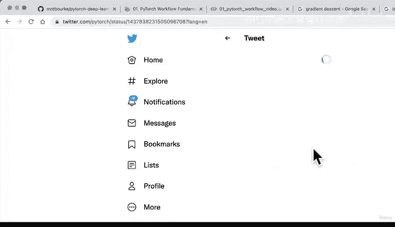
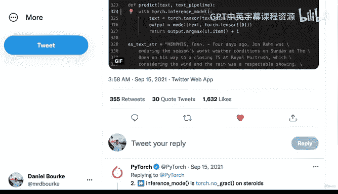
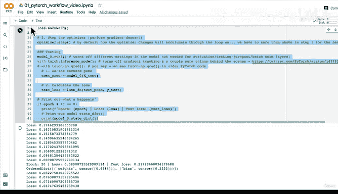

# Daniel Bourke《PyTorch 深度学习｜PyTorch 101 Crash Course For Beginners in 2025》中英字幕 - P53：053_03_017 编写测试循环代码与逐步解析.zh_en - GPT中英字幕课程资源 - BV1kTSKB1E9m

Welcome back。 In the last video， we did something super excited。 We saw our loss go down。

 So the loss is remember how different our model's predictions are to what we'd ideally like them。

 And we saw our model update its parameters through the power of back propagation and gradient descent。

 all taken care of behind the scenes for us by pytorrch。 So thank you Pytorrch。 And again。

 if you'd like some extra resources on what's actually happening from a math perspective for back propagation and gradient descent。

 I would refer to you to these。 Otherwise， this is also how I learn about things。 gradient descent。😊。

There we go， how does gradient descent work， and then we've got back propagation。

And just to reiterate， I am doing this， just googling these things because that's what you're going to do in practice。

 You're gonna to come across a lot of different things that aren't covered in this course。

 And this is seriously what I do day to day as a machine learning engineer if I don't know what's going on。

 I just go to Google， read， watch a video， write some code， And then I build my own intuition for it。

 But with that being said， I also issued you the challenge of trying to run this training code for 100 epochs。

 Did you give that a go， I hope you did， And how low did your loss value there Did the weights and bias get anywhere close to where they should have been。

 How do the predictions look。Now， I'm going to save that for later on running this code for 100 epochs。

 For now， let's write some testing code。 And just a note。

 you don't necessarily have to write the training and testing loop together。

 You can functionise them， which we will be doing later on。 but for the sake of this intuition。

 building and code practicing and first time where we're writing this code together。

 I'm going to write them together。 so。Testing code， we call model dot of our。 What does this do。

 So this turns off。Different settings。In the model， not needed for。Evaluation。Slash testing。

 This can be a little confusing to remember when you're writing testing code。

 but we're going to do it a few times until it's habit。 So just make it a habit。

 if you're training your model call model dot train to make sure it's in training mode if you're testing or evaluating your model。

 so that's what a vow stands for evaluating call model do aval。

 So it turns off different settings in the model not needed for evaluations So testing。

 this is things like dropout， we haven't seen what dropout is slash batch norm layers。

 but if we go into torch do an N。 I'm sure you'll come across these things。

In your future machine learning endeavors。So， drop out。Drop out layers， there we go and batch norm。

 do we have batch？Batch norm， there we go。 If you'd like to work out what they are。

 feel free to check out the documentation。 Just take it from me for now。

 that model ofval turns off different settings not needed for evaluation and testing。

 Then we set up with torch dot inference mode。Inference mode。So what does this do。

 Let's write down here。So this turns off gradient tracking。 So as we discussed。

 if we have parameters in our model。And it turns off actually a few more things。

And a couple more things。Behind the scenes。These are things， again， not needed for testing。

 So we discussed that if parameters in our model have requires grad equals true。

 which is the default for many different parameters in piytorrch。Pytoch will behind the scenes。

 keep track of the gradients of our model and use them in lost up backward and optimize a step for back propagation and gradient descent。

 however。We only need those two back propagation and gradient descent during training。

 because that is when our model is learning。 when we are testing。

 we are just evaluating the parameters the patterns that our model has learned on the training data set。

 So we don't need to do any learning when we're testing So we turn off the things that we don't need。

 And is this going to have the correct spacing for me。 I'm not sure we'll find out。

 So we still do the forwardd pass。In testing mode。Do the forward pass。

 And if you want to look up torch inference mode， just go torch inference mode。

 There's a great tweet about it。 that Pi torch did， which explains what's happening。

I think we've covered this before。 but yeah， want to make your inference code and Ptorrch run faster。

 Here's a quick thread on doing exactly that。 So inference mode is torch nograd。 Again。

 you might see torch nograd。 I think I'll write that down just to。

Let you know。 But here's what's happening behind the scenes， a lot of optimization code。

 which is beautiful。 This is why we're using Pytorch。 so that our code runs nice and far。

 Let we go there。 you may also see with torch。 nograd in older Pytorrch code。 It does similar things。

 but inference mode is the faster way of doing things。 According to the thread。

 And according to there's a blog post attached to there as well， I believe。😊，So。

You may also see Torch。 Nograd。In older。Py torch code， which would be valid， but again。

 inference mode is the better way of doing things。So do forward pass。 So let's get our model。

 We want to create test predictions here， So we're going to go model 0。

 There's a lot of code going on here， but I'm going to just step by step it in a second。

 We'll go back through it all。And then number two is calculate the loss。

 Now we're doing the test predictions here。 Calulate the loss。Test predictions with Model0。

 So now we want to calculate the w。 We want to calculate the test loss。

 So this will be our loss function。 The difference between the test pre and the test labels。

 that's important。 So for testing， we're working with test data for training。

 we're working with training data Model learns patterns on the training data and it evaluates those patterns that it's learned the different parameters on the test data data it has never seen before。

 just like in a university course， you'd study the course materials。

 which is the training data and you'd evaluate your knowledge on materials you'd hopefully never seen before unless you sort of were friends with your professor and they gave you the exam before the actual exam that would be cheating right。

 So that's a very important point for the test data set。

 Don't let your model see the test data set before you evaluate on Otherwise you'll get poor results。

And that's printed out what's happening。 Epoch， We're going to go epoch。

 and then I will introduce you to my little jingle to remember all of these steps because there is a lot going on。

 Don't you worry， I know there's a lot going on， but。Again， with practice， we're going to。No。

 what's happening here？Like it's the back of our hand。好 right。So do we need this， yeah。

 we could say that。 Oh， we don't need test here。 Los。 This is loss， not test。

Print out what's happening。Okay。And we don't actually need to do this every epoch。

 we could just go say if epoch。Divided by 10 equals 0。 Pri out what's happening。

 Let's do that rather than clutter everything up， print it out， and we'll print out this。

So let's just step through what's happening。 We've got 100 epochs。

 that's what we're about to run 100 epochs。 Our model is trained for about 10 so far。

 So it's got a good base。 Maybe we'll just get rid of that base。 Start a new instance of our model。

So we'll come right back down。So our model is back to randomly initialized parameters， but。

 of course， randomly initialized， flavored with a random seed or 42。 Lovely， lovely。

 And so we've got our training code here。 We've discussed what's happening there。😊。

Now we've got our testing code。 We call model do aval。

 which turns off different settings in the model， not needed for evaluation slash testing。

 We call with torch inference mode context manager。

 which turns off gradient tracking and a couple more things behind the scenes to make our code faster。

 We do the forward pass。 We do the test predictions。 We pass our model， the test data。

 the test features to calculate the test predictions。

Then we calculate the loss using our loss function。

 We can use the same loss function that we used for the training data。

 and it's called the test loss because it's on the test data set。

 And then we print out what's happening because we want to know what's happening while our model is training。

 We don't necessarily have to do this。 But the beauty of Pytor is。

 you can use basic python printing statements to see what's happening with your model。

 And so because we're doing 100 epochs， we don't want to clutter up everything here。

 So we'll just print out what's happening every 10th epoch。 Again。

 you can customize this as much as you like what's printing out here。 This is just one example。

 if you had other metrics here， such as calculating model accuracy， we might see that later on。

 Hiin hint。We might print out our model accuracy。So this is very exciting。

 Are you ready to run 100 epochs。 How low do you think our loss can go。😊。

This loss was after about 10。 So let's just save this here。 Let's give it a go。 Ready，3，2，1。

 let's run。Oh my goodness。 Look at that， whites。Here we go。

 Every 10 epochs were're printing out what's happening。 So the 0 the epoch we started with loss is 3。

1，2。 Look at it go down。Yes， that's what we want。 And are our weights and bias。

 Are they moving towards our ideal weight and bias values of 0。7 and 0。3。 Yes。

 they're moving in the right direction here。 The loss is going down。 Epoch 20。 wonderful。 epoch 30。

 even better，40，50 going down， down down。 Yes， this is what we want。 This is what we want。 Now。

 we're predicting a straight line here。 Look how low the loss gets。 after 100 epochs。 we've got。😊。

About three times less than what we had before。And then weve got these values are quite close to where they should be。

0，5，6，29，0，3，5，7，3， We make some predictions。 What do they look like。Whyprereads new。

 this is the original predictions with random values。 and if we make Ypres new。Look how close it is。

 After 100 epochs。 Now， what's our， do we print out the test loss， I know。

 we're printing out loss as well， Let's get rid of that。 I think this is this， yeah。

 that's this statement here。 Our code would have been a much cleaner if we didn't have that。

 But that's all right。 Life goes on。 So our test loss。

 because this is the test predictions that we're making。 is not as low as our training loss。

 I wonder how we could get that lower。 What do you think we could do。😊，We just trained it for longer。

 And what happened。How do you think you could get these red dots to line up with these green dots。

 Do you think you could。So that's my challenge to you for the next video。

 think of something that you could do to get these red dots to match up with these green dots。

 maybe train for longer。How do you think you could do that？

So give that a shot and I'll see in the next video we'll review what our testing code is doing。

I'll see you there。