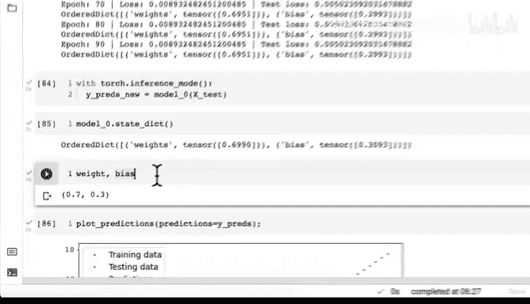
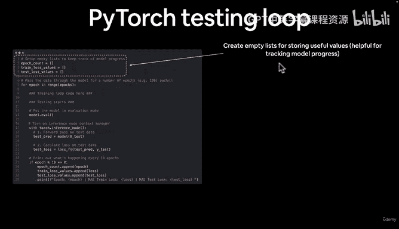
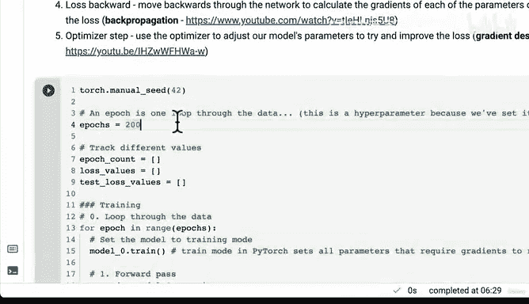
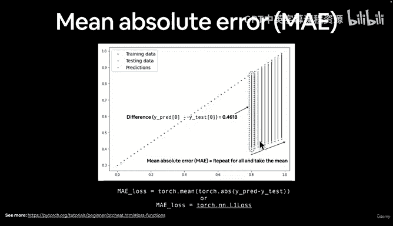
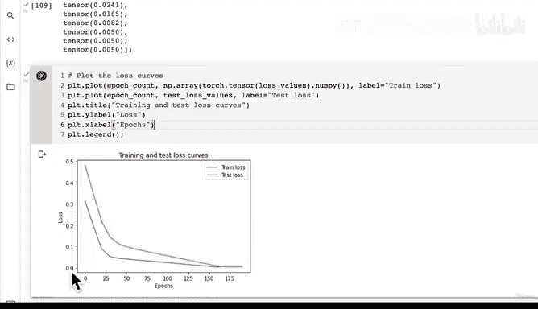
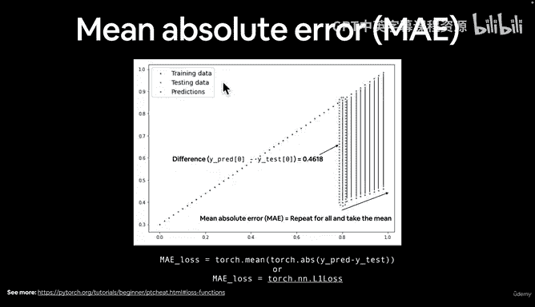
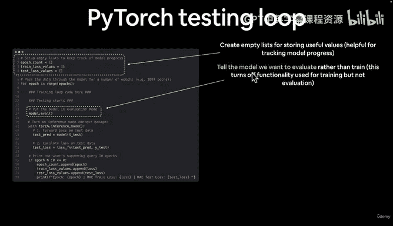
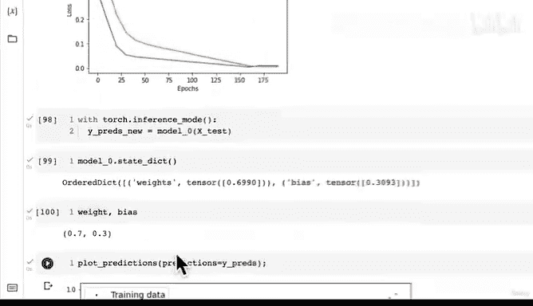

# Daniel Bourke《PyTorch 深度学习｜PyTorch 101 Crash Course For Beginners in 2025》中英字幕 - P54：054_03_018 逐步解析测试循环流程.zh_en - GPT中英字幕课程资源 - BV1kTSKB1E9m

Welcome back。In the last video， we did something super exciting。

 We trained our model for 100 epochs and look how good the predictions got。

 But I finish it off with challenging you to see if you could align the red dots with the green dots。

 And it's okay。 if you're not sure how the best way to do that。 That's what we're here for。

 We're here to learn what are the best way to do these things together。

 But you might have had the idea of potentially training the model for a little bit longer。

 So how could we do that。😊，Well， we' could just rerun this code。

So the model is going to remember the parameters that it has from what we've done here and if we rerun it。

 well it's going to start from where it finished off， which is already pretty good for our data set。

 and then it's going to try and improve them even more。 This is I can't stress enough。

 like what we are doing here is going to be very similar throughout the entire rest of the course for training more and more models。

 So this step that we've done here for training our model and evaluating it is seriously like the fundamental steps of deep learning with Pytorch is training and evaluating a model and we've just done it。

😊，Although albeit to predict some red dots and green dots。That's all right。

 So let's try to line them up。 Hey， red dots onto green dots。

 I reckon if we train it for another 1 hundred epochs， we should get pretty darn close。readyy， three。

 two， one， I'm going to run this cell again。Runs really quick because our data is nice and simple。

 but look at this last So we start at 02，44。 Where do we get down to008 Oh my goodness。

 So we've improved it by another 3 x or so。 And Now this is where our modelss got really good on the test loss we've gone from0005。

6，4 and we've gone down to 005。 So almost 10 x improvement there。

 And so we make some more predictions。 What are our model parameters。 Remember the ideal ones here。

 we won't necessarily know them in practice。 but because we're working with a simple data set。

 we know what the ideal parameters are。😊，Model 0 state dig weights。

These are what they previously were。 What are they going to change to？Oh， would you look at that。

 Ho ho，0，6，9，9，0。 Now， again， if yours are very slightly different to mine， don't worry too much。

 That is the inherent randomness of machine learning and deep learning。

 even though we set a manual seed， it may be slightly different。The direction is more important。

 So if your number here is not exactly what mine is， it should still be quite close to 0。7。

 And the same thing with this one。 If it's not exactly what mine is， don't worry too much。

 the same with all of these loss values as well， The direction is more important。

So we're pretty darn close。 How do these predictions look， Remember。

 these are the original ones we started with random。 and now we've trained a model。So close。

So close to being exactly that。 So a little bit off。 But that's all right。

 We could tweak a few things to improve this。 But I think that that's well and truly enough for this example purpose。

 You see what's happened。 Of course， we could just create a model and set the parameters ourselves manually。

 but where would be the fun in that。 We just wrote some machine learning code to do it for us through the power of back propagation and gradient descent。

 Now， in the last video， we wrote the testing loop。 We discussed a few of the steps here。

 But now let's go over it with a colourful slide。 Hey， because I mean， code on a page is nice。

 but colorss are even nicer。 Oh， we haven't done this。 we might set up this in this video， too。😊。

But let's just discuss what's going on。 createate an empty list for storing useful value。

 So this is helpful for tracking model progress。t we just do this right now。 Hey。

 we'll go here and we'll go。

So what did we have epoch count？Equals that。 And then we'll go。Losts values。

 So why do we keep track of these， It's because。If we want to monitor our model's progress。

 this is called tracking experiments。 So track different values。

 If we wanted to try and improve upon our current model with a future model。 So our current results。

Such as this， if we wanted to try and improve upon it。

 we might build an entire other model and we might train it in a different setup。

 We might use a different learning rate。 We might use a whole bunch of different settings。

 but we track the values so that we can compare future experiments to past experiments like the brilliant scientists that we are。

And so where could we use these lists， Well， we're calculating the loss here and we're calculating the test loss here。

 So maybe we each time append。What's going on here as we do a status update。 So epoch count。

Dot append。 And we're going to go the current epoch。

And then we'll go loss values dot append a current loss value。

 and then we will do test loss values dot append the current test loss values。 Wo。

 and now let's say re instantsantiate our model so that it starts from fresh So this is just create another instance。

 So we're just gonna reinitialize our model parameters to start from zero。 If we wanted to。

 we could functionize all of this so we don't have to go right back up to the top of the code。

 but just for demo purposes we're doing it how we're doing it， And I'm going to run this for。

 let's say 200 epochs because that's what we ended up doing right。

 We ran it for 200 epochs because we did 100 epochs twice and I want to show you something beautiful。

 one of the most beautiful sites in machine learning So there we go， we run it for 200 epochs。

 we start with a fairly high training loss value and a fairly high test loss value。

 So remember what is our loss value。 It's MAe。 So if we go back。

Yeah， this is what we're measuring for loss。 So this means for the test loss on average each of our dot points here。

 the red predictions are 0。481。 that's the average distance between each dot point and then ideally what are we doing We're trying to minimize this distance。

 That's the MAe。 So the mean absolute error。 and we get it right down to 0。05。

 And if we make predictions。 What do we have here， we get very close to the ideal weight and bias。

 make our predictions。 have a look at the new predictions。 Yeah， very small distance here。 beautiful。

 That's a low loss value。

Ideally， they'd line up， but we've got as close as we can for now。

 So this is one of the most beautiful sites in machine learning。 So plot the loss curves。😊。

So let's make a plot because what were we doing， we were tracking the value of epoch count。

Loss values。 and test loss values。Let's have a look at what these all look like。

So epoch count goes up， Los values ideally go down。 So we'll get rid of that。

 We're going to create a plot， PLT dot plot。We're going step back through the。Test loop in a second。

 with some colorfulful。Slides， label equals train loss。And then we're going to go plot。

You might be able to tell what's going on here。 Test loss values。

 We're going to visualize it because that's the data Explorer's motto， right， is visualize。

 visualize， visualize。 This is equals see， coLive does this autocorrect。

 That doesn't really work very well。 And I don't know when it does it and why it doesn't。Have we got。

I know。 we didn't。 We didn't say Las Vegas。 So that's a good auto， correct。 Thank you， Co La。

So training and loss and test loss curves。 So this another term you're going to come across often is a loss curve。

 Now you might be able to think about a loss curve if we're doing a loss curve and it's starting at the start of training。

 what do we want that curve to do？What do we want our lost value to do， We want it to go down。

 So what should an ideal loss curve look like Well we're about to see a couple。 Let's have a look。

 Oh， what do we got wrong。We need to I'll turn it into nuy。Is this what we're getting wrong？

So why is this wrong？Loss values， why are we getting an issue？Test loss values。

It's because they're all tensor values。 So I think we should let's。I might change this to Nie。

Oh can I just do that if I just call this as an umpre array。

 we're going to try and fix this on the fly。People Nier array。

 will this turn this into a nuumpier array？Let's see if we get nu poll。

Of figuring these things out together。 Numpy as nuy， because Matpl Libb works with nuumpy。 Yeah。

 there we go。 So can we do loss values， maybe。I'm going try one thing To dot tensor loss values。

 and then call。CP u。Dot number派。See what happens here。There we go。 Okay， so let's just copy this。

 So what we're doing here is our loss values are still。On pieytorrch。

 and they can't be because Matplot Libb works with。

Numpie and so what we're doing here is we're converting our loss days of the training loss to Ny。

 And if you called from the fundamental section， we call CPU and Numpy。

 I wonder if we can just do straight up Ny。Ca we're not working on the。 Yeah， Okay。

 we don't need CPU because we're not working on the GPU yet， but we might need that later on。

 Will this work beautiful of there we go。 One of the most beautiful sites in machine learning is a declining loss curve。

 So this is how we keep track of our experiments。Or one way， quite rudimentary。

 we'd like to automate this later on。But I'm just showing you one way to keep track of what's happening。

 So the training loss curve is going down here。 The training loss starts at 0。3。

 and then it goes right down。 The beautiful thing is they match up If there was a too big a distance behind with the train loss in the test loss or sorry between。

 then we're running into some problems。But if they match up closely at some point。

 that means our model is converging and the loss is getting as close to zero as it possibly can if we train for longer。

 maybe the loss will go almost basically to zero， but that's an experiment I'll leave you to try to train that model for longer Let's just step back through our testing loop to finish off this video。

So we did that。 We created empty list for strong useful values， storing useful values。

 strong useful values， told the model what we want to evaluate or that we want to evaluate。

 So we put it in an evaluation mode。 It turns off functionality use for training。

 but not evaluation such as drop out and batch normalization layers。

 If you want to learn more about them。 You can look them up in the documentation。

Turn on torch inference mode， so this is for faster performance。So we don't necessarily need this。

 but it's good practice。 So I'm going to say that， yes， turn on torch inference mode。

 So this disables functionality， such as gradient tracking for inference。

 gradient tracking is not needed for inference only for training。😊。

Now we pass the test data through the model， so this will call the modelss implemented ForD method。

 the ForD pass is the exact same as what we did in the training loop except we're doing it on the test data。

 so big notion there， training loop， training data， testing loop， testing data。

Then we calculate the test loss value， How wrong the models's predictions are on the test data set。

 And， of course， lower is better。 Then finally， we print out what's happening so we can keep track of what's going on during training。

 We don't necessarily have to do this。 You can customize this print value to print out almost whatever you want。

 because it's Pytorrches， basically。Very beautifully interactive with pure Python。

 And then we keep track of the values of what's going on in epochs and train loss and test loss。

 We could keep track of other values here。 But for now we're just going， okay。

 what's the loss value at a particular epoch for the training set and for the test set。

 And of course， all of this could be put into a function。

 And that way we won't have to remember these steps off by heart。

 But the reason why we've spent so much time on this。

 is because we're going to be using this training and test functionality for all of the models that we build throughout this course。

 So give yourself a pat in the back for getting through all of these videos。

 we've written a lot of code， we've discussed a lot of steps。

 But if you'd like a song to remember what's happening。

 let's finish this video off with my unofficial pytorch optimization loop song。

 So for an epoch in a arrange go mod or train do the forward pass。 calculate the loss Ops。😊。

Erow gra loss backward。 Opim a step。 step， step。 note， you only' have to call this once。

 But now let's test Commod orard de vow with torn chim mode。 Do the Ford pass。 Calulate the loss。

 And then that real song goes for another E park because you keep going back through。

 But we finish off with print out what's ha then。 And then， of course。😊。

We evaluate what's going on With that being said， it's time to move on to another thing。

 but if you'd like to review what's happening， please， please。

 please try to run this code for yourself again and check out the slides and also check out the extra curriculum。

 Oh， by the way， if you want to link to all of the extra curriculum。

 just go to the book version of the course。 and it's all going to be in here。

 So that's there ready to go。 Everything I link as extra curriculum will be in the extra curriculum of each chapter。

😊。

I'll see you in the next video。