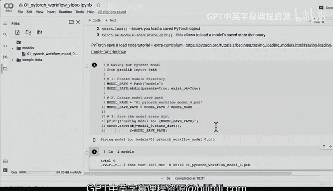

# Daniel Bourke《PyTorch 深度学习｜PyTorch 101 Crash Course For Beginners in 2025》中英字幕 - P55：055_03_019 保存PyTorch模型代码实现.zh_en - GPT中英字幕课程资源 - BV1kTSKB1E9m

Welcome back。 In the last video， we saw how to train our model and evaluated by not only looking at the loss metrics and the loss curves。

 but we also plotted our predictions。 and we compared them。 Hey。

 have we got at these random predictions。 Quite terrible。

 But then we trained a model using the power of back propagation and gradient descent。

 And now look at our predictions。 They're almost exactly where we want them to be。

 And so you might be thinking， well， we've trained this model and it took us a while to write all this code to get some good predictions。

 How might we run that model again。 So I've took a little break after the last video。

 but now I've come back and you might notice that my Google coab notebook has disconnected。

 So what does this mean if I was to run this。😊，Is it going to work。

' going to connect to a new Google co La instance， But will we have all of the code that we've run above。

You might have already experienced this if you took a break before and came back to the videos。

 So plot predictions is no longer defined。 And do you know what that means。

 That means that our model is also no longer defined。 So we would have lost our model。

 We would have lost all of that effort of training。 Now， luckily。

 we didn't train the model for too long。 So we can just go run time， run all。

 And it's going to rerun all of the previous cells and be quite quick。

Because we're working with a small data set and using a small model。

 But we've been through all of this code， or whatever have we got wrong here。Model 0 state diict。 Oh。

 that's all right。 This is good。 We're finding errors。 So if you want to as well。

 you can just go run after。 It's going to run all of the cells after。Beautiful。

 and we come back down。 There's our model training。

 We're getting very similar values to what we got before。 There's the loss curves。

 beautifulut still going。 Okay， now our predictions are back because we've rerun all the cells。

 and we've got our model here。 So what we might cover in this video is saving。😊，A model in Ptorrch。

 because if we're training a model。And you get to a certain point。

 especially when you have a larger model， you probably want to save it and then reuse it in this particular notebook itself。

 or you might want to save it somewhere and send it to your friend so that your friend can try it out。

 or you might want to use it in a week's time。 And if Google Coab is disconnected。

 you might want to be able to load it back in somehow。

 So now let's see how we can save our models in Pytorch。 So。😊，I'm going to write down here。

 there are three main methods。You should know about。For saving and loading models in pytorch。

 Because， of course， with saving comes loading。 So we're going to over the next two videos。

 discuss saving and loading。 So one is torch shot save。 And as you might guess。

 this allows you to save pytorch。😊，Object。In Pythons。Pickle format。

So you may or may not be aware of Python pickle。There we go。Python object serialization。 There we go。

 So we've got the pickle module implements a binary protocols or implements binary protocols for serializing and desializing a Python object。

 So serializing means I understand it as saving and decializing means that is loading。

 So this is what Pythtorch uses behind the scenes， which is from pure Python。

So if we go back here in Python's pickle format， number two is torch。load。

 which you might be able to guess what that does as well。

 allows you to load a saved Pythtorrch object。😊，And number three is also very important is taunch。nn。

module。 loadstatedt。 Now what does this allow you to do Well。

 this allows you to load a model's saved dictionary。Or save state dictionary。 Yeah。

 that's what we'll call it。 Sa state dictionary。 beautifuli。 And what's the model state dict。 Well。

 let's have a look。 Model 0 dot state dit。😊，The beauty of Pytorrch is that it stores a lot of your model's important parameters in just a simple python dictionary。

 Now， it might not be that simple because our model again， only has two parameters in the future。

 you may be working with models with millions of parameters。

 So looking directly at the state dick may not be as simple as what we've got here。

 but the principle is still the same。 It's still a dictionary that holds the state of your model。

 And so I've got these three methods。 I want to show you where from。

 because this is going to be your extra curriculum， save and load models。

Your extra curriculum for this video。If we go into here， this is a very， very。

 very important piece of pipetorrch documentation or maybe even a tutorial。

 So your extra curriculum for this video is to go through it。 Here we go。

 We've got torch save Torch load torch module state di。 that's where a load state di。

 That's where I've got the three things that we've just written down。😊。

And there's a fair few different pieces of information。 So what is a state dict。 So in Ptorrch。

 the learnable parameters I。e。 the weights and biases of a torch Nn module， which is our model。

 Remember， our model subclasss Nn module are contained in the models parameters access with model dot parameters a state dict is simply a python dictionary object that maps each layer to its parameter tensor。

 That's what we've seen。 And so then if we defined a model。

 we can initialize the model And if we wanted to print the state dict。

 we can use that the optimizer also has a state dickt。 So that's something to be aware of。

 you can go optimize a dot state dict。 And then you get an output here。

 And this is our saving and loading model for inference。 So inference again， is making a prediction。

 that's probably what we wanted to do in the future at some point。 For now。

 we've made predictions right within our notebook。 But if we wanted to use our model outside of our notebook。

 say in an application or in another notebook that's not this one。😊。

You'll want to know how to save and load it。 So the recommended way of saving and loading a Pyto model is by saving its state d。

Now， there is another method down here， which is saving and loading the entire model。

 So your extracurricular for this lesson。We're gonna go through the code to do this。

 But your extra curricula is to read all of the。Sections in here and then figure out what the pros and cons are of saving and loading the entire model versus saving and loading just the state date。

😊，So that's a challenge for you for this video。 I'm going to link this in here。

 And now let's write some code to save our model。So， pie torch。Save and load code。codeode。Tuttorial。

Plus， extra curriculum。So， if we go。Saving our pieytorch model。 So what might we want。

 What do you think the save parameter takes。If we have Torch do save。

 what do you think it takes inside it？Well， let's find out together。y， So let's import Part Lib。

 We're gonna to see why in a second。 this is Python's module for dealing with writing file parts。

 So if we wanted to save something to this is Google Coabs files section over here。

 But just remember if we do save this from within Google Coabab。

 the model will disappear if our Google Coabab notebook instance disconnects。

 So I'll show you how to download it from Google Coab if you want。😊，Google car La。Also has a way。

 save from Google Co Lab。Google Coabb 2 Google Drive to save it to your Google Drive if you wanted to。

 but I'll leave you to look at that on your own， if you like。

So we're first going to create a model directory。 So create models directory。

So this is going to help us create a folder over here called models。 And， of course。

 we could create this by hand by adding a new folder here somewhere。 But I like to do it with code。

 So model path。We're going to set this to PA， which is using the PA library here。

To create us a path called models simpleimple， we're just going to save all of our models to the models file。

And then we're going to create。Model path， we're going to make that directory Model path dot MkD for make directory。

 We're going to set parents to equals true。And we're also going to set exist O equals to true。

 That means if it already existed， it won't throw us an error。 It will try to create it。

 But if it already exists， it'll just recreate the parent's directory or it'll leave it there。

 It won't error out on us。We're also going to create a model save path。This way。

 we can give our model a name right now， it's just model 0。

We want to save it under some name to the Models directory， so let's create the model name。

Model name equals。O1， I'm going to call it01 for the section that way。

 if we have more models later on the course， we know which ones come from where。

You might create your own naming convention。Model workflow Pytorch workflow Model 0 do Ph and now this is another important point Pytorch objects usually have the extension dot ph for Pytorch or dot PT So if we go in here and if we look up dot PT Yeah a common convention is to save models using either a dot PT or dot ph file extension I'll let you choose which one you like I like dot ph So if we go down here dot ph they both result in the same thing。

 you just have to remember to make sure you write the right loading path and write saving path。

So now we're going to create our model save path， which is going to be our model path。

 And because we're using the pathlib， we can use this syntax that we've got here。Model path。

 slash model name。 And then if we just print out。Model save path， What does this look like？

There we go。 So it creates us a pos path using the pathlib library of models slash01 Pytorch workflow model 0 dot P T H。

 We haven't saved our model there yet。 It's just got the path that we want to save our model ready。

 So if we refresh this， We've got models over here。 Do we have anything in there。😊，No， we don't yet。

 So now is our step to save the model。 So3 is save the model state dic。

 Why are we saving the state dic， Because that's the recommended way of doing things If we come up here。

 saving and loading the model for inference， saveve and load the state dic， which is recommended。

 We could also save the entire model， but that's part of your extra curriculum to look into that。

So let's use some syntax。 It's quite like this。 Torch do save。 And then we pass it an object。

 and we pass it a path of where to save it。 We already have a path。 And good thing is。

 we already have a model。 So we just have to call this。 Let's try it out。😊，So let's go print F。

Saving model  to。And we'll put in the path here。Model save path。

I like to print out some things here and there that way we know what's going on。And oh。

 I don't need that capital A， do I。Geting a little bit trigger happy here with the typing。

 So torch dot save。 And we're going to pass in the object parameter here。 And if we looked up torch。

 save。We can go， what does this code take， So Torch save object F， What is F。A file like object。

 Okay， or a string or OS S path like object。 Beauti。 That's what we've got。

 a path like object containing a file name。 So let's jump back into here。

 The object is what It's our model 0 dot state di。 That's what we're saving。

 And then the file path is model， save path。😊，And you ready， let's run this and see what happens。

Beautiful saving model to models。 So that's our model path。 And there's our model there。

 So if we refresh this， what do we have over here。 Wonderful， we've saved our trained model。

 So that means we could potentially if we wanted to， you could download this file here。

 That's going download it from Google coab to your local machine。 That's one way to do it。

 But there's also a guide here to save from Google Collaboratory to Google Drive that way you could use it later on。

 So there's many different ways。 The beauty of Pitorrchches its flexibility。

 So now we've got a saved model。 But let's just check using our L S command。

 We're going check models。😊，Yeah， let's just check models。This is going to check here。

So this is list。Wonderful， there's our01 pitorrch workflow Model 0 dot P T H。 Now， of course。

 we've saved a model。😊，How about we try loading it back in and seeing how it works。

 So if you want a challenge。Read ahead in the documentation and try to use Torch。

 load to bring our model back in， see what happens。I'll see you in the next video。

