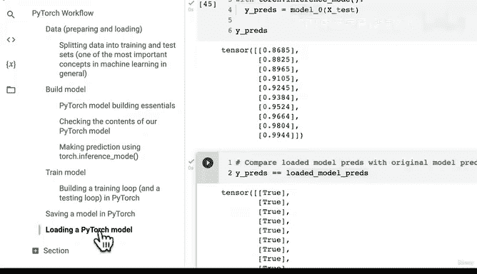

# Daniel Bourke《PyTorch 深度学习｜PyTorch 101 Crash Course For Beginners in 2025》中英字幕 - P56：056_03_020 加载PyTorch模型代码实现.zh_en - GPT中英字幕课程资源 - BV1kTSKB1E9m

Welcome back。 In the last video， we wrote some code here to save our Pytorch model。

 and I'm just gonna exit out of this couple of things that we don't need just to clear up the screen。

 and now we've got our dot ph file because remember dot P or dot PT as a common convention for saving a Pytorch model we've got it saved there。

 we didn't necessarily have to write all of this path style code but this is just handy for later on if we wanted to functionize this and create it in say a save dot pi file over here so that we could just call our save function and pass it in a file path where we wanted to save like a directory and a name and then it'll save it exactly how we want it for later on but。

😊，Now we've got a saved model I issued a challenge of trying to load that model in。

 so do we have Torch。t load in here？Did you try that out， We've got， oh。

 we've got a few options here， Wo， but we're using one of the first ones。 So let's go back up here。

 If we wanted to check the documentation for torch dot load。 We've got this option here， load。😊。

What happens？ Los and objects save with torch dot save from a file。

 Torch dot load uses Python's unpickling facilities。

 but treat storages which underlie tensors specially。 They are first decilized on the CPU。

 and then I move to the device， they were saved from wonderful。 So this is moved to the device。

 if later on when we're using a GP。 This is just something to keep in mind。

 We'll see that when we start to use a CPU and a GP。 But for now。

 let's practice using the torch dot load method and see how we can do it。 So we'll come back here。

 and we'll go loading a ptorrch model。 And since we。😊。

Just' going to start writing here since we saved our models state deck。

 So just the dictionary of parameters from a model， rather than。The entire model。

We'll create a new instance。Of our model class and load the state deck。Load the saved state dick。

 That's better， State dick。Into that。Now， this is just words on a page。 Let's see this in action。

 So to load in a state deck， which is what we saved， we didn't save the entire model itself。

 which is one option。 That's extra curriculum。But we saved just the model state di。

 So if we remind ourselves what model 0 dot state dick looks like， we saved just this。

 So to load this in， we have to。Instantiate a new class or a new instance of our linear regression model class。

So to load in a saved state dick。We have to instantiate。A new instance of our model class。

So let's call this loaded Model0。I like that that way we can differentiate because it's still going to be the same parameters as model 0。

 But this way， we know that。This instance is the loaded version。

 not just the version we've been training before。 So we'll create a new version of it here。

 linear regression model。This is just the code that we wrote above。😊。

Linear regression model and then we're going to load the saved state deck of Model0。And so。

 this will。Update the new instance with updated parameters。So let's just check before we load it。😊。

We haven't written any code to actually load anything。 What does loaded Model 0。

 What does the state deckck look like here。It won't have anything， it'll be initialized with what。Oh。

 loaded。 That's what I called it loaded。See how it's initialised with random parameters。

 So essentially， all we're doing when we load a state dictionary into our new instance of our model is that we're going。

 hey， take the saved state deck from this model and plug it into this。

 So let's see what happens when we do that。 So loaded model。😊，Z。

 remember how I said there's a method to also be aware of up here。

 which is torch Nn module dot load state dit。 And because our model is a what。

 it's a subclass of torch dot N n dot module。 So we can call load state di on our model directly or on our instance。

 So recall linear regression model is a subclass of N n dot module。 So let's call in。Load state di。

 And this is where we call the torch dot load method， and then we pass it the model save path。

 Is that what we called it because torch dot load， it takes in F。 So what's F a file like object。

Or a string or an OS S path like object。 So that's why we created this path like object up here。

 Model save path。 So all we're doing here， we're creating a new instance， linear regression model。

 which is a subclass of N N dot module。 And then on that instance。

 we're calling in load state dit of torch dot load model save path。

 Because what's saved at the model save path。 our previous model state died， which is here。

 So if we run this， let's see what happens。😊，All keys match successfully。 That is beautiful。

 And so see their values here。😊，Loaded state deck of Model 0。

 Well let's check the loaded version of that。We now have wonderful。

 We have the exact same values as above， but there's a little way that we can test this。😊。

So how about we go。Make some predictions。 So make some predictions。

Just to make sure with our loaded model。So let's put it in a vowel mode。

Because when you make predictions， you want it in evaluation mode。

 so it goes a little bit faster and we want to also use inference mode。

 so with Torch dot inference mode for making predictions。We want to write this loaded model pres。

 We're going to make some predictions on the test data as well。 So loaded model 0。

 we're going to forward pass on the X test data。 And then we can have a look at the loaded。

Model pres。Wonderful， and then to see if the two models are the same， we can compare。😊。

Loaded model pres with original model pres。 So why pres。These should be equivalent， equals equals。

 loaded model pres。Do we have the same thing， false， false， false， what's going on here？Why breads。

How much different are they。Oh， where has that happened？Have we made some model pres with this yet？

So how about we。Make some model pres。 This is a troubleshooting on the fly team。

 So let's go Model 0 do aval。And then with torch dot inference mode。

 this is how we can check to see that our two models are actually equivalent。 Y pres equals。

 I have a feeling why pres actually save somewhere else equals model 0。

 And then we pass it the X test data。And then we might move this above here。

And then have a look at what Y Ps equals。Do we get the same output？Yes， we should。 wonderful。 Okay。

 beautiful。 So now we've covered saving and loading models or specifically saving the models state deck。

 So we saved it here with this code。 and then we loaded it back in with load state deck plus torch load。

 And then we checked to see by testing equivalentvalence of the predictions of each of our models。

 So the original one that we trained here Model 0 and the loaded version of it here。😊。

So that's saving and loading a model in Ptorrch。 There are a few more things that we could cover。

 but I'm going to leave that for extracur。 We've covered the two main things， or three main things，1。

2，3。 If you'd like to read more， I'd highly encourage you to go through and read this tutorial here。

 But with that being said， we've covered a fair bit of ground over the last few videos。

 How about we do a few videos where we put everything together。 just to reiterate what we've done。

 I think that'll be good practice。 I'll see in the next video。😊。

