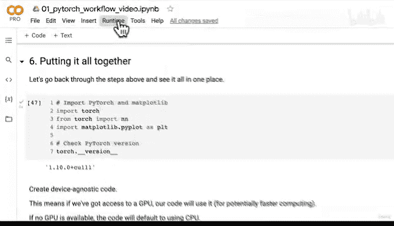
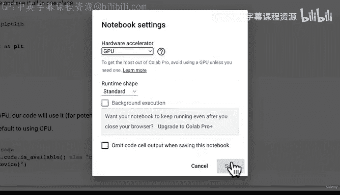
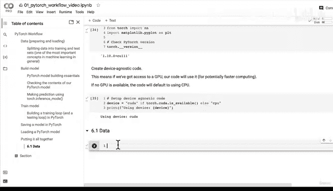

# Daniel Bourke《PyTorch 深度学习｜PyTorch 101 Crash Course For Beginners in 2025》中英字幕 - P57：057_03_021 配置设备无关代码实践环境.zh_en - GPT中英字幕课程资源 - BV1kTSKB1E9m

Welcome back。 Over the past few videos， we've covered a whole bunch of ground in a pytorch workflow。

 starting with data， then building a model。 Well， we split the data， then we built a model。

 We looked at the model building essentials。 We checked the contents of our model。

 We made some predictions with a very poor model because it's based off random numbers。😊。

We spent a whole bunch of time figuring out how we could train a model。

 We figured out what the loss function is。 We saw an optimizer。 We wrote a training and test loop。

We then learned how to save and load a model intorrch。

 So now I'd like to spend the next few videos putting all this together。

 We're not going to spend as much time on each step。

 but we're just going to have some practice together so that we can reiterate all the things that we've done。

😊，So putting it all together。Let's go back through。The steps above。And see it all。In one place。

Wonderful。So we're going to start off with 6。1。And we'll go have a look at our workflow。 So 6。

1 is data。But we're going to do one step before that。 And I'm just going to get rid of this。

 So we have a bit more space。So we've got our data ready。

 We've turned it into tensors way back at the start。 Then we built a model。

 and then we picked a loss function and an optimizer。 We built a training loop。 We trained our model。

 We made some predictions。 We saw that they were better。 We evaluated our model。

 We didn't use torch metrics， but we got visual。 We saw our red dots starting to line up with the green dots。

 We haven't really improve through experimentation。 we did a little bit of it， though。

 As in we saw that if we trained our model for more epochs。 We got better results。

 So you could argue that we have done a little bit of this， but there are other ways to experiment。

 We're going to cover those throughout the course。 and then we saw how to save and reload a trained model。

 So we've been through this entire workflow， which is quite exciting， actually。

 So now let's go back through it， but we're going to do it a bit quicker than what we've done before。

 because I believe you've got the skills to do so now。 So let's start by importing pi torch。😊。

So you could start the code from here if you wanted to and mapplot Lib and actually， if you want。

 you can pause this video and try to recode all of the steps that we've done by putting some headers here like data and then build a model and then train a model。

 save and load a model， whatever and try to code it out yourself。😊，If not。

Feel free to follow along with me and we'll do it together。 So import torch。From torch， import oh。

 would help if I could spell torch import N N because we've seen that we use N N quite a bit。

 And we're going to also import Matpllib because we like to make some plots because we like to get visual。

Visualize， visualize， visualize as PLT。 And we're going to check our Py version。That way， we know。

 if you're on an older version， some of the code might not work here。

 but if you're on a newer version， it should work。 if it doesn't， let me know。There we go，1。10。

 I'm using 1。10 for this。 By the time you watch this video， there may be a later version out。

And we're also gonna， let's create some device， agnostic code。 So create device agnostic code。

 because I think we're up to this step now。😊，This means。If we've got access to a GPU。

Our code will use it。For potentially。Faster。Computing。If no GPU is available。

The code will default to using CPU。 We don't necessarily need to use a GP for our particular problem that we're working on right now。

 because it's a small model， and it's a small data set。

 but it's good practice to write device agnostic code。

 So that means our code will use a GP if it's available or a CPU by default。

 If a GP is not available。 So set up device agnostic code。

We're going to be using a similar setup up to this throughout the entire course from now on。

 So that's why we're bringing it back。 Kuda is available。

 So remember Kuda is Nvidia's programming framework for their GPs， else use CPU。

 and we're going to print。What device are we using。Deevvice。So what we might do is if we ran this。

 it should be just a CPU for now。Right， yours might be different to this if you've enabled a GPU。

 but let's change this over to use Coa。 And we can do that if you're using Google Coabab。

 and can change the runtime type by selecting GPU here。

And then I'm going to save this。 But what's going to happen is it's going to restart the runtime。

 So we're going to lose all of the code that we've written above。

How can we get it all back？ Well， we can go。Run all。So this is going run all the cells above here。

 They should all work， and it should be quite quick because our model and data aren't too big。

 And if it all worked， we should have Couda as our device that we can use here。 Wonderful。

 So the beauty of Google Coab is that they've given us access to on NviR GPU。 So thank you。

 Google Coab。😊，Just once again， I'm paying for the paid version of Google Coab。 You don't have to。

 The free version should give you access to a GPU， albeit it。

 it might not be as a later version as GPU as the pro versions give access to。

But this will be more than enough for what we're about to recreate。

 So I feel like that's enough for this video。 We've got some device agnostic code ready to go。

 And for the next few videos， we're going to be rebuilding this except using device agnostic code。

 So give it a shot yourself。 There's nothing in here that we haven't covered before。

 So I'll see you in the next video。 Let's create some data。😊。

