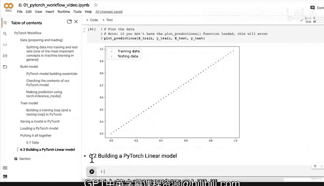

# Daniel Bourke《PyTorch 深度学习｜PyTorch 101 Crash Course For Beginners in 2025》中英字幕 - P58：058_03_022 全流程整合（第一部分）：数据准备.zh_en - GPT中英字幕课程资源 - BV1kTSKB1E9m

Welcome back。 In the last video， we set up some device agnostic code。

 and we got ready to start putting everything we've learned together。

 So now let's continue with that。 We're going to recreate some data。

 Now we could just copy this code， but we're going to write it out together so we can have some practice creating a dummy data set。

😊，And we want to get to about this stage in this video。

 so we want to have some data that we can plot so that we can build a model to once again。

 learn on the blue dots to predict the green dots。So it'll come down here data。

 I'm going to get out of this as well so that we have a bit more room let's now。C。3。

Data using the linear。Regression formula。Of y equals white。Times， features plus bias。

 And you may have heard this as y equals。M， X plus C or M X plus B or something like that。

 Or you can substitute these for different names。 Iages。 When I learned this in high school。

 it was y equals M X plus C。 Yours might be slightly different。 Yeah， B X plus A。

 That's what they use here。 whole bunch of different ways to name things。

 but they're all describing the same thing。 So let's see this in code rather than formulaic examples。

 So we're going create our weight， which is 0。7 and a bias， which is 0。3。

 These are the values we previously used for a challenge you could change these to 0。1 maybe and 0。2。

 These could be whatever values you'd like to set them as。😊，So weight and bias。

 the principle is going to be the same thing。We're going to try and build a model to estimate these values。

So we're going to start at zero and we're going to end at one。

So we can just create a straight line and we're going to fill in those between0 and one with a step of 0。

02。And now we'll create the X and Y features， X and Y， which is features and labels， actually。

So x is our features and Y are our labels x equals torch dot a range and x is a capital y is Z。

 because typically x is a feature matrix， even though ours is just a vector now。

 we're going to unsqueeze this so we don't run into dimensionality issues later on。

You can check this for yourself without unsqueeed errors will pop up。

And y equals weight times x plus bias。 you see how we're going a little bit faster now。

This is sort of the pace that we're going to start going for things that we've already covered。

 If we haven't covered something， will'll slow down。 But if we have covered something。

 I'm going step it through。 We're going to start speeding things up a little。

So if we get some values here， wonderful， we've got some x values。

 and they correlate to some y values， we're going to try and use the training values of x to predict the training values of y and subsequently for the test values。

 Oh， and speaking of training and test values， how about we split the data。So let's split the data。

Split data。 So we'll create the train split equals nt 0。8。 We're going to use 80%， which is where 0。

8 comes from for the length of x。 So we use 80% of our samples for the training。

 which is a typical training and test split。8020。 Thereabouts。 You could use like 70，30。

 You could use 9010。 It all depends on how much data you have。

There's a lot of things in machine learning that are quite flexible。Train split。

 we're going to index on our data here so that we can create our splits。

Google Co Laab auto corrected my code in a。Nonhel way just then。And we're gonna do。

The opposite split for the。Testing data。 Now， let's have a look at the lengths of these。

 If my calculations are correct， we should have about 40 training samples。And10。Testing samples。

And again， this may change in the future when you work with larger data sets。

 you might have 100000 training samples and 20000 testing samples。

 The ratio will often be quite similar。And then let's plot what's going on here， so plot the data。

And note。If you don't have。The plot predictions。Function loaded。This will error。

So we can just run plot predictions here if we wanted to， and we'll pass it in X train， Y train。

X test， Y test。And this should come up with al。Plot， wonderful。

 So we've just recreated the data that we've been previously using。

 we've got blue dots to predict green dots。 But if this function errors out because you've started the notebook。

😊，From here。Right from this cell， and you've gone down from there。 Just remember。

 you'll just have to go up here and copy this function。

We don't have to do it because we've run all the cells， but if you haven't run that cell previously。

 you could put it here and then run it， run it， and we'll get the same outcome here。 Woful。

 So what's next。 Well， if we go back to our workflow。 we've just created some data。

 And have we turned it into tenses yet。😊，I think it's just still， oh yeah， it is。

 It's tenses because we use pie torch to create it。But。Now we're up to building or picking a model。

 So we've built a model previously。 We did that back in build model。

 So you could refer to that code and try to build a model to fit the data that's going on here。

 So that's your challenge for the next video。 So building a high torch linear model。

 And why do we call it linear， Because linear refers to a straight line。 What's non linear。

 non straight。 So。I'll see you in the next video。Give it a shot before we get there。

 but we're going to build a high torch linear model。

