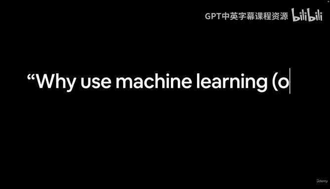
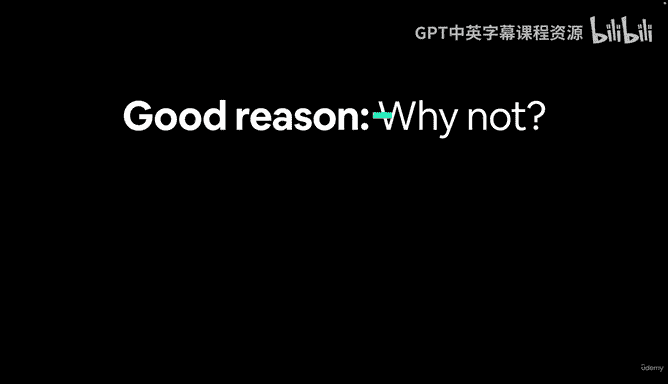
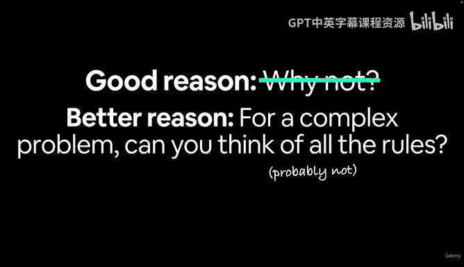
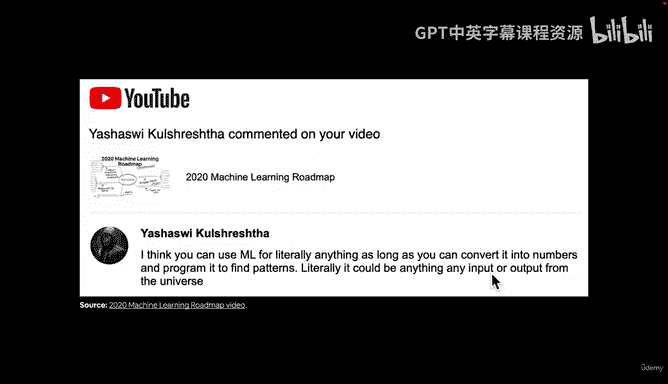
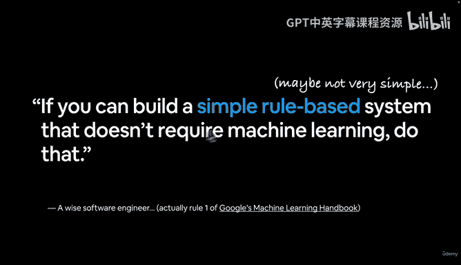
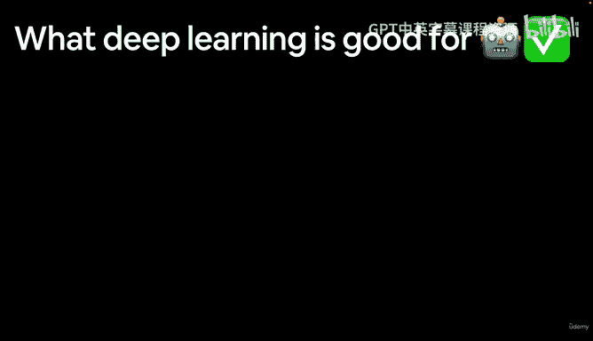

# Daniel Bourke《PyTorch 深度学习｜PyTorch 101 Crash Course For Beginners in 2025》中英字幕 - P5：005_02_001 为何使用机器学习或深度学习.zh_en - GPT中英字幕课程资源 - BV1kTSKB1E9m

Welcome back。 So in the last video， we covered briefly the difference between traditional programming and machine learning。

 And again， I don't want to spend too much time on definitions。 I'd rather you see this in practice。

 And I left you with the question。 why would you want to use machine learning or deep learning。 Well。

 let's think of a good reason。 Why not？ I mean， if we had to write all those handwritten rules to reproduce Alicelysis and grandmother's roast chicken dish all the time。

 That would be quite cumbersome， right。😊。

Well， let's draw a line on that。 Why not？ What's a better reason， kind of what we just said， right。

 for a complex problem， Can you think of all the rules。 So let's imagine。

We're trying to build a self-ding car。 Now， if you've learned to drive。

 you've probably done so in maybe 20 hours，100 hours。

 but now I'll give you a task of writing down every single rule about driving。

 How do you back out of your driveway， How do you turn left and go down the street。

 How do you park a reverse park， How do you stop at an intersection。

 How do you know how fast to go somewhere， So we just listed half a dozen rules。

 But you could probably go a fair few more you might get into the thousands。

 And so for a complex problem such as driving， can you think of all the rules。 Well， probably not。

 So that's where machine learning and deep learning come into help。

 And so this is a beautiful comment， I like to share with you on one of my YouTube videos。😊。

Is my 2020 machine learning roadmap。 And this is from Yahuwi。

 I'm probably going mispronounce this if I even try to。 but Yahuwi says， I think you can use Ml。

 So Ml is machine learning， I'm going to use that a lot throughout the course， by the way。

 M is machine learning。 just so you know for literally anything as long as you can convert it into numbers that's what we said before。

 machine learning is turning something into computer readable numbers and then programming it to find patterns except with the machine learning algorithm。

 typically we write the algorithm and it finds the patterns， not us。

 And so literally it could be anything。 any input or output from the universe That's pretty darn cool about machine learning right but should you always use it just because it could be used for anything。

 Well， I'd like to also introduce you to Google's number one rule of machine learning。😊。

Now， if you can build a simple rule based system such as the step of five rules that we had to map the ingredients to our Sicilian grandmother's roast chicken dish。

 if you can write just five steps to do that， that's going to work every time well you should probably do that so if you can build a simple rule based system。

 that doesn't require machine learning， do that。And of course， maybe it's not so very simple。

 but maybe you can just write some rules to solve the problem that you're working on。

Now this is from a wise software engineer， which is I kind of hinted at it before。

 Rule one of Google's machine learning handbook。 Now I'm going to highly recommend you read through that。

 but we're not going to go through that in this video。 So check that out。 You can Google that。

 Otherwise the links will be where you get links。😊，So just keep that in mind。

 although machine learning is very powerful and very fun and very excited。

 It doesn't mean that you should always use it。 And I know this is quite the thing to be saying at the start of a deep learning and machine learning course。

 But I just want you to keep in mind。 Simple real based systems are still good。

 Machine learning isn't a solve all for everything。😊。

Now let's have a look at what deep learning is good for。

 but I'm going to leave you on a cliff homework because we're going to check this out in the next video。

😊。

Sason。