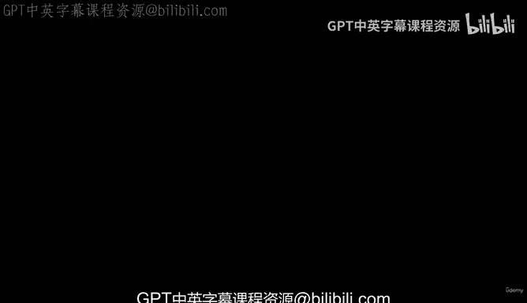
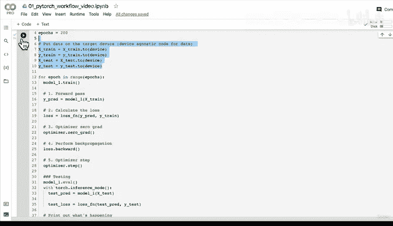

# Daniel Bourke《PyTorch 深度学习｜PyTorch 101 Crash Course For Beginners in 2025》中英字幕 - P60：060_03_024 全流程整合（第三部分）：模型训练.zh_en - GPT中英字幕课程资源 - BV1kTSKB1E9m

Welcome back。 So in the last video， we built a pitorrch linear model。

 nice and simple using a single Nn dot linear layer with one in feature， one out feature。

 and we overri the forwardd method of Nn dot module using the linear layer that we created up here。

 So what's going to happen is when we do the forwardd parcel on our model。

 we're going to put some data in and it's going to go through this linear layer。

 which behind the scenes as we saw with torch Nn linear。😊。

Behind the scenes， it's going to perform the linear regression。Formula here。

 So y equals X A T plus B。 But now case we've got weight and bias。So let's go back。

 It's now time to write some training code。 but before we do。Let's set the model。

To use the target device。 And so in our cases， we've got a device of。Couda。

 but because we've written device agnostic cone， if we didn't have access to a couder device， a GPU。

 our default device would be a CPU。 So let's check the model device。 We can do that first up here。

Check the model。Current device， because we're going to use the GPU here。

 or we're going to write device agnostic code。That's better to say， device， agnostic code。

 that's the proper terminology。Device， what device are we currently using。This is the CPU right。

 so by default， the model will end up on the CPU。 But if we set it to Model 1 call dot 2 device。

 what do you think it's going to do now， if our current target device is coa。

 we've seen what2 does in the fundamental section，2 is going to send the model to the GPU memory。

 So now let's check where the parameters of our model live dot device。

If we send them to the device previously， it was the CPU。

 it's gonna to take a little bit longer while the GP gets fired up and goes， Pytorch goes， hey。

 I'm about to send you this model。 You're ready for it。 boom， there we go。 wonderful。

 So now our model is on the device or the target device， which is Kuda。 And if kuda wasn't available。

 the target device would be CPU。 So this would just come out just exactly how we've got it here。

 But with that being said， Now， let's get on some training code。 And this is a fun part。

 What do we have to do。😊，We've already seen this for training。

 we're just going to clear up our workspace a little bit here。For training we need。

 this is part of the Pyto workflow。 We need a loss function。 What does a loss function do。

Measures how wrong our model is。 We need an optimizer。We need a training loop and a testing loop。

And the optimizer， what does that do， Well， it optimizes the parameters of our model。 So in our case。

 Model1 dot state di， What do we have。So we have some parameters here within the linear layer。

 We have a weight， and we have a bias。 The optimizer is going to optimize these random parameters。

So that they hopefully reduce the loss function， which remember。

 the loss function measures how wrong our model is。 So in our case。

 because we're working with a regression problem， let's set up the loss function。And by the way。

 all of these steps are part of the workflow。 We've got data ready。 We've built or picked a model。

 We're using a linear model。 Now we're up to here 2。1 pick a loss function and an optimizer。

 We're going to do build a training loop in the same session because you know what we're getting pretty darn good at this Los function equals what Well we're going to use L1 loss。

 So let's set that up and then dot L1 loss， which is the same as NAe。😊。

And if we wanted to set up our Opr， what optimizer could we use， Well。

 Pytorrch offers a lot of optimizers in torch。opimm Sgd。It's stochastic gradient descent。

 becauseuse remember， gradient descent is the algorithm that optimizes our model parameters。

Adom is another popular option for now we're going to stick with SGD Lr which stands for learning rate。

 in other words， how big of a step will our optimizer change our parameters with every iteration。

 a smaller learning rate so such as 0001 will be a small step and then a larger learning rate such as 0。

1 will be a larger step。😊，Too big of a step。 Our model learns too much。

 and it explodes too small of a step。 Our model never learns anything。 But， oh。

 we actually have to pass parameterss first。 I forgot about that。

 I got ahead of myself with a learning rate。 Paras is the parameters we'd like our optimizer to optimize。

 So in our case， it's model 1 dot parameters because model 1 is our current target model。😊，Beautiful。

 so we've got a loss function and an optimizer now。😊，Let's write a training loop。

So I'm going to set torch manual see so we can try and get as reproducible as results as possible。

 Remember， if you get different numbers to what I'm getting。

 don't worry too much if they're not exactly the same， the direction is more important。

 So that means if my loss function is getting smaller， yours should be getting smaller to。

 don't worry too much if your fourth decimal place isn't the same as what my values are。

 So we have a training loop。Ready to be written here。 Epos。 How many should we do， Well。

 we did 200 last time。 that worked pretty well。 So let's do 200 again。

 Did you go through the extra curriculum yet， Did you watch the video for the unofficial pie torch。

Optimisation loop song， you had。This one here， listen to the unofficial pie torch optimization loop song。

 If not， it's okay。 Let's sing it together。 So for an epoch。😊，In range， epochs。

We're going to go through the song in a second。 We're going to set the model to train。 In our case。

 it's model 1。Model to train Now step number one is what do the forward pass This is where we calculate the predictions so we calculate the predictions by passing the training data through our model and in our case。

 because the forwardd method in Model1 implements the linear layer。

 this data is going to go through the linear layer。

 which is torch do nn do linear and go through the linear regression formula and then we calculate the loss which is how wrong our model' predictions are So the loss value equals loss fn and here where we're going to pass in ypred and y train。

Then what do we do， We zero the optimizer。Optimer 0 grad， which because by default。

 the optimize is going to accumulate gradients behind the scenes。

 So every epoch we want to reduce those back to 0。 so it starts from fresh。

We're going to perform back propagation here。Back propagation by calling loss stop backwards。

 If the forward pass goes forward through the network。

 the back pass goes backwards through the network， calculating the gradients for the loss function with respect to each parameter in the model。

So optimize a step， this next part is going to look at those gradients and go， you know what。

 which way should I optimize the parameters？So because the optr is optimizing the model parameters。

 it's going to look at the loss and go， you know what， I'm going to adjust the weight to be。

Increased， and I'm going to lower the bias and see if that reduces the loss。

 And then we can do testing。We can do both of these in the same hit。

 Now we are moving quite fast through this because we spent a whole bunch of time discussing what's going on here。

So for testing， what do we do， we set the model into evaluation mode that's going to turn off things like dropout and batch normalization layers。

 We don't have any of that in our model for now， but just it's good practice to always call a vow whenever you're doing testing and same with inference mode we don't need to track gradients and a whole bunch of other things Pytorch does behind the scenes when we're testing or making predictions So we use the inference mode context manager。

This is where we're going to create test pre， which is going to be our test predictions。

 because here we're going to pass the test data features。Forward pass through our model。

 and then we can calculate the test loss， which is our loss function。

 And we're going to compare the test pre to why test。Wonderful。

 and then we can print out what's happening。So what should we print out？How about。If apoch。

Divided by 10 equals 0。 So every 10 epochs， let's print something out， print。

We'll do an F string here， epoch。Is epoch。And then we'll go loss， which is the training loss。

 can just be equal to the loss。 And then we'll go test loss is equal to。Test loss。

 So do you think this will work？It's okay if you're not sure。八。Let's find out together。 Hey， oh。

 we've got a。We need a bracket there。Oh my goodness。 What's going on。

Runtime error expected all tensors to be on the same device。 of course。

Do you know what's happening here？But we found at least two devices， Couda and CPU。 Yes， of course。

 that's what's happened。 So what have we done up here， we put our model on the GPU。

 But what's going on here， our data， as our data on the GPU。😊，No， it's not by default。

 It's on the CPU。 So we haven't written device agnostic code for our data。 So let's write it here。

 put data on the target device。Devicice， agnostic code for data， so。Remember。

 one of the biggest issues with Pytorch sideron shape errors is that you should have your data or all of the things that you're computing with on the same device。

 So that's why if we set up device agnostic code for our model。 we have to do the same for our data。

 So now let's put X train to device， Ytrain equals Y train to device。

 this is going to create device agnostic code， In our case it's going to use couda because we have access to a couda device。

 But if we don't， this code will still work， it will still default to CPU。So this is good。

 I like that。 We got that error because that's some of the things you're going to come across in practice。

 right， So now let's run this。 What's happening here。 He， look at that wonderful。

 So our loss starts up here， nice and high。 And then it starts to go right down here for the training data。

 And then the same for the testing data， beautiful。 right up here。 And then all the way down。 Okay。

 so this looks pretty good on the test data set。 So how can we check this。

 How can we evaluate our model。😊，Well， one way is to check its state di so。State died。

 What are we got here， What are our weight and bias， Oh my gosh， so close。

 So we just set weight and bias before to be 0。7 and 0。3。

 So this is what our model has estimated our parameters to be based on the training data。0。6968。

 That's pretty close to 0。7 nily perfect。 And the same thing with the bias，0。

3025 versus the perfect value is 0。03。 But remember， in practice。

 you won't necessarily know what the ideal parameters are。

 This is just to exemplify what our model is doing behind the scenes。

 It's moving towards some ideal representative parameters of whatever data we're working with。😊。

So in the next video， I'd like you to give it a go of or before we get to the next video。

 make some predictions with our model and plot them on the original data。

 How close to the green dots。 match up with the red dots。

 And you can use this plot predictions formula or function that we've been using in the past。

 So give that a go And I'll see you in the next video。 But congratulations。

 Look how quickly we just trained a model。 using the steps that we've covered in a bunch of video so far and device agnostic code。

 so good。 I'll see you soon。😊。

